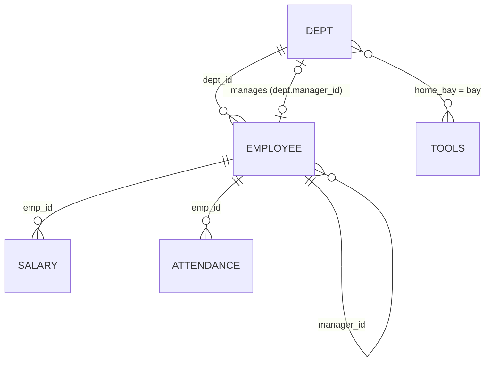

# Assessment: Joins

**Time:** 60 minutes. **Marks:** 100 (10 questions). **Before this:** Lab 5 and the [Joins](../topics/06-joins.md) topic.

This is a test, not a lab. Nothing new is taught after the refresher. Each question has one hint; using it costs nothing, but try without it first.

## The scenario

Until now the fab data has been about things: products, lots, wafers, tools. This assessment adds the people who run the place. HR has handed Maya four tables: departments, employees, pay records and last week's attendance. Maya wants answers, and every one of them needs at least two tables.

## Scripts

| File | What it does |
| --- | --- |
| [`assess_joins_data.sql`](scripts/assess_joins_data.sql) | Creates and fills `DEPT`, `EMPLOYEE`, `SALARY` and `ATTENDANCE`. Run it once, as `FAB_LAB`, with **Execute Script (Alt+X)**. It does not touch the five original tables, and it is safe to run again: it drops its own four tables first. The last query should show 7, 19, 22 and 86. |
| [`assess_joins.sql`](scripts/assess_joins.sql) | Your answer sheet. Write each query under its question. |

## The new tables



| Table | One row is | Columns worth knowing |
| --- | --- | --- |
| `DEPT` | a department | `dept_id`, `dept_name`, `home_bay` (matches `TOOLS.BAY`, or NULL), `manager_id` (an `EMPLOYEE.EMP_ID`, or NULL) |
| `EMPLOYEE` | a person | `emp_id`, `first_name`, `last_name`, `job_title`, `dept_id` (can be NULL), `manager_id` (another `emp_id`, NULL for the top) |
| `SALARY` | one pay period for one person | `emp_id`, `effective_from`, `effective_to` (NULL means "current"), `base_pay`, `allowance` (can be NULL) |
| `ATTENDANCE` | one person on one day | `emp_id`, `work_date`, `status` (`PRESENT`, `ABSENT`, `LEAVE`), `hours_worked` (NULL unless present) |

Things in the data that are there on purpose: two people with no department, one department with no people, one department with no manager, one new starter with no pay record and no attendance, four people with two pay records, and one more technician with no attendance rows at all.

## Refresher: how a join really works

### Pairs, then a filter

Forget the syntax for a moment. When you write `FROM a JOIN b ON <condition>`, think of it in two steps:

1. Oracle pairs **every** row of `a` with **every** row of `b`.
2. It keeps only the pairs where the condition is true.

Take two employees and two departments:

```text
EMPLOYEE              DEPT
first_name  dept_id   dept_id  dept_name
Nurul       60        60       Quality
Li Na       (null)    70       Facilities
```

Step 1 gives four pairs:

```text
FIRST_NAME  E_DEPT  D_DEPT  DEPT_NAME
Li Na               60      Quality
Li Na               70      Facilities
Nurul       60      60      Quality
Nurul       60      70      Facilities
```

Step 2, with `ON d.dept_id = e.dept_id`, keeps only the `Nurul / Quality` pair. Li Na is compared with 60 and with 70, and both answers are *unknown* because her `dept_id` is NULL. Unknown is not true, so her pairs go.

Oracle does not actually build the full grid; the optimizer is smarter than that. But the result is always the same as if it had, so this is the right way to *predict* what you will get.

Two consequences fall straight out of this picture:

- **A row with several matches appears several times.** Four people have two `SALARY` rows, so joining `EMPLOYEE` to `SALARY` gives them two lines each. If you wanted one line per person, the join condition (or a filter) has to pick one pay row.
- **A row with no match disappears.** That is what an inner join means. If you need it back, you need an outer join.

### The outer joins

An outer join runs the same two steps, then adds one more: any row from the protected side that ended up with **no** pair is put back, with NULL in every column of the other table.

| You write | Rows put back if they found no pair | From the example above |
| --- | --- | --- |
| `a JOIN b` | none | Nurul / Quality |
| `a LEFT JOIN b` | rows of `a` (the table written first) | + Li Na / (null) |
| `a RIGHT JOIN b` | rows of `b` | + (null) / Facilities |
| `a FULL JOIN b` | rows of both | + both of the above |

`RIGHT JOIN` is never needed: swap the table order and use `LEFT JOIN`. Most teams write only `JOIN` and `LEFT JOIN`, and so should you.

### ON or WHERE? The question that decides outer joins

With an inner join, a filter gives the same answer in `ON` or in `WHERE`. With an outer join it does not, because the steps happen in this order:

1. pair and filter with `ON`,
2. put back the unmatched rows of the protected side,
3. **then** apply `WHERE`.

So:

- A condition on the *optional* table that belongs in `ON` says "only these rows count as a match". Unmatched rows still come back.
- The same condition in `WHERE` runs after the put-back. The put-back rows have NULL in those columns, the condition is unknown for them, and they vanish. Your `LEFT JOIN` has quietly become an inner join.

Rule of thumb: **conditions on the optional table go in `ON`. Conditions on the protected table go in `WHERE`.**

### Finding what is missing

To find rows of `a` with no partner in `b` (an *anti-join*), outer join and then keep only the put-back rows:

```sql
FROM a LEFT JOIN b ON b.key = a.key
WHERE b.key IS NULL
```

Test a column of `b` that can never be NULL in a real match: its primary key is the safe choice. `NOT EXISTS` gives the same answer and many people find it easier to read.

### Joining a table to itself

`EMPLOYEE.MANAGER_ID` holds another `EMP_ID`. To see an employee's manager, use `EMPLOYEE` twice with two aliases, as if they were two tables: `employee e` for the person and `employee m` for the manager, joined by `m.emp_id = e.manager_id`. The aliases are what make it work; without them Oracle cannot tell which copy a column belongs to.

The same idea applies to any table you need in two roles: `SALARY` as "pay then" and "pay now", or `EMPLOYEE` as "staff" and "department manager".

### Counting after a join

Joins multiply rows, so count carefully:

- `COUNT(*)` counts result rows, including the put-back rows of an outer join. A department with no staff still has one row, so `COUNT(*)` says 1.
- `COUNT(e.emp_id)` skips NULLs, so the empty department correctly shows 0.
- After joining to a table with many rows per person, `COUNT(e.emp_id)` counts one per *pair*. Use `COUNT(DISTINCT e.emp_id)` for people.

### Non-equal conditions

The `ON` condition can be any test, not just `=`. "Which pay record was in force on 1 March?" is a range test:

```sql
ON  s.emp_id = e.emp_id
AND DATE '2026-03-01' BETWEEN s.effective_from AND NVL(s.effective_to, DATE '9999-12-31')
```

The `NVL` turns "no end date" into "far in the future" so the current row still matches.

### Five checks before you run

1. What is **one row** of the answer? (one person, one department, one tool, one tool-and-person pair)
2. Which table must keep **every** row, even without a match? That table goes first and the others are `LEFT JOIN`ed.
3. Does any join bring **several matches** per row? If yes, pick one in `ON`, or count with `DISTINCT`.
4. Is every condition on an optional table in **`ON`**?
5. Does the row count match what you expected? Every question below tells you how many rows to expect.

## The questions

Write each answer in `assess_joins.sql`. "Full name" means first name, a space, last name.

### Q1. Who works where (5 marks)

**Maya:** "List every employee with their department name. Order by department name, then last name."

**Expect:** 17 rows.

<details>
<summary>Hint</summary>

A plain `JOIN` on `dept_id`. Count the employees: there are 19. Which two are missing, and why?

</details>

### Q2. Nobody left behind (5 marks)

**Maya:** "Same list, but I want all 19 people. Anyone without a department shows `(no department)`. Order by employee id."

**Expect:** 19 rows.

<details>
<summary>Hint</summary>

Which table must keep every row? Put it first and use `LEFT JOIN`. `NVL` fills the gap.

</details>

### Q3. Who runs each department (10 marks)

**Maya:** "Show every department and the full name of its manager. If a department has no manager, show `Vacant`."

**Expect:** 7 rows.

<details>
<summary>Hint</summary>

Join on `DEPT.MANAGER_ID`, not on `DEPT_ID`. Be careful with `NVL(first || ' ' || last, 'Vacant')`: in Oracle, `'x' || NULL` is `'x'`, not NULL, so `NULL || ' ' || NULL` is a single space. Test the manager's key instead.

</details>

### Q4. Reporting line (10 marks)

**Maya:** "For every employee, show their full name, job title and the full name of the person they report to. The person at the top shows `(top of the tree)`."

**Expect:** 19 rows.

<details>
<summary>Hint</summary>

`EMPLOYEE` twice: `e` for the person, `m` for the manager. One of the 19 has no manager, so the join to `m` must not lose him.

</details>

### Q5. Managed from another department (10 marks)

**Maya:** "Who reports to a manager in a different department? Treat 'no department' as a department of its own, so someone with no department is always different from someone who has one. Show both people and both department ids."

**Expect:** 7 rows. If you get 1 row, read the hint.

<details>
<summary>Hint</summary>

`e.dept_id <> m.dept_id` is unknown whenever either side is NULL, and unknown rows are dropped. Replace NULL with a value no real department uses before you compare.

</details>

### Q6. Current monthly pay (10 marks)

**Maya:** "For everyone, show current base pay, allowance (0 if none) and the monthly total. People with no pay record still appear. Highest total first, no-pay people last."

**Expect:** 19 rows. If you get 23, some people appear twice.

<details>
<summary>Hint</summary>

The current pay row is the one with `effective_to IS NULL`. Put that test where it limits the match without throwing away the person. `ORDER BY ... DESC NULLS LAST` sorts the empty totals to the bottom.

</details>

### Q7. Then and now (10 marks)

**Maya:** "For everyone who was being paid on 1 March 2026, show their base pay on that day, their base pay now, and the difference. Biggest rise first."

**Expect:** 17 rows, four of them with a rise above 0.

<details>
<summary>Hint</summary>

`SALARY` twice, with two aliases: one joined with a date-range condition, one with `effective_to IS NULL`. Inner joins are right here: someone not paid on 1 March is not in the question.

</details>

### Q8. Headcount and hours by department (10 marks)

**Maya:** "For each department, how many people it has and how many hours they worked in total during the week of 14 September. Departments with nobody show 0 and 0."

**Expect:** 7 rows. Process Engineering has 5 people.

<details>
<summary>Hint</summary>

`DEPT`, then `LEFT JOIN` employees, then `LEFT JOIN` attendance. Each person now appears once per attendance day: how do you count people, not rows? `SUM` of nothing is NULL, not 0.

</details>

### Q9. Not seen all week (10 marks)

**Maya:** "Who was not PRESENT on a single day this week? That includes people with no attendance rows at all. Show id, name and department (`(no department)` if none)."

**Expect:** 3 rows. If you get 0 rows, read the hint.

<details>
<summary>Hint</summary>

Anti-join: `LEFT JOIN attendance`, keep the rows with no match. "Present" is a condition on the optional table. Which clause does it belong in?

</details>

### Q10. Capstone: tools with nobody on the floor (20 marks)

**Maya:** "Each department with a `HOME_BAY` looks after the tools in that bay. For Wednesday 16 September, list every one of those tools with each Technician from the owning department who was PRESENT that day. A tool with no such technician must still appear, once, showing `-- nobody --`. Order by tool id."

**Expect:** 11 rows, 5 of them `-- nobody --`.

<details>
<summary>Hint</summary>

`TOOLS` to `DEPT` is a join on `t.bay = d.home_bay`: no foreign key, just matching values. The optional part is "a technician who was present on that day", which needs two tables: `EMPLOYEE` and `ATTENDANCE`. If you write `... LEFT JOIN employee ... JOIN attendance ...`, the final inner join removes the tools you just saved (you will see 6 rows). Make the optional part a single unit first, either as an inline view `(SELECT ... FROM employee JOIN attendance ...)` or with brackets around `employee e JOIN attendance a ON ...`, and then `LEFT JOIN` that unit.

</details>

### Bonus (not marked)

**Maya:** "For each department, and one `(no department)` line, how many people, how many of them have a current pay record, and the total current monthly pay (base plus allowance)."

## Marking guide

| Marks | What earns them |
| --- | --- |
| Full | Correct rows, columns and order. Any correct method counts (`NOT EXISTS` instead of an anti-join, an inline view instead of brackets). |
| Half | Right join shape but one slip: wrong row count from a misplaced filter, `COUNT(*)` instead of a distinct count, missing `NVL` label, wrong order. |
| Zero | Wrong tables or wrong join columns, or the query does not run. |

Solutions are in [`assess_joins_solutions.sql`](solutions/assess_joins_solutions.sql) and are released after the assessment. Each answer has a comment explaining the trap it was built to catch.
