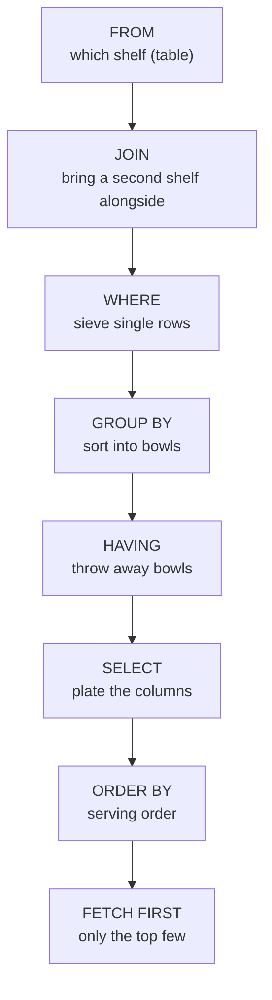

# Query cheat sheet

## The kitchen order

You write a query starting with `SELECT`. The database works it out starting with `FROM`.



## Four questions to ask about any request

| # | Ask | Example: "Which lots are on hold, and why?" |
| --- | --- | --- |
| 1 | What am I looking for? | lots |
| 2 | Which table holds it? | `LOTS` |
| 3 | Which rows do I want? | status is `HOLD` |
| 4 | Which columns, in what order? | `lot_id`, `hold_reason` |

## The skeleton

```sql
SELECT   columns or expressions        -- what to show
FROM     table                         -- which shelf
JOIN     other_table ON a.key = b.key  -- second shelf, matched on a shared key
WHERE    row conditions                -- sieve rows
GROUP BY columns                       -- bowls
HAVING   group conditions              -- throw away bowls
ORDER BY columns                       -- serving order
FETCH FIRST n ROWS ONLY;               -- top n
```

## Quick reminders

| Need | Write |
| --- | --- |
| Text | single quotes, case sensitive: `'HOLD'` |
| Alias with a space | double quotes: `AS "Target (nm)"` |
| A date | `DATE '2026-09-01'` |
| Missing value test | `IS NULL`, never `= NULL` |
| Several values | `IN (1, 4)` |
| Range, ends included | `BETWEEN 11.5 AND 12.5` |
| Pattern | `LIKE 'L26-003%'` |
| Join two tables | `JOIN ... ON a.col = b.col` |
| Keep unmatched left rows | `LEFT JOIN` |
| Count rows or values | `COUNT(*)` counts rows, `COUNT(col)` skips NULLs |
| Join text | `a \|\| ' ' \|\| b` |
| Save or undo changes | `COMMIT`, `ROLLBACK` |

## DBeaver keys

| Do this | Press |
| --- | --- |
| New SQL editor | `Ctrl + ]` |
| Run the statement at the cursor | `Ctrl + Enter` |
| Run the whole script | `Alt + X` |
| Choose the active connection | `Ctrl + 9` |
| Format the SQL | `Ctrl + Shift + F` |
| Edit the connection | `F4` |
