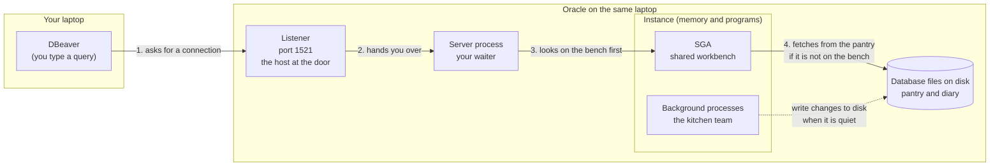
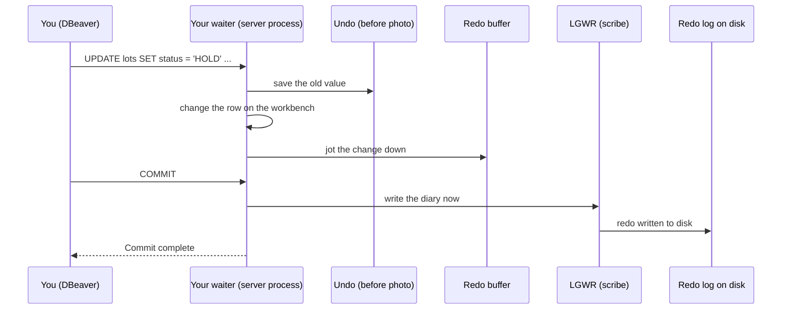
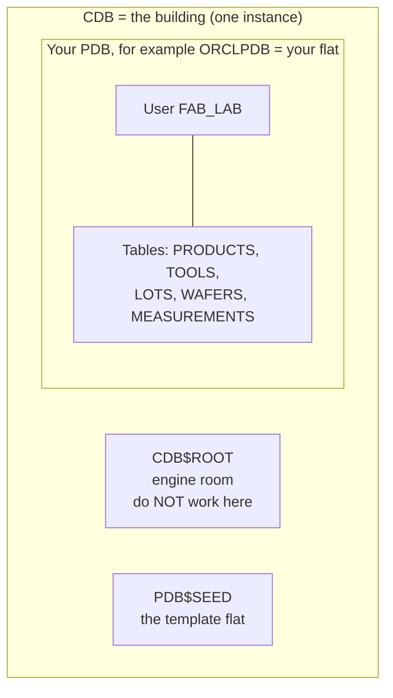

# How Oracle works, in plain words

Before you write a single query, it helps to know where your query goes and who answers it. You do not need to be a DBA to follow this page. You only need a picture in your head that you can come back to when something confuses you later in the week.

**By the end of this page you can:**

- say what the listener, the instance and the database each do
- explain what a container database (CDB) and a pluggable database (PDB) are
- say why `COMMIT` is fast and why `ROLLBACK` works
- name the one place you will work all week: the PDB

## The restaurant picture

Think of Oracle as a busy restaurant.

| In the restaurant | In Oracle | What it really is |
| --- | --- | --- |
| The pantry, the recipe books and the order diary | The **database** | Files on the disk. They stay when the power goes off. |
| The kitchen team on shift, and the workbench they share | The **instance** | Memory plus background programs. It exists only while Oracle is running. |
| The host at the front door | The **listener** | A small program that waits on port 1521 and says "you want the kitchen? Follow me." |
| Your personal waiter | A **server process** | One process per connected user. It takes your request, fetches the answer and brings it back. |
| The shared workbench | The **SGA** | Shared memory. Everybody's waiter uses the same bench. |
| Your waiter's own notepad | The **PGA** | Private memory for one session. Nobody else can see it. |

Two words that people mix up all the time: the **database** is the files on disk, and the **instance** is the memory and the programs working on those files. You can have the files without an instance (Oracle switched off). You cannot query anything until the instance is started and has opened the files.



Read the diagram from left to right. Everything you do in DBeaver follows this path. When a connection fails, the error tells you which step broke. A connection error mentioning the *listener* or *service* means step 1 or 2. An error mentioning *login* or *password* means you reached Oracle and it did not like your credentials.

## What is on the disk: the database

Three kinds of file matter for now.

- **Data files** hold your tables and rows. This is the pantry.
- **Redo log files** are the order diary. Every change is written here first.
- **Control files** are the small index that says where everything else is. Oracle reads them at startup.

You will not touch these files in this course. It is enough to know that the data you load tonight is stored in a data file, and that the diary of what you did is in the redo logs.

## What is in memory: the instance

The **SGA** (System Global Area) is the shared workbench. Its three busiest parts:

- the **buffer cache**, the bench where recently used rows are kept so Oracle does not walk to the pantry every time
- the **shared pool**, where recipes Oracle has already worked out (your SQL statements) are remembered so the next person who asks the same thing gets a faster answer
- the **redo log buffer**, the notepad where each change is jotted down before it goes into the diary

The **PGA** (Program Global Area) is private to each session. It holds your sorting and your variables. Think of the waiter's own notepad.

The **background processes** are the kitchen team. Two of them are worth a name:

- **DBWR** (database writer) is the runner who carries changed rows from the bench back to the pantry. He does this when it is quiet, not after every order.
- **LGWR** (log writer) is the scribe who writes the diary. She writes it when you commit.

## Why COMMIT is fast, and why ROLLBACK works

When you change a row, the pantry is *not* updated straight away. Three things happen:

1. Oracle copies the **old** version of the row into an area called **undo**. This is the "before" photo.
2. It changes the row on the workbench and jots the change in the redo buffer.
3. Nothing else happens until you decide.

If you type `ROLLBACK`, Oracle puts the before photo back. If you type `COMMIT`, the scribe writes the diary line to disk, and only then does Oracle tell you "Commit complete". The runner may carry the changed row to the pantry minutes later. The diary is enough to rebuild it if the power fails first.



This is also the reason other people do not see your change until you commit. They are served the before photo from undo. You will see this with your own eyes in the lab on changing data.

## One building, many flats: CDB and PDB

Oracle 19c installs as a **multitenant** database. Picture an apartment building.

- The **building** is the container database, the **CDB**. It has one set of plumbing and wiring, which is the instance.
- Each **flat** is a pluggable database, a **PDB**. Each flat has its own tenants (users) and its own furniture (tables).
- The engine room of the building is called **CDB$ROOT**. Administrators work there. You do not.



**The rule for this course: everything you create lives in your PDB.** When you connect, you will give a *service name* that points to the PDB, not to the root. If you ever get "ORA-65096: invalid common user or role name", you are knocking on the engine room door. Reconnect to the PDB.

Your install may have named the PDB `ORCLPDB`, `orclpdb` or something else. You will read the real name from the listener in Lab 1.

## Check it yourself

Once you are connected (Lab 1 does this with you), these three queries confirm where you are:

```sql
SELECT banner FROM v$version;
SELECT sys_context('USERENV', 'CON_NAME') AS container FROM dual;
SELECT sys_context('USERENV', 'SESSION_USER') AS me FROM dual;
```

The first shows the Oracle version. The second must show your PDB name, not `CDB$ROOT`. The third shows who you are logged in as. (`dual` is a built-in one-row table that exists so you can run a `SELECT` that needs no real table. You will meet it again with functions.)

## Common mistakes

- **Treating the instance and the database as the same thing.** Remember: files versus memory and programs.
- **Working in CDB$ROOT.** Check `CON_NAME` when in doubt.
- **Assuming COMMIT writes your row to the data file.** It writes the diary line. The data file catches up later.

## Check your understanding

1. A colleague says "the database is down but the files are fine." Which half is down, the instance or the database files?
2. Which program answers when you connect on port 1521?
3. Why can another user not see your uncommitted change?

<details>
<summary>Answers</summary>

1. The instance. The files are on disk and untouched.
2. The listener. It hands you to a server process.
3. Oracle shows them the old version from undo until you commit.

</details>

## Further reading

- [Oracle Database 19c Concepts: Introduction to Oracle Database](https://docs.oracle.com/en/database/oracle/oracle-database/19/cncpt/introduction-to-oracle-database.html)
- [Oracle Database 19c Concepts: Memory architecture](https://docs.oracle.com/en/database/oracle/oracle-database/19/cncpt/memory-architecture.html)
