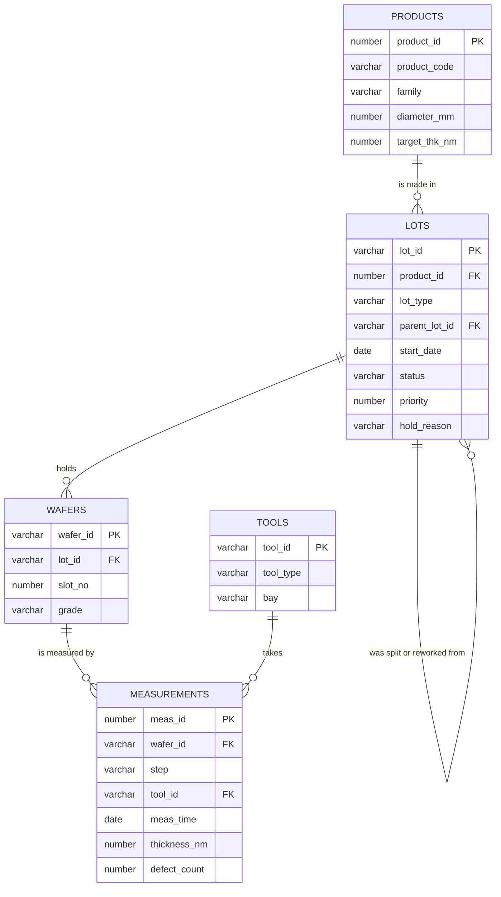

# Meet the fab: the data you will question all week

Every query in this course runs against one small database called FAB_LAB. It describes an invented factory, a **wafer fab**, where thin discs of silicon are made. The names and numbers are made up for the course. Nothing here describes a real company.

You do not need to know anything about chips. All you need is the picture on this page, and the picture is a bakery.

**By the end of this page you can:**

- name the five tables and say what one row in each means
- say which column links each pair of tables
- read the map before writing a join

## The bakery picture

Imagine a bakery that sells several kinds of biscuit.

| In the bakery | In the fab | Table |
| --- | --- | --- |
| The **recipes** (ginger snap, shortbread...) | The **products** the fab makes | `PRODUCTS` |
| The **ovens and machines** | The **tools** that process or measure wafers | `TOOLS` |
| A **tray** of biscuits baked together | A **lot**: a group of wafers that travels through the fab together | `LOTS` |
| One **biscuit** on a tray | One **wafer** | `WAFERS` |
| A **taste test** on one biscuit, done in one oven | A **measurement** of one wafer at one step, on one tool | `MEASUREMENTS` |

So the story of one biscuit is: it follows a recipe, it sits on a tray, it goes through ovens, and people check it after each step. The fab is the same, with thickness in nanometres instead of crunchiness.

## The map

Keep this map open all week. Every join you write follows one of the lines.



How to read it: the line between `PRODUCTS` and `LOTS` with a "crow's foot" on the `LOTS` end means **one product has many lots**. The column that links them appears in both tables: `product_id`. A column that appears as the *key* of one table (`PK`, primary key) and as a pointer in another (`FK`, foreign key) is a join column.

| To connect | Use this join condition |
| --- | --- |
| lots and their product | `lots.product_id = products.product_id` |
| wafers and their lot | `wafers.lot_id = lots.lot_id` |
| measurements and their wafer | `measurements.wafer_id = wafers.wafer_id` |
| measurements and the tool used | `measurements.tool_id = tools.tool_id` |
| a lot and its parent lot | `lots.parent_lot_id = lots.lot_id` (later in the week) |

> **A primary key is like a ticket number.** No two rows share one, and you can use it to find exactly one row. A foreign key is like writing that ticket number on another form: "see ticket L26-003".

## What is in each table

Here are the real rows, so you know what you are working with.

```sql
SELECT * FROM products;
```

<!--gen-->
```text
PRODUCT_ID PRODUCT_CODE FAMILY         DIAMETER_MM TARGET_THK_NM
---------- ------------ -------------- ----------- -------------
         1 FD-300       FD-SOI                 300            12
         2 RF-300       RF-SOI                 300            75
         3 PWR-200      Power-SOI              200          1500
         4 PHO-300      Photonics-SOI          300           220
         5 SIC-150      SiC                    150           500
```

`target_thk_nm` is the thickness, in nanometres, each product should have at its last step. The unit is in the column name on purpose. Always put the unit in a column name.

```sql
SELECT * FROM tools;
```

<!--gen-->
```text
TOOL_ID TOOL_TYPE    BAY
------- ------------ ----
SPL01   SPLIT        B1
SPL02   SPLIT        B1
ANL01   ANNEAL       B2
ANL02   ANNEAL       B2
MET01   METROLOGY    B3
MET02   METROLOGY    B3
MET03   METROLOGY    B4
CMP01   POLISH       B4
IMP01   IMPLANT      B1
```

```sql
SELECT lot_id, product_id, lot_type, parent_lot_id, start_date, status, priority, hold_reason
FROM   lots;
```

<!--gen-->
```text
LOT_ID     PRODUCT_ID LOT_TYPE PARENT_LOT_ID START_DATE       STATUS     PRIORITY HOLD_REASON
---------- ---------- -------- ------------- ---------------- -------- ---------- --------------------------------
L26-001             1 PROD                   2026-08-03 07:30 SHIPPED           3
L26-002             2 PROD                   2026-08-05 09:00 SHIPPED           2
L26-003             1 PROD                   2026-08-10 06:45 ACTIVE            1
L26-003A            1 SPLIT    L26-003       2026-08-14 10:00 SHIPPED           1
L26-003B            1 SPLIT    L26-003       2026-08-14 10:05 HOLD              1 Thickness out of spec at FINAL
L26-003B1           1 REWORK   L26-003B      2026-08-20 13:00 ACTIVE            1
L26-004             3 PROD                   2026-08-18 08:15 SHIPPED           3
L26-005             4 PROD                   2026-08-24 11:00 HOLD              2
L26-006             2 PROD                   2026-08-28 07:00 SHIPPED           3
L26-007             1 PROD                   2026-09-02 08:00 ACTIVE            2
L26-007A            1 SPLIT    L26-007       2026-09-06 09:30 ACTIVE            2
L26-008             3 PROD                   2026-09-08 06:30 SCRAPPED          3
L26-009             4 PROD                   2026-09-12 10:00 ACTIVE            2
L26-010             2 PROD                   2026-09-17 08:45 ACTIVE            1
L26-011             1 PROD                   2026-09-22 07:15 ACTIVE            3
L26-012             4 PROD                   2026-09-29 09:00 ACTIVE            2
```

A lot is usually a `PROD` lot. If part of a lot needs different treatment it is **split**, and if a lot fails a check it can be **reworked**. A child lot remembers its parent in `parent_lot_id`, exactly like a family tree. Look at `L26-003`: it has two children, `L26-003A` and `L26-003B`, and `L26-003B` has its own child `L26-003B1`.

`priority` 1 is the most urgent. `status` is one of `ACTIVE`, `HOLD`, `SHIPPED` or `SCRAPPED`.

```sql
SELECT * FROM wafers FETCH FIRST 6 ROWS ONLY;
```

<!--gen-->
```text
WAFER_ID     LOT_ID        SLOT_NO GRADE
------------ ---------- ---------- ------
L26-001-01   L26-001             1 PRIME
L26-001-02   L26-001             2 PRIME
L26-001-03   L26-001             3 PRIME
L26-001-04   L26-001             4 PRIME
L26-001-05   L26-001             5 TEST
L26-002-01   L26-002             1 PRIME
```

A wafer ID is the lot ID plus the slot number. `grade` is `PRIME`, `TEST` or `SCRAP`.

```sql
SELECT * FROM measurements WHERE wafer_id = 'L26-001-01' ORDER BY meas_time;
```

<!--gen-->
```text
   MEAS_ID WAFER_ID     STEP     TOOL_ID MEAS_TIME        THICKNESS_NM DEFECT_COUNT
---------- ------------ -------- ------- ---------------- ------------ ------------
         1 L26-001-01   SPLIT    SPL02   2026-08-04 08:00        15.81           42
         2 L26-001-01   ANNEAL   ANL02   2026-08-05 08:15        13.53           23
         3 L26-001-01   FINAL    MET01   2026-08-06 08:54        11.89            4
```

This is one wafer's whole story. It was measured after three steps, always `SPLIT`, then `ANNEAL`, then `FINAL`. The layer gets thinner and the defects fall. At the `FINAL` step the thickness of 11.89 nm is close to the target of 12 nm for this wafer's product.

## Some things are missing on purpose

Real data has gaps. This data set has a few, and the labs will walk you into them so you learn to spot them:

- one product has no lots yet
- two tools have never taken a measurement
- one lot has wafers but no measurements yet
- one lot on `HOLD` has no hold reason written down
- two wafers have no grade yet

Do not fix these. They are the reason some of your answers will surprise you, and the surprise is the lesson.

## Maya's questions

Throughout the week, Maya the shift manager asks plain-English questions, like:

- "Which lots are on hold, and why?"
- "How many wafers are in each lot?"
- "Which tool took the most measurements?"
- "Which wafers came out too thick?"

Your job is to turn each question into a query. The next page shows you how.

## Check your understanding

1. Which column links `LOTS` to `PRODUCTS`?
2. A tray holds many biscuits. Which table has the "many" side, `LOTS` or `WAFERS`?
3. Why does `LOTS` point at itself?

<details>
<summary>Answers</summary>

1. `product_id`.
2. `WAFERS`. One lot holds many wafers.
3. A split or reworked lot remembers the lot it came from in `parent_lot_id`, so the table links to itself like a family tree.

</details>
