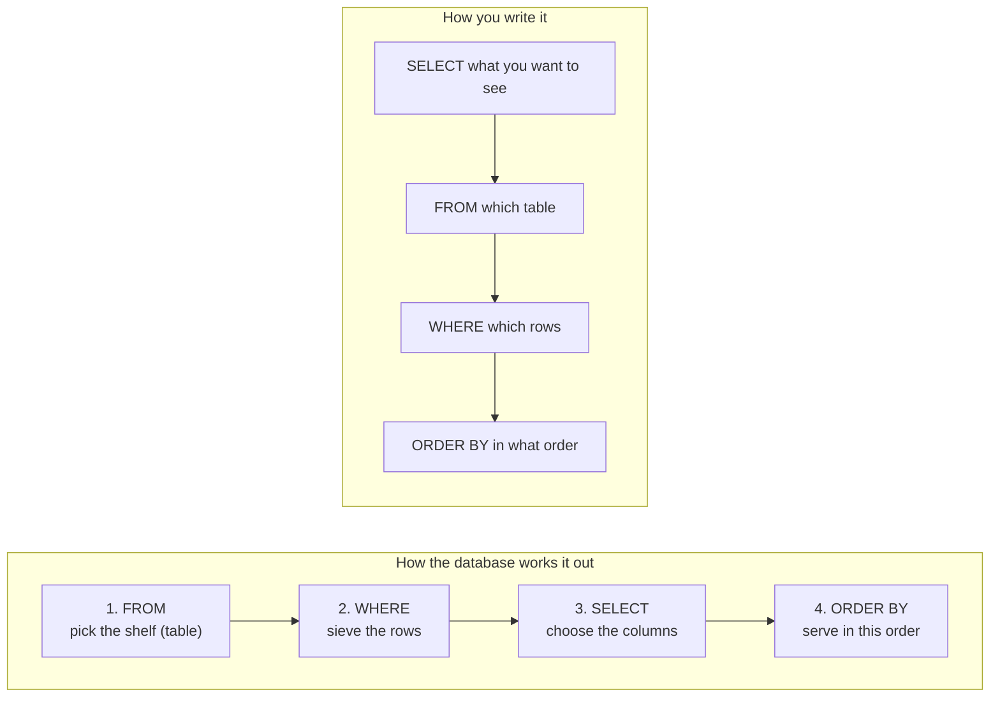

# Your first queries: from Maya's question to SQL

A query is just a question written in a form the database understands. This page gives you a method for turning a plain-English question into SQL, and then teaches the four clauses you need for most everyday questions: `SELECT`, `FROM`, `WHERE` and `ORDER BY`.

**By the end of this page you can:**

- break any question into the same four parts
- write `SELECT ... FROM ... WHERE ... ORDER BY`
- filter with `=`, `AND`, `OR`, `IN`, `BETWEEN` and `LIKE`
- sort, remove duplicates and limit the rows you get back

## The mental map: a kitchen order

Imagine you walk into a kitchen and ask for lunch. The cook does not start by plating. They go in this order:

1. **Which shelf?** Walk to the shelf with the right ingredients. That is `FROM`.
2. **Which ones?** Sieve out what you do not want. That is `WHERE`.
3. **What goes on the plate?** Choose what to show. That is `SELECT`.
4. **In what order do you serve it?** That is `ORDER BY`.

You *write* a query in a different order from the one the cook *works* in. Writing starts with `SELECT`. Thinking starts with `FROM`. This catches almost everybody once, so here is both side by side.



Over the next days we add three more stations to the kitchen: `JOIN` (bring a second shelf alongside), `GROUP BY` (sort into bowls) and `HAVING` (throw away bowls). You will see the same map again, a little bigger each time.

## A method for any question

Take this question from Maya:

> "Which lots are on hold, and why?"

Ask yourself four questions, in this order:

| Step | Ask yourself | For Maya's question |
| --- | --- | --- |
| 1 | **What am I looking for?** Underline the thing being counted or listed. | "lots" |
| 2 | **Which table holds it?** Look at the map. | `LOTS` |
| 3 | **Which rows do I want?** What is the condition? | status is HOLD |
| 4 | **Which columns, in what order?** | the lot and the reason |

Now fill in the sentence:

```sql
SELECT lot_id, status, hold_reason      -- 4. what to show
FROM   lots                              -- 2. which shelf
WHERE  status = 'HOLD';                  -- 3. which rows
```

<!--gen-->
```text
LOT_ID     STATUS   HOLD_REASON
---------- -------- --------------------------------
L26-003B   HOLD     Thickness out of spec at FINAL
L26-005    HOLD
```

Two lots are on hold. One has a reason and one has a blank. Hold on to that blank. A blank here is not an empty piece of text, it is something called `NULL`, and the next page explains it. For now, note that Maya's question has an answer, and you wrote it by following four steps.

> **Habit worth building:** write the plain-English question as a comment above the query. When a query goes wrong, you can compare what you asked with what you wrote.

## SELECT and FROM: choose the shelf and the plate

`SELECT *` means "show me every column". It is fine for exploring a table.

```sql
SELECT * FROM tools;
```

<!--gen-->
```text
TOOL_ID TOOL_TYPE    BAY
------- ------------ ----
SPL01   SPLIT        B1
SPL02   SPLIT        B1
ANL01   ANNEAL       B2
ANL02   ANNEAL       B2
MET01   METROLOGY    B3
MET02   METROLOGY    B3
MET03   METROLOGY    B4
CMP01   POLISH       B4
IMP01   IMPLANT      B1
```

For real questions, name the columns. You get only what you need, in the order you list them.

```sql
SELECT tool_id, bay FROM tools;
```

<!--gen-->
```text
TOOL_ID BAY
------- ----
SPL01   B1
SPL02   B1
ANL01   B2
ANL02   B2
MET01   B3
MET02   B3
MET03   B4
CMP01   B4
IMP01   B1
```

### Aliases: give a column a friendlier name

A column heading does not have to be the raw column name. `AS` gives it a new label for this query only. Use double quotes if the label has a space.

```sql
SELECT product_code AS "Product", target_thk_nm AS "Target (nm)"
FROM   products;
```

<!--gen-->
```text
Product      Target (nm)
------------ -----------
FD-300                12
RF-300                75
PWR-200             1500
PHO-300              220
SIC-150              500
```

### DISTINCT: show each value once

Maya asks: "What different statuses do our lots have?" The `status` column repeats, so ask for each value once.

```sql
SELECT DISTINCT status FROM lots;
```

<!--gen-->
```text
STATUS
--------
SHIPPED
ACTIVE
HOLD
SCRAPPED
```

## WHERE: the sieve

`WHERE` keeps the rows that pass the test and drops the rest. Text goes in **single quotes** and is **case sensitive**: `'HOLD'` is not `'hold'`.

| To test | Write | Example |
| --- | --- | --- |
| equal | `=` | `status = 'HOLD'` |
| not equal | `<>` | `status <> 'SHIPPED'` |
| bigger, smaller | `>` `<` `>=` `<=` | `priority <= 2` |
| one of a list | `IN (...)` | `product_id IN (1, 4)` |
| inside a range, ends included | `BETWEEN a AND b` | `thickness_nm BETWEEN 11.5 AND 12.5` |
| matches a pattern | `LIKE` | `lot_id LIKE 'L26-003%'` |

### Combine tests with AND, OR and NOT

`AND` means both must be true. `OR` means at least one. When you mix them, use brackets, the way you would in arithmetic.

Maya: "Show me the urgent lots that are not finished yet." Urgent means priority 1 or 2. Finished means `SHIPPED`.

```sql
SELECT lot_id, status, priority
FROM   lots
WHERE  priority <= 2
AND    status <> 'SHIPPED';
```

<!--gen-->
```text
LOT_ID     STATUS     PRIORITY
---------- -------- ----------
L26-003    ACTIVE            1
L26-003B   HOLD              1
L26-003B1  ACTIVE            1
L26-005    HOLD              2
L26-007    ACTIVE            2
L26-007A   ACTIVE            2
L26-009    ACTIVE            2
L26-010    ACTIVE            1
L26-012    ACTIVE            2
```

Now the mistake that costs everyone an afternoon: mixing `AND` and `OR` without brackets. `AND` is worked out first, so this does **not** mean "either ACTIVE or HOLD, and priority 1".

```sql
-- Not what you probably meant:
SELECT lot_id, status, priority
FROM   lots
WHERE  status = 'ACTIVE' OR status = 'HOLD' AND priority = 1;
```

<!--gen-->
```text
LOT_ID     STATUS     PRIORITY
---------- -------- ----------
L26-003    ACTIVE            1
L26-003B   HOLD              1
L26-003B1  ACTIVE            1
L26-007    ACTIVE            2
L26-007A   ACTIVE            2
L26-009    ACTIVE            2
L26-010    ACTIVE            1
L26-011    ACTIVE            3
L26-012    ACTIVE            2
```

Add brackets to say what you mean:

```sql
SELECT lot_id, status, priority
FROM   lots
WHERE  (status = 'ACTIVE' OR status = 'HOLD')
AND    priority = 1;
```

<!--gen-->
```text
LOT_ID     STATUS     PRIORITY
---------- -------- ----------
L26-003    ACTIVE            1
L26-003B   HOLD              1
L26-003B1  ACTIVE            1
L26-010    ACTIVE            1
```

### IN, BETWEEN and LIKE

`IN` is a tidy way to write several `OR`s on one column. Maya: "Lots of the FD-300 and PHO-300 products", which are product 1 and 4.

```sql
SELECT lot_id, product_id
FROM   lots
WHERE  product_id IN (1, 4);
```

<!--gen-->
```text
LOT_ID     PRODUCT_ID
---------- ----------
L26-001             1
L26-003             1
L26-003A            1
L26-003B            1
L26-003B1           1
L26-007             1
L26-007A            1
L26-011             1
L26-005             4
L26-009             4
L26-012             4
```

`BETWEEN` includes both ends. Maya: "Which FINAL readings are close to 12 nm, say 11.5 to 12.5?"

```sql
SELECT wafer_id, step, thickness_nm
FROM   measurements
WHERE  step = 'FINAL'
AND    thickness_nm BETWEEN 11.5 AND 12.5;
```

<!--gen-->
```text
WAFER_ID     STEP     THICKNESS_NM
------------ -------- ------------
L26-001-01   FINAL           11.89
L26-001-02   FINAL           11.99
L26-001-03   FINAL           12.06
L26-001-04   FINAL           12.03
L26-001-05   FINAL           11.86
L26-003-01   FINAL           12.07
L26-003-02   FINAL           12.07
L26-003-03   FINAL           11.88
L26-003-04   FINAL           11.95
L26-003-05   FINAL           11.95
L26-003A-01  FINAL            12.1
L26-003A-02  FINAL           11.81
L26-003A-03  FINAL           11.98
L26-003B-01  FINAL            12.5
L26-003B1-01 FINAL            12.1
L26-003B1-02 FINAL           12.02
L26-007-01   FINAL           12.05
L26-007-02   FINAL           12.08
L26-007-03   FINAL           11.87
L26-007-04   FINAL           11.98
L26-007-05   FINAL           11.93
L26-007A-01  FINAL           12.02
L26-007A-02  FINAL           11.99
L26-011-01   FINAL           12.03
L26-011-02   FINAL           11.97
L26-011-03   FINAL           12.01
L26-011-04   FINAL           12.02
L26-011-05   FINAL           12.09
```

Look at the row `L26-003B-01`. Its reading is exactly 12.5, the top of the range, and it is included because `BETWEEN` keeps both ends. It is also the wafer from the lot that went on hold for being too thick, which is a first hint that the data has stories in it.

`LIKE` matches a pattern. `%` stands for any number of characters, `_` for exactly one. Maya: "Everything that came from lot L26-003."

```sql
SELECT lot_id, lot_type, parent_lot_id
FROM   lots
WHERE  lot_id LIKE 'L26-003%';
```

<!--gen-->
```text
LOT_ID     LOT_TYPE PARENT_LOT_ID
---------- -------- -------------
L26-003    PROD
L26-003A   SPLIT    L26-003
L26-003B   SPLIT    L26-003
L26-003B1  REWORK   L26-003B
```

Notice that `LIKE 'L26-003%'` also caught the children `L26-003A`, `L26-003B` and `L26-003B1`. The pattern matches *anything that starts with* those characters. That happens to be useful here, and it is a good example of why you read the result and not only the query.

### Dates

A date literal is written `DATE 'YYYY-MM-DD'`. Maya: "Lots started in September 2026."

```sql
SELECT lot_id, start_date
FROM   lots
WHERE  start_date >= DATE '2026-09-01'
AND    start_date <  DATE '2026-10-01';
```

<!--gen-->
```text
LOT_ID     START_DATE
---------- ----------------
L26-007    2026-09-02 08:00
L26-007A   2026-09-06 09:30
L26-008    2026-09-08 06:30
L26-009    2026-09-12 10:00
L26-010    2026-09-17 08:45
L26-011    2026-09-22 07:15
L26-012    2026-09-29 09:00
```

Why not `BETWEEN '2026-09-01' AND '2026-09-30'`? Because a lot that started at 09:00 on 30 September is *after* midnight on the 30th and would be missed. Using "on or after the 1st, before the 1st of next month" never loses a row. (Oracle dates carry a time of day, even when it is not shown.)

## ORDER BY: serving order

Without `ORDER BY`, the database may return rows in any order. If order matters, ask for it. `DESC` reverses it. You can sort by several columns, and the second breaks ties in the first.

Maya: "Most urgent first. If two lots are equally urgent, the oldest first."

```sql
SELECT lot_id, priority, start_date
FROM   lots
ORDER  BY priority, start_date;
```

<!--gen-->
```text
LOT_ID       PRIORITY START_DATE
---------- ---------- ----------------
L26-003             1 2026-08-10 06:45
L26-003A            1 2026-08-14 10:00
L26-003B            1 2026-08-14 10:05
L26-003B1           1 2026-08-20 13:00
L26-010             1 2026-09-17 08:45
L26-002             2 2026-08-05 09:00
L26-005             2 2026-08-24 11:00
L26-007             2 2026-09-02 08:00
L26-007A            2 2026-09-06 09:30
L26-009             2 2026-09-12 10:00
L26-012             2 2026-09-29 09:00
L26-001             3 2026-08-03 07:30
L26-004             3 2026-08-18 08:15
L26-006             3 2026-08-28 07:00
L26-008             3 2026-09-08 06:30
L26-011             3 2026-09-22 07:15
```

## FETCH FIRST: only the top few

Maya: "Just the three most recently started lots."

```sql
SELECT lot_id, start_date
FROM   lots
ORDER  BY start_date DESC
FETCH FIRST 3 ROWS ONLY;
```

<!--gen-->
```text
LOT_ID     START_DATE
---------- ----------------
L26-012    2026-09-29 09:00
L26-011    2026-09-22 07:15
L26-010    2026-09-17 08:45
```

`FETCH FIRST` goes at the very end, and it only makes sense with an `ORDER BY` in front of it. Without one, you would get "three rows", but nobody could say which.

## The whole query, one more time

```sql
SELECT   lot_id, status, priority          -- what to show
FROM     lots                              -- which shelf
WHERE    status <> 'SHIPPED'               -- which rows
ORDER BY priority, lot_id                  -- in what order
FETCH FIRST 5 ROWS ONLY;                   -- how many
```

<!--gen-->
```text
LOT_ID     STATUS     PRIORITY
---------- -------- ----------
L26-003    ACTIVE            1
L26-003B   HOLD              1
L26-003B1  ACTIVE            1
L26-010    ACTIVE            1
L26-005    HOLD              2
```

## Common mistakes

- **Double quotes around text.** `WHERE status = "HOLD"` fails. Text uses single quotes. Double quotes are only for aliases.
- **Case.** `'hold'` finds nothing. Check how the value is stored with `SELECT DISTINCT`.
- **AND and OR without brackets.** Always bracket when you mix them.
- **A semicolon in the middle of two statements.** In DBeaver, `Ctrl + Enter` runs the statement your cursor is in. Put a blank line between statements.
- **Expecting an order you never asked for.** Add `ORDER BY`.

## Check your understanding

1. Write the four-step method in your own words.
2. What is wrong with `WHERE status = 'hold'`?
3. Which rows does `priority BETWEEN 1 AND 2` keep?
4. Why do we write `start_date < DATE '2026-10-01'` rather than `<= DATE '2026-09-30'`?

<details>
<summary>Answers</summary>

1. What am I looking for, which table holds it, which rows do I want, which columns in what order.
2. Text is case sensitive. The stored value is `HOLD`.
3. Priority 1 and 2. `BETWEEN` includes both ends.
4. A lot that started on 30 September after midnight would be missed by `<= DATE '2026-09-30'`.

</details>

## Further reading

- [Oracle Database 19c SQL Language Reference: SELECT](https://docs.oracle.com/en/database/oracle/oracle-database/19/sqlrf/SELECT.html)
- [Oracle Database 19c SQL Language Reference: Conditions](https://docs.oracle.com/en/database/oracle/oracle-database/19/sqlrf/Conditions.html)
