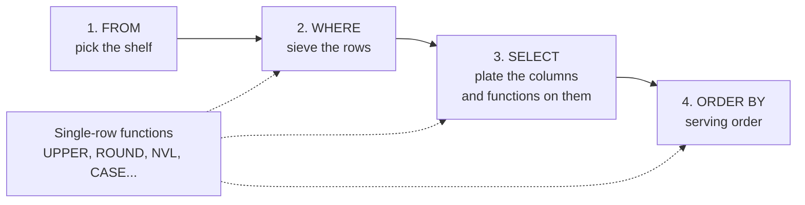
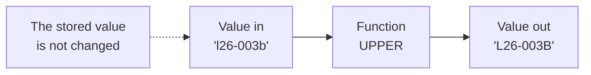
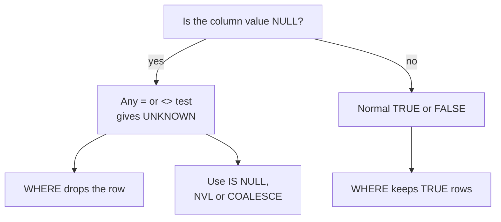

# NULL and single-row functions

Real data has gaps, and real questions need the data reshaped before you show it: names in capitals, dates as words, a number rounded, a blank replaced by a label. This page covers both. First `NULL`, the way a database says "nothing recorded here". Then the single-row functions, small tools that take a value, change it and hand it back.

**By the end of this page you can:**

- explain what `NULL` is and test for it with `IS NULL` and `IS NOT NULL`
- say why `= NULL` never finds anything, and why Oracle treats an empty string as `NULL`
- replace a `NULL` with `NVL`, `NVL2` or `COALESCE`
- label rows with `CASE`
- clean up and cut text, round numbers and calculate with dates
- convert between text, numbers and dates on purpose

## The mental map, a little bigger

Last page you learned the kitchen order: `FROM` (which shelf), `WHERE` (sieve), `SELECT` (plate), `ORDER BY` (serving order). Functions do not add a new station. They work *in the middle of the plate*: a value comes off the shelf, a function changes it, and the changed value lands on the plate. You can also use a function inside the sieve, in `WHERE`.



A single-row function runs once for every row and returns one value for it. That is the whole idea, and it is why they are called single-row.



The stored data never changes. The function only changes what lands on your plate for this one query. A kitchen picture: a cook slicing a tomato for your plate does not slice the tomato still in the fridge.

## NULL: nothing recorded

### Three boxes

Picture three boxes on a shelf.

- Box A is **empty**, and the label says "contents: zero". That is the number `0`.
- Box B has a note inside saying **"none"**. Someone looked and wrote it down. That is a blank text such as `' '`, or the text `'none'`.
- Box C has **never been opened**. Nobody knows what is inside, or whether anything should be. That is `NULL`.

`NULL` is box C. It is not zero, it is not blank. It means "no value recorded". From that, a rule follows that surprises everyone once: if you do not know what is in the box, you cannot say it equals anything, not even another unopened box.

Where the analogy stops: a real unopened box can be opened later. A `NULL` becomes a value only when somebody runs an `UPDATE` to put one in.

You have already met one. Last page showed two lots on hold, and one of them had a blank reason.

### IS NULL and IS NOT NULL

Maya asks: "Which lots are on hold and nobody wrote down why?"

```sql
SELECT lot_id, status, hold_reason
FROM   lots
WHERE  status = 'HOLD'
AND    hold_reason IS NULL;
```

<!--gen-->
```text
LOT_ID     STATUS   HOLD_REASON
---------- -------- --------------------------------
L26-005    HOLD
```

To ask the opposite question, use `IS NOT NULL`. Maya: "Which lots have a hold reason recorded?"

```sql
SELECT lot_id, status, hold_reason
FROM   lots
WHERE  hold_reason IS NOT NULL;
```

<!--gen-->
```text
LOT_ID     STATUS   HOLD_REASON
---------- -------- --------------------------------
L26-003B   HOLD     Thickness out of spec at FINAL
```

Only `L26-003B` has a reason written down. Every other lot holds `NULL` in that column, including all the lots that were never on hold.

### Why = NULL never matches

Many people try this first.

```sql
SELECT lot_id, hold_reason
FROM   lots
WHERE  hold_reason = NULL;
```

<!--gen-->
```text

```

No rows, and no error. The database asked "is the unknown value equal to the unknown value?" and the honest answer is "I cannot tell". A row is kept only when the test is clearly true. "I cannot tell" is not true, so the row is dropped.

### Oracle's special rule: an empty string is NULL

In many databases a blank text `''` and `NULL` are two different things. In Oracle they are the same. When lot `L26-005` was put on hold, nobody typed a reason, and Oracle stored `NULL`. So comparing with `''` fails in the same way:

```sql
SELECT lot_id, hold_reason
FROM   lots
WHERE  hold_reason = '';
```

<!--gen-->
```text

```

Again no rows, even though `L26-005` clearly shows a blank. Use `IS NULL`.

```sql
SELECT lot_id, status, hold_reason
FROM   lots
WHERE  lot_id = 'L26-005';
```

<!--gen-->
```text
LOT_ID     STATUS   HOLD_REASON
---------- -------- --------------------------------
L26-005    HOLD
```

### NULL in arithmetic and in comparisons

Anything calculated with an unknown is unknown. `5 + NULL` is `NULL`. `NULL || 'text'` is just `'text'` in Oracle, which is the one exception worth remembering. The next query wraps each result in `NVL` so you can see a `NULL` as the word `(null)` instead of a blank. (`NVL` comes in a moment, and `UNION ALL` just stacks four small results on top of each other.)

```sql
SELECT '5 + NULL' AS calc, NVL(TO_CHAR(5 + NULL), '(null)') AS result FROM dual
UNION ALL
SELECT '5 * 0', NVL(TO_CHAR(5 * 0), '(null)') FROM dual
UNION ALL
SELECT 'NULL * 0', NVL(TO_CHAR(NULL * 0), '(null)') FROM dual
UNION ALL
SELECT '''abc'' || NULL', NVL('abc' || NULL, '(null)') FROM dual;
```

<!--gen-->
```text
CALC          RESULT
------------- ------
5 + NULL      (null)
5 * 0         0
NULL * 0      (null)
'abc' || NULL abc
```

`NULL * 0` is still `NULL`, not `0`. If the box was never opened, you cannot say what is in it times zero.

A comparison with `NULL` has three possible answers: TRUE, FALSE and UNKNOWN. `WHERE` keeps only TRUE. This table is all you need.

| Test | Result |
| --- | --- |
| `5 = 5` | TRUE |
| `5 = 6` | FALSE |
| `5 = NULL` | UNKNOWN |
| `NULL = NULL` | UNKNOWN |
| `NULL IS NULL` | TRUE |

And how `AND`, `OR` and `NOT` treat UNKNOWN:

| A | B | A AND B | A OR B | NOT A |
| --- | --- | --- | --- | --- |
| TRUE | UNKNOWN | UNKNOWN | TRUE | FALSE |
| FALSE | UNKNOWN | FALSE | UNKNOWN | TRUE |
| UNKNOWN | UNKNOWN | UNKNOWN | UNKNOWN | UNKNOWN |

Read the table in words: `OR` with one TRUE is TRUE whatever the other side is. `AND` with one FALSE is FALSE. Everything else involving UNKNOWN stays unknown.

A real consequence: two wafers in lot `L26-012` have no grade. Maya: "How many wafers are not PRIME?" Compare the two counts below.

```sql
SELECT COUNT(*) AS not_prime_naive
FROM   wafers
WHERE  grade <> 'PRIME';
```

<!--gen-->
```text
NOT_PRIME_NAIVE
---------------
             13
```

```sql
SELECT COUNT(*) AS not_prime_with_nulls
FROM   wafers
WHERE  grade <> 'PRIME'
OR     grade IS NULL;
```

<!--gen-->
```text
NOT_PRIME_WITH_NULLS
--------------------
                  15
```

The two ungraded wafers are neither PRIME nor "not PRIME" as far as `<>` is concerned, so the first count leaves them out. Whether they belong in Maya's answer is a question for Maya. The skill is knowing they are there.

Here is the decision as a picture.



## Replacing a NULL: NVL, NVL2, COALESCE

**`NVL(x, y)`**: "if x is `NULL`, use y instead; otherwise use x." Maya: "List the wafers in lot L26-012, and mark the ones nobody graded."

```sql
SELECT wafer_id, NVL(grade, 'UNGRADED') AS label
FROM   wafers
WHERE  lot_id = 'L26-012'
ORDER  BY wafer_id;
```

<!--gen-->
```text
WAFER_ID     LABEL
------------ --------
L26-012-01   PRIME
L26-012-02   PRIME
L26-012-03   UNGRADED
L26-012-04   UNGRADED
```

**`NVL2(x, if_not_null, if_null)`**: choose between two answers depending on whether x has a value.

```sql
SELECT lot_id, status,
       NVL2(hold_reason, 'reason on file', 'no reason on file') AS note
FROM   lots
WHERE  status = 'HOLD';
```

<!--gen-->
```text
LOT_ID     STATUS   NOTE
---------- -------- -----------------
L26-003B   HOLD     reason on file
L26-005    HOLD     no reason on file
```

**`COALESCE(a, b, c, ...)`**: "the first one that is not `NULL`." It is the same idea as `NVL` but takes any number of values, and it is standard SQL, so it works in other databases too.

```sql
SELECT lot_id,
       COALESCE(hold_reason, 'no reason given') AS reason
FROM   lots
WHERE  status = 'HOLD';
```

<!--gen-->
```text
LOT_ID     REASON
---------- ------------------------------------------------------------
L26-003B   Thickness out of spec at FINAL
L26-005    no reason given
```

For a root lot with no parent, `parent_lot_id` is `NULL`. Maya: "Where did each lot come from?" `COALESCE` reads naturally:

```sql
SELECT lot_id, COALESCE(parent_lot_id, 'original lot') AS came_from
FROM   lots
WHERE  lot_id LIKE 'L26-003%'
ORDER  BY lot_id;
```

<!--gen-->
```text
LOT_ID     CAME_FROM
---------- ------------
L26-003    original lot
L26-003A   L26-003
L26-003B   L26-003
L26-003B1  L26-003B
```

## CASE: give each row a label

`CASE` works like a series of "if" cards. The first card that is true wins, and the rest are skipped. If none is true and there is no `ELSE`, you get `NULL`. Always write the `ELSE`.

**Searched CASE**: each card holds a full test. Maya: "Turn the priority number into words for the morning board."

```sql
SELECT lot_id, priority,
       CASE
         WHEN priority = 1 THEN 'URGENT'
         WHEN priority = 2 THEN 'HIGH'
         ELSE 'NORMAL'
       END AS label
FROM   lots
WHERE  status <> 'SHIPPED'
ORDER  BY priority, lot_id;
```

<!--gen-->
```text
LOT_ID       PRIORITY LABEL
---------- ---------- ------
L26-003             1 URGENT
L26-003B            1 URGENT
L26-003B1           1 URGENT
L26-010             1 URGENT
L26-005             2 HIGH
L26-007             2 HIGH
L26-007A            2 HIGH
L26-009             2 HIGH
L26-012             2 HIGH
L26-008             3 NORMAL
L26-011             3 NORMAL
```

**Simple CASE**: when every card compares the same column to a value, you can name the column once.

```sql
SELECT lot_id, status,
       CASE status
         WHEN 'ACTIVE'   THEN 'running'
         WHEN 'HOLD'     THEN 'waiting for a decision'
         WHEN 'SHIPPED'  THEN 'done'
         ELSE 'scrapped'
       END AS plain_status
FROM   lots
WHERE  lot_id LIKE 'L26-00_'
ORDER  BY lot_id;
```

<!--gen-->
```text
LOT_ID     STATUS   PLAIN_STATUS
---------- -------- ----------------------
L26-001    SHIPPED  done
L26-002    SHIPPED  done
L26-003    ACTIVE   running
L26-004    SHIPPED  done
L26-005    HOLD     waiting for a decision
L26-006    SHIPPED  done
L26-007    ACTIVE   running
L26-008    SCRAPPED scrapped
L26-009    ACTIVE   running
```

Maya: "Of the final readings for lot L26-003 and its children, which are too thin, on target or too thick for the 12 nm product?" The target for FD-300 is 12 nm. Say that within 0.4 nm is fine. (You will learn to look the target up from `PRODUCTS` when we reach joins. For now we type 12.)

```sql
SELECT wafer_id, thickness_nm,
       CASE
         WHEN thickness_nm < 12 - 0.4 THEN 'TOO THIN'
         WHEN thickness_nm > 12 + 0.4 THEN 'TOO THICK'
         ELSE 'ON TARGET'
       END AS verdict
FROM   measurements
WHERE  step = 'FINAL'
AND    wafer_id LIKE 'L26-003%'
ORDER  BY wafer_id;
```

<!--gen-->
```text
WAFER_ID     THICKNESS_NM VERDICT
------------ ------------ ---------
L26-003-01          12.07 ON TARGET
L26-003-02          12.07 ON TARGET
L26-003-03          11.88 ON TARGET
L26-003-04          11.95 ON TARGET
L26-003-05          11.95 ON TARGET
L26-003A-01          12.1 ON TARGET
L26-003A-02         11.81 ON TARGET
L26-003A-03         11.98 ON TARGET
L26-003B-01          12.5 TOO THICK
L26-003B-02         12.64 TOO THICK
L26-003B1-01         12.1 ON TARGET
L26-003B1-02        12.02 ON TARGET
```

The two thick readings are in lot `L26-003B`, the lot that is on hold. The `CASE` reproduced the reason by itself.

## DUAL: a table with one row

Sometimes you want to calculate something that has nothing to do with a table. Oracle requires a `FROM`, so it supplies `DUAL`, a built-in table with one row and one column. Think of it as a scrap of paper you can scribble on.

```sql
SELECT 2 * 6 AS twelve, UPPER('fab') AS up
FROM   dual;
```

<!--gen-->
```text
    TWELVE UP
---------- ---
        12 FAB
```

Use `DUAL` to try a function before you trust it. That habit saves a lot of confusion.

## Text functions

Maya types lot names by hand and cannot be bothered about capitals. These functions fix that.

| Function | What it does | Example | Result |
| --- | --- | --- | --- |
| `UPPER(t)` | capitals | `UPPER('l26-003b')` | `L26-003B` |
| `LOWER(t)` | small letters | `LOWER('HOLD')` | `hold` |
| `INITCAP(t)` | First Letter Capital | `INITCAP('photonics soi')` | `Photonics Soi` |
| `SUBSTR(t, start, len)` | cut a piece | `SUBSTR('L26-003B', 5, 3)` | `003` |
| `INSTR(t, find)` | position of a piece, 0 if absent | `INSTR('L26-003B', '-')` | `4` |
| `LENGTH(t)` | number of characters | `LENGTH('L26-003B')` | `8` |
| `TRIM(t)` | remove spaces at both ends | `TRIM('  hi ')` | `hi` |
| `REPLACE(t, old, new)` | swap a piece | `REPLACE('L26-003B', 'L26', 'L27')` | `L27-003B` |
| `a \|\| b` | join text | `'L26' \|\| '-003'` | `L26-003` |
| `LPAD(t, n, pad)` | pad on the left to length n | `LPAD('7', 3, '0')` | `007` |

Rather than trust the table, run them. Positions in `SUBSTR` and `INSTR` start at 1, not 0.

```sql
SELECT UPPER('l26-003b')              AS up,
       LOWER('HOLD')                  AS low,
       INITCAP('photonics soi')       AS cap,
       SUBSTR('L26-003B', 5, 3)       AS cut,
       INSTR('L26-003B', '-')         AS dash_at,
       LENGTH('L26-003B')             AS len
FROM   dual;
```

<!--gen-->
```text
UP       LOW  CAP           CUT    DASH_AT        LEN
-------- ---- ------------- --- ---------- ----------
L26-003B hold Photonics Soi 003          4          8
```

```sql
SELECT '[' || TRIM('  hi ') || ']'               AS trm,
       REPLACE('L26-003B', 'L26', 'L27')         AS replaced,
       'L26' || '-003'                           AS joined,
       LPAD('7', 3, '0')                         AS pad
FROM   dual;
```

<!--gen-->
```text
TRM  REPLACED JOINED  PAD
---- -------- ------- ---
[hi] L27-003B L26-003 007
```

Now on real rows. Maya: "Give me every lot in one tidy line: lot, status and priority."

```sql
SELECT lot_id || ' (' || status || ', priority ' || priority || ')' AS summary
FROM   lots
WHERE  lot_id LIKE 'L26-007%'
ORDER  BY lot_id;
```

<!--gen-->
```text
SUMMARY
--------------------------------------------------------------------------
L26-007 (ACTIVE, priority 2)
L26-007A (ACTIVE, priority 2)
```

Functions also work inside `WHERE`. Maya typed `l26-003b` in lower case and still wants the lot.

```sql
SELECT lot_id, status
FROM   lots
WHERE  UPPER(lot_id) = UPPER('l26-003b');
```

<!--gen-->
```text
LOT_ID     STATUS
---------- --------
L26-003B   HOLD
```

One more, pulling the lot number out of a wafer id. `L26-003B-01` has the lot first, then a dash and the slot. `INSTR` can find the last dash, and `SUBSTR` can cut what comes after it.

```sql
SELECT wafer_id,
       SUBSTR(wafer_id, INSTR(wafer_id, '-', -1) + 1) AS slot_text
FROM   wafers
WHERE  lot_id = 'L26-003B';
```

<!--gen-->
```text
WAFER_ID     SLOT_TEXT
------------ ----------------------------------------------------------------
L26-003B-01  01
L26-003B-02  02
```

The `-1` tells `INSTR` to search from the end of the text backwards.

## Number functions

| Function | What it does | Example | Result |
| --- | --- | --- | --- |
| `ROUND(n, d)` | round to d decimals | `ROUND(12.4567, 2)` | `12.46` |
| `TRUNC(n, d)` | cut off, no rounding | `TRUNC(12.4567, 2)` | `12.45` |
| `MOD(a, b)` | remainder after dividing | `MOD(10, 3)` | `1` |
| `ABS(n)` | remove the minus sign | `ABS(-4.5)` | `4.5` |
| `CEIL(n)` | round up to a whole number | `CEIL(4.1)` | `5` |
| `FLOOR(n)` | round down to a whole number | `FLOOR(4.9)` | `4` |

```sql
SELECT ROUND(12.4567, 2)   AS rounded,
       TRUNC(12.4567, 2)   AS cut,
       MOD(10, 3)          AS remainder,
       ABS(-4.5)           AS plain,
       CEIL(4.1)           AS up,
       FLOOR(4.9)          AS down,
       ROUND(1250, -2)     AS to_hundreds
FROM   dual;
```

<!--gen-->
```text
   ROUNDED        CUT  REMAINDER      PLAIN         UP       DOWN TO_HUNDREDS
---------- ---------- ---------- ---------- ---------- ---------- -----------
     12.46      12.45          1        4.5          5          4        1300
```

A negative number of decimals rounds to the left of the decimal point: `ROUND(1250, -2)` goes to the nearest hundred.

Maya: "How far is each final reading in lot L26-003B from the 12 nm target? I only want the size of the miss."

```sql
SELECT wafer_id, thickness_nm,
       ABS(ROUND(thickness_nm - 12, 2)) AS miss_nm
FROM   measurements
WHERE  step = 'FINAL'
AND    wafer_id LIKE 'L26-003B-%'
ORDER  BY wafer_id;
```

<!--gen-->
```text
WAFER_ID     THICKNESS_NM    MISS_NM
------------ ------------ ----------
L26-003B-01          12.5         .5
L26-003B-02         12.64        .64
```

`MOD` is handy for odd and even. Maya: "Wafers in odd slots of lot L26-003, please."

```sql
SELECT wafer_id, slot_no
FROM   wafers
WHERE  lot_id = 'L26-003'
AND    MOD(slot_no, 2) = 1
ORDER  BY slot_no;
```

<!--gen-->
```text
WAFER_ID        SLOT_NO
------------ ----------
L26-003-01            1
L26-003-03            3
L26-003-05            5
```

## Date functions

An Oracle `DATE` holds a day *and* a time down to the second. Display settings often hide the time, which is why dates confuse people.

`SYSDATE` is "now", read from the database server's clock. Its answer changes every time you run it, so the output below depends on the day you run it and I have not pasted any. Try it yourself.

```sql
SELECT SYSDATE, SYSTIMESTAMP FROM dual;
```

With a date, `+ 1` means one day later. Adding `1/24` means one hour.

```sql
SELECT SYSDATE + 7         AS a_week_from_now,
       SYSDATE - 1         AS yesterday_same_time,
       TRUNC(SYSDATE)      AS today_at_midnight
FROM   dual;
```

Those results also depend on today's date. The functions below work from fixed dates, so their output is the same for everyone.

```sql
SELECT ADD_MONTHS(DATE '2026-09-29', 1)                          AS one_month_later,
       ADD_MONTHS(DATE '2026-01-31', 1)                          AS jan31_plus_1,
       MONTHS_BETWEEN(DATE '2026-10-15', DATE '2026-07-15')      AS months_apart,
       DATE '2026-09-29' - DATE '2026-09-01'                     AS days_apart,
       TRUNC(TO_DATE('2026-09-29 14:30', 'YYYY-MM-DD HH24:MI'))  AS cut_to_midnight
FROM   dual;
```

<!--gen-->
```text
ONE_MONTH_LATER  JAN31_PLUS_1     MONTHS_APART DAYS_APART CUT_TO_MIDNIGHT
---------------- ---------------- ------------ ---------- ----------------
2026-10-29 00:00 2026-02-28 00:00            3         28 2026-09-29 00:00
```

Notice what `TRUNC(date)` does: it throws away the time and leaves midnight. It is the quick way to compare "the same day".

`EXTRACT` pulls one part out of a date.

```sql
SELECT lot_id, start_date,
       EXTRACT(YEAR  FROM start_date) AS yr,
       EXTRACT(MONTH FROM start_date) AS mth,
       EXTRACT(DAY   FROM start_date) AS dy
FROM   lots
WHERE  lot_id IN ('L26-001', 'L26-012')
ORDER  BY lot_id;
```

<!--gen-->
```text
LOT_ID     START_DATE               YR        MTH         DY
---------- ---------------- ---------- ---------- ----------
L26-001    2026-08-03 07:30       2026          8          3
L26-012    2026-09-29 09:00       2026          9         29
```

## Converting: TO_CHAR, TO_DATE, TO_NUMBER

Three small converters move values between text, dates and numbers.

- `TO_CHAR(date, 'mask')` turns a date into text laid out as you choose.
- `TO_DATE(text, 'mask')` turns text into a date, using the mask to read it.
- `TO_NUMBER(text)` turns text into a number.

The **mask** (also called the format model) is a pattern of letters.

| Mask | Meaning | Mask | Meaning |
| --- | --- | --- | --- |
| `YYYY` | four-digit year | `HH24` | hour, 00 to 23 |
| `MM` | month number | `MI` | minutes |
| `DD` | day of month | `SS` | seconds |
| `MON` | short month name | `DAY` | weekday name |
| `MONTH` | full month name | `D` | weekday number |

Month and day names come out in the language of your session, so the words can differ from the ones on these pages. Number masks like `YYYY-MM-DD` never change.

```sql
SELECT lot_id,
       TO_CHAR(start_date, 'YYYY-MM-DD')        AS day_only,
       TO_CHAR(start_date, 'DD/MM/YYYY HH24:MI') AS day_and_time,
       TO_CHAR(start_date, 'HH24')              AS hr
FROM   lots
WHERE  lot_id IN ('L26-001', 'L26-012')
ORDER  BY lot_id;
```

<!--gen-->
```text
LOT_ID     DAY_ONLY   DAY_AND_TIME     HR
---------- ---------- ---------------- --
L26-001    2026-08-03 03/08/2026 07:30 07
L26-012    2026-09-29 29/09/2026 09:00 09
```

Maya: "Which lots started in the morning, before 08:00?" Turn the hour into a number and compare.

```sql
SELECT lot_id, TO_CHAR(start_date, 'HH24:MI') AS time
FROM   lots
WHERE  TO_NUMBER(TO_CHAR(start_date, 'HH24')) < 8
ORDER  BY start_date;
```

<!--gen-->
```text
LOT_ID     TIME
---------- -----
L26-001    07:30
L26-003    06:45
L26-006    07:00
L26-008    06:30
L26-011    07:15
```

`TO_DATE` goes the other way. It is safer than hoping the database guesses your date layout.

```sql
SELECT lot_id, start_date
FROM   lots
WHERE  start_date >= TO_DATE('2026-09-20', 'YYYY-MM-DD')
ORDER  BY start_date;
```

<!--gen-->
```text
LOT_ID     START_DATE
---------- ----------------
L26-011    2026-09-22 07:15
L26-012    2026-09-29 09:00
```

`DATE '2026-09-20'` and `TO_DATE('2026-09-20', 'YYYY-MM-DD')` mean the same. The `DATE` form is shorter when the text is fixed. `TO_DATE` is what you use when the text comes from a column or a parameter.

`TO_CHAR` also formats numbers. `9` is a digit that may be blank, `0` is a digit that always shows.

```sql
SELECT TO_CHAR(1496.48, '9,999.99')  AS fmt_num,
       TO_CHAR(12, '0000')           AS pad,
       TO_NUMBER('42.5')             AS from_text
FROM   dual;
```

<!--gen-->
```text
FMT_NUM   PAD    FROM_TEXT
--------- ----- ----------
 1,496.48  0012       42.5
```

### Implicit and explicit conversion

If you compare a number with text, Oracle quietly converts one to the other. That is *implicit* conversion. It works until the day it does not. Converting on purpose with `TO_CHAR`, `TO_DATE` and `TO_NUMBER` is *explicit*, and it is what you should write.

This works, because Oracle can read `'12'` as a number:

```sql
SELECT target_thk_nm FROM products WHERE target_thk_nm = '12';
```

<!--gen-->
```text
TARGET_THK_NM
-------------
           12
```

This one fails, because `'abc'` cannot become a number. The error is the lesson.

```sql
SELECT product_code FROM products WHERE target_thk_nm = 'abc';
```

<!--gen-->
```text
SELECT product_code FROM products WHERE target_thk_nm = 'abc'
                                                        *
ERROR at line 1:
ORA-01722: invalid number
```

A date compared with text relies on the session's date format, which is different on different computers. A query that works on yours may fail on a colleague's. Write `DATE '2026-09-01'` or `TO_DATE` with a mask, and the problem disappears.

## Putting it together: a sentence per lot

Maya wants one readable sentence for each lot in the 003 family, like `L26-003B is a SPLIT lot that came from L26-003`. A root lot has no parent, so `COALESCE` supplies the ending.

```sql
SELECT lot_id || ' is a ' || lot_type || ' lot that came from '
       || COALESCE(parent_lot_id, 'nowhere, it is an original') AS sentence
FROM   lots
WHERE  lot_id LIKE 'L26-003%'
ORDER  BY lot_id;
```

<!--gen-->
```text
SENTENCE
------------------------------------------------------------------------
L26-003 is a PROD lot that came from nowhere, it is an original
L26-003A is a SPLIT lot that came from L26-003
L26-003B is a SPLIT lot that came from L26-003
L26-003B1 is a REWORK lot that came from L26-003B
```

Text glue (`||`), a `NULL` replacement and a `LIKE` filter in one query. Each piece is small and you have used every one of them on this page.

## Common mistakes

- **`= NULL` or `<> NULL`.** Neither finds anything. Use `IS NULL` and `IS NOT NULL`.
- **`= ''`.** In Oracle an empty string is `NULL`, so this finds nothing either.
- **Forgetting `NULL` in a `<>` test.** Rows with a `NULL` are silently dropped. Add `OR column IS NULL` if they belong in the answer.
- **`CASE` without `ELSE`.** Unmatched rows get `NULL`, and then you have a new gap.
- **Counting from 0 in `SUBSTR`.** Positions start at 1.
- **Dates as text.** Compare dates with `DATE '...'` or `TO_DATE`, never with a bare string.
- **Expecting `SYSDATE` to match a date at midnight.** It carries the current time. Use `TRUNC(SYSDATE)` to compare days.
- **Wrapping a column in a function in `WHERE`** (`UPPER(lot_id) = ...`) is correct, but it can stop an index from helping on big tables. Fine on our small tables. Keep it in mind later.

## Check your understanding

1. Which of these returns rows: `WHERE hold_reason = NULL`, `WHERE hold_reason IS NULL`, `WHERE hold_reason = ''`?
2. What does `NVL(grade, 'UNGRADED')` return for a wafer with grade `PRIME`?
3. What is the difference between `ROUND(2.567, 1)` and `TRUNC(2.567, 1)`?
4. You write `WHERE start_date = DATE '2026-09-29'` and miss a lot that started that day at 09:00. Why, and what would you write?

<details>
<summary>Answers</summary>

1. Only `hold_reason IS NULL`. The `= NULL` and `= ''` versions never return rows.
2. `PRIME`. `NVL` only replaces a `NULL`; other values pass through unchanged.
3. `ROUND` gives 2.6 (it rounds), `TRUNC` gives 2.5 (it cuts).
4. The stored date has a time of 09:00, so it does not equal midnight. Write `WHERE start_date >= DATE '2026-09-29' AND start_date < DATE '2026-09-30'`, or `TRUNC(start_date) = DATE '2026-09-29'`.

</details>

## Further reading

- [Oracle Database 19c SQL Language Reference: Functions](https://docs.oracle.com/en/database/oracle/oracle-database/19/sqlrf/Functions.html)
- [Oracle Database 19c SQL Language Reference: Nulls](https://docs.oracle.com/en/database/oracle/oracle-database/19/sqlrf/Nulls.html)
- [Oracle Database 19c SQL Language Reference: Format Models](https://docs.oracle.com/en/database/oracle/oracle-database/19/sqlrf/Format-Models.html)
