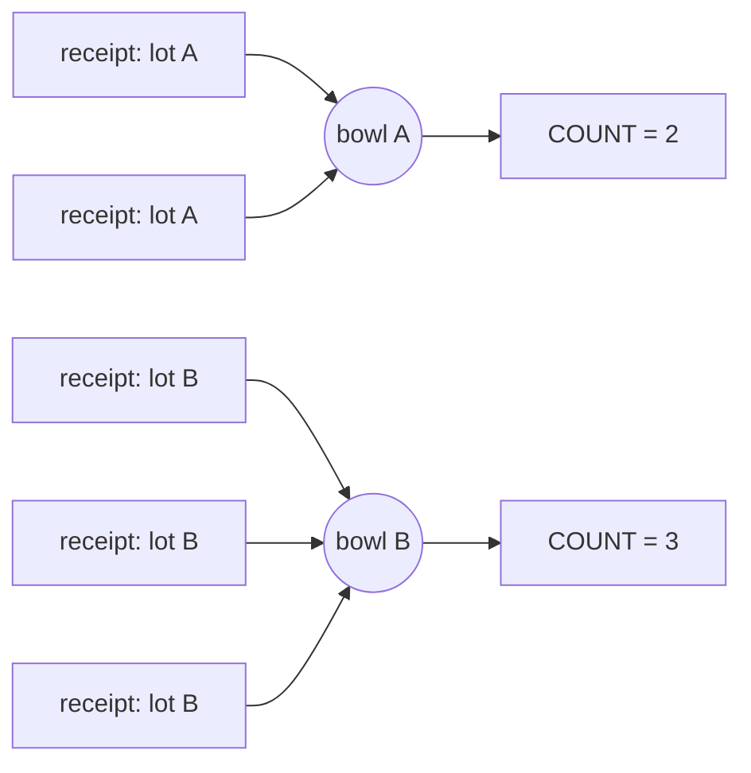
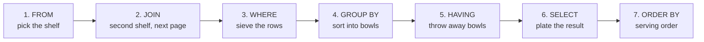

# Summarising: aggregate functions, GROUP BY and HAVING

Until now every query returned rows from a table, one row in and one row out. Maya's next questions are different: "How many wafers are in each lot?", "What is the average thickness at FINAL?" They do not want the rows. They want one number that sums up many rows. This page shows you how to ask for those numbers.

**By the end of this page you can:**

- count, add, average and find the smallest and largest value with aggregate functions
- explain why `COUNT(*)` and `COUNT(column)` can give different answers
- sort rows into groups with `GROUP BY` and summarise each group
- explain the rule that causes `ORA-00979` and fix it
- choose between `WHERE` and `HAVING`
- group by an expression, such as a month

## The analogy: receipts and bowls

Imagine a shoebox full of till receipts and you want to know how much was spent on each day of the week.

1. You do not add them up one by one in your head. You put out a row of **bowls**, one bowl per day, and drop each receipt into the bowl for its day. That is `GROUP BY`.
2. Then you look into each bowl and write down one thing: how many receipts, or their total. That is an **aggregate function**: `COUNT`, `SUM`, `AVG`, `MIN`, `MAX`.
3. The result is one line per bowl, not one line per receipt.

Two clean-up steps can happen, and the order matters:

- **`WHERE`** throws away receipts *before* they go into a bowl. "Ignore anything from the petrol station."
- **`HAVING`** throws away whole bowls *after* you have summarised them. "Only keep days where the total was over 100."

The analogy stops in one place: a real shoebox has no limit on how you sort, but in SQL each receipt (row) lands in exactly one bowl, and the bowl is decided by the values in the `GROUP BY` columns.



## The mental map, one station bigger

Here is the kitchen from the last page, now with the new stations. `JOIN` gets its own page next. The ones you meet today are `GROUP BY` and `HAVING`.



Read it left to right: the database picks the shelf, sieves the rows, sorts the survivors into bowls, discards unwanted bowls, plates one line per bowl, and finally sorts the plates. That is why `WHERE` cannot talk about a count (no bowls exist yet) and `HAVING` can (the bowls are ready).

The four-step method still works. Add one question in the middle: **"what am I counting, and per what?"** The "per what" becomes the `GROUP BY`.

## Aggregate functions on the whole table

An **aggregate function** takes many rows and returns one value. With no `GROUP BY`, the whole table is one big bowl.

Maya: "How many wafers do we have?"

```sql
SELECT COUNT(*) AS wafers FROM wafers;
```

<!--gen-->
```text
    WAFERS
----------
        66
```

| Function | What it returns |
| --- | --- |
| `COUNT(*)` | the number of rows |
| `COUNT(column)` | the number of rows where that column is **not NULL** |
| `COUNT(DISTINCT column)` | the number of different non-NULL values |
| `SUM(column)` | the total |
| `AVG(column)` | the average |
| `MIN(column)`, `MAX(column)` | the smallest and largest |

### COUNT(*) against COUNT(column)

Two wafers have no grade yet. See what each form of `COUNT` makes of that.

```sql
SELECT COUNT(*)      AS all_rows,
       COUNT(grade)  AS with_grade,
       COUNT(DISTINCT grade) AS different_grades,
       COUNT(DISTINCT lot_id) AS lots_with_wafers
FROM   wafers;
```

<!--gen-->
```text
  ALL_ROWS WITH_GRADE DIFFERENT_GRADES LOTS_WITH_WAFERS
---------- ---------- ---------------- ----------------
        66         64                3               16
```

`COUNT(*)` counts rows, whatever is in them: 66. `COUNT(grade)` skips the two `NULL` grades: 64. `COUNT(DISTINCT grade)` is 3, the grades `PRIME`, `TEST` and `SCRAP`, and `NULL` is not counted as a value. All 16 lots have wafers, which is worth remembering: one of them (`L26-012`) has wafers but no measurements.

> **Rule of thumb:** `COUNT(*)` answers "how many rows?". `COUNT(column)` answers "how many rows have a value here?". Every other aggregate also ignores `NULL`, which is why an average is never dragged down by a blank.

### SUM, AVG, MIN, MAX and ROUND

Maya: "Look at the FINAL step only. What is the smallest, largest and average thickness, and the total number of defects?"

```sql
SELECT MIN(thickness_nm) AS thinnest,
       MAX(thickness_nm) AS thickest,
       AVG(thickness_nm) AS average_nm,
       SUM(defect_count) AS total_defects
FROM   measurements
WHERE  step = 'FINAL';
```

<!--gen-->
```text
  THINNEST   THICKEST AVERAGE_NM TOTAL_DEFECTS
---------- ---------- ---------- -------------
     11.81     1582.6     277.35           283
```

That average has far too many decimals. `ROUND(value, places)` tidies it.

```sql
SELECT ROUND(AVG(thickness_nm), 1) AS average_nm
FROM   measurements
WHERE  step = 'FINAL';
```

<!--gen-->
```text
AVERAGE_NM
----------
     277.4
```

Notice this average mixes all five products, so 277.4 nm means nothing on its own. A thin 12 nm wafer and a 1500 nm wafer are in the same bowl. When you cannot explain a number to Maya, you probably put different things in one bowl. The next sections fix that by using more bowls.

## GROUP BY: one line per bowl

Maya: "How many measurements did we take at each step?" The "per what" is `step`.

```sql
SELECT step, COUNT(*) AS measurements
FROM   measurements
GROUP  BY step;
```

<!--gen-->
```text
STEP     MEASUREMENTS
-------- ------------
SPLIT              62
ANNEAL             62
FINAL              62
```

Three bowls (`SPLIT`, `ANNEAL`, `FINAL`), one line each. The order is not promised, so add `ORDER BY` if order matters.

Maya: "How many wafers are in each lot, biggest lot first?"

```sql
SELECT lot_id, COUNT(*) AS wafers
FROM   wafers
GROUP  BY lot_id
ORDER  BY wafers DESC, lot_id;
```

<!--gen-->
```text
LOT_ID         WAFERS
---------- ----------
L26-001             5
L26-002             5
L26-003             5
L26-004             5
L26-006             5
L26-007             5
L26-009             5
L26-010             5
L26-011             5
L26-005             4
L26-008             4
L26-012             4
L26-003A            3
L26-003B            2
L26-003B1           2
L26-007A            2
```

`ORDER BY` runs last, so it may use the alias `wafers`. The 66 wafers fall into 16 bowls, one per lot. Notice what a bowl can never show you: a lot with no wafers would have no bowl at all, so it would be missing from the answer instead of showing a zero. Joins on the next page deal with that.

Maya: "What are the defects per step?"

```sql
SELECT step,
       SUM(defect_count)          AS total_defects,
       ROUND(AVG(defect_count), 1) AS avg_defects
FROM   measurements
GROUP  BY step
ORDER  BY total_defects DESC;
```

<!--gen-->
```text
STEP     TOTAL_DEFECTS AVG_DEFECTS
-------- ------------- -----------
SPLIT             2336        37.7
ANNEAL            1015        16.4
FINAL              283         4.6
```

You can see the defects falling as wafers move along the line. You can use as many aggregates as you like in one query, and each bowl gets all of them.

### Grouping by a column with NULLs

`NULL` gets a bowl of its own. Maya: "How many wafers of each grade?"

```sql
SELECT grade, COUNT(*) AS wafers
FROM   wafers
GROUP  BY grade
ORDER  BY wafers DESC;
```

<!--gen-->
```text
GRADE      WAFERS
------ ----------
PRIME          51
TEST            9
SCRAP           4
                2
```

There is the bowl for the two wafers without a grade. The heading is blank because `NULL` shows as nothing. `COUNT(*)` counts them (2); `COUNT(grade)` would show 0 for that line, because every grade in that bowl is `NULL`.

### Grouping by several columns

List more columns and a bowl is made for each *combination*. Maya: "For each tool, how many measurements at each step?" Tools only measure certain steps, so you will see the pattern.

```sql
SELECT tool_id, step, COUNT(*) AS measurements
FROM   measurements
GROUP  BY tool_id, step
ORDER  BY tool_id, step;
```

<!--gen-->
```text
TOOL_ID STEP     MEASUREMENTS
------- -------- ------------
ANL01   ANNEAL             28
ANL02   ANNEAL             34
MET01   FINAL              21
MET02   FINAL              20
MET03   FINAL              21
SPL01   SPLIT              25
SPL02   SPLIT              37
```

One line per (tool, step) pair. The `SPL` tools only appear at `SPLIT`, the `ANL` tools at `ANNEAL`, and the metrology tools at `FINAL`. The lines show how the plant is organised, which you could not see in the raw rows.

## The rule: every plain column must be in GROUP BY

Here is the error everybody meets. Suppose you want the number of wafers per lot, and you also want the grade shown.

```sql
SELECT lot_id, grade, COUNT(*) AS wafers
FROM   wafers
GROUP  BY lot_id;
```

<!--gen-->
```text
SELECT lot_id, grade, COUNT(*) AS wafers
               *
ERROR at line 1:
ORA-00979: not a GROUP BY expression
```

`ORA-00979: not a GROUP BY expression` is Oracle saying: "You asked for one line per lot, but on that line you want `grade`. The lot has several grades. Which one?" Each bowl produces **one** line. Every item in `SELECT` must therefore be either:

- something you grouped by, or
- an aggregate function, which turns many values into one.

Two fixes, depending on what you meant. If you want the count per lot and grade, add the column to the groups:

```sql
SELECT lot_id, grade, COUNT(*) AS wafers
FROM   wafers
WHERE  lot_id IN ('L26-003', 'L26-005')
GROUP  BY lot_id, grade
ORDER  BY lot_id, grade;
```

<!--gen-->
```text
LOT_ID     GRADE      WAFERS
---------- ------ ----------
L26-003    PRIME           4
L26-003    TEST            1
L26-005    PRIME           4
```

If you only wanted the count per lot, drop `grade` from the `SELECT`. The rule has a mirror image: `GROUP BY` can mention columns that `SELECT` does not show, but not the other way round.

## WHERE and HAVING: two different sieves

Both filter, at different moments.

| | `WHERE` | `HAVING` |
| --- | --- | --- |
| Throws away | rows (receipts) | groups (bowls) |
| When | before grouping | after grouping |
| Can use aggregates like `COUNT(*)` | no | yes |
| Typical use | `step = 'FINAL'` | `COUNT(*) >= 4` |

Maya: "Which lots have at least 4 wafers?" The count only exists once the bowls are full, so this belongs in `HAVING`.

```sql
SELECT lot_id, COUNT(*) AS wafers
FROM   wafers
GROUP  BY lot_id
HAVING COUNT(*) >= 4
ORDER  BY lot_id;
```

<!--gen-->
```text
LOT_ID         WAFERS
---------- ----------
L26-001             5
L26-002             5
L26-003             5
L26-004             5
L26-005             4
L26-006             5
L26-007             5
L26-008             4
L26-009             5
L26-010             5
L26-011             5
L26-012             4
```

Maya: "Which tools took more than 30 measurements?"

```sql
SELECT tool_id, COUNT(*) AS measurements
FROM   measurements
GROUP  BY tool_id
HAVING COUNT(*) > 30
ORDER  BY measurements DESC;
```

<!--gen-->
```text
TOOL_ID MEASUREMENTS
------- ------------
SPL02             37
ANL02             34
```

Only the busiest two tools remain. The other five bowls were thrown away after counting. Note too that `CMP01` and `IMP01` do not appear in the earlier tool lists. They have no measurements, so no bowl.

### Side by side: the same words, two meanings

Maya: "Count the measurements per tool, but only look at FINAL readings." The filter is about a row (`step`), so it goes in `WHERE`.

```sql
SELECT tool_id, COUNT(*) AS final_readings
FROM   measurements
WHERE  step = 'FINAL'
GROUP  BY tool_id
ORDER  BY tool_id;
```

<!--gen-->
```text
TOOL_ID FINAL_READINGS
------- --------------
MET01               21
MET02               20
MET03               21
```

Now add a bowl filter as well. "...and only tools with more than 20 FINAL readings." That is about the bowl total, so it goes in `HAVING`. Both filters live together happily:

```sql
SELECT tool_id, COUNT(*) AS final_readings
FROM   measurements
WHERE  step = 'FINAL'
GROUP  BY tool_id
HAVING COUNT(*) > 20
ORDER  BY tool_id;
```

<!--gen-->
```text
TOOL_ID FINAL_READINGS
------- --------------
MET01               21
MET03               21
```

Receipts first (`WHERE`), bowls second (`HAVING`). If you put `step = 'FINAL'` in `HAVING` you will get an error or a muddle, and if you put `COUNT(*) > 20` in `WHERE` Oracle refuses:

```sql
SELECT tool_id, COUNT(*) AS final_readings
FROM   measurements
WHERE  COUNT(*) > 20
GROUP  BY tool_id;
```

<!--gen-->
```text
WHERE  COUNT(*) > 20
       *
ERROR at line 3:
ORA-00934: group function is not allowed here
```

`ORA-00934: group function is not allowed here` means: you used a bowl-level number at the receipt-level sieve. Move the test to `HAVING`.

## GROUP BY an expression

You can group by a calculated value, not only a column. Maya: "How many lots did we start each month?" Use `TO_CHAR(date, 'YYYY-MM')` to turn a date into a text like `2026-09`. Repeat the same expression in `GROUP BY`.

```sql
SELECT TO_CHAR(start_date, 'YYYY-MM') AS yr_mon,
       COUNT(*)                        AS lots_started
FROM   lots
GROUP  BY TO_CHAR(start_date, 'YYYY-MM')
ORDER  BY yr_mon;
```

<!--gen-->
```text
YR_MON  LOTS_STARTED
------- ------------
2026-08            9
2026-09            7
```

The expression in `SELECT` and the one in `GROUP BY` must match. If you only group by `start_date`, each lot (with its own time of day) lands in a bowl of one.

Maya: "What is the average FINAL thickness per tool, and how many readings is it based on?" Averages from only one or two readings deserve less trust, so always show the count alongside.

```sql
SELECT tool_id,
       COUNT(*)                     AS readings,
       ROUND(AVG(thickness_nm), 1)  AS avg_nm,
       MIN(thickness_nm)            AS min_nm,
       MAX(thickness_nm)            AS max_nm
FROM   measurements
WHERE  step = 'FINAL'
GROUP  BY tool_id
ORDER  BY tool_id;
```

<!--gen-->
```text
TOOL_ID   READINGS     AVG_NM     MIN_NM     MAX_NM
------- ---------- ---------- ---------- ----------
MET01           21      286.9      11.86    1551.89
MET02           20      215.2      11.81    1580.16
MET03           21      327.1      11.95     1582.6
```

Each metrology tool sees all products, so these averages are still mixes of thin and thick wafers. To compare like with like, you need the product of each wafer. That information lives in another table, which is exactly what the next page, joins, is for.

## Common mistakes

- **A plain column next to an aggregate without `GROUP BY`.** `SELECT lot_id, COUNT(*) FROM wafers` fails with `ORA-00937`. Add `GROUP BY lot_id`.
- **A plain column missing from `GROUP BY`.** `ORA-00979`. Add it, or remove it from `SELECT`.
- **Using `COUNT(column)` when you meant `COUNT(*)`.** `NULL`s are silently skipped.
- **Putting an aggregate in `WHERE`.** `ORA-00934`. Use `HAVING`.
- **Putting a row filter in `HAVING` when `WHERE` would do.** It works for grouped columns, but `WHERE` filters earlier, so there is less to sort into bowls.
- **Averaging things that should not be mixed.** Ask "per what?" before you write the query.
- **Expecting an empty bowl.** A group exists only if at least one row falls in it.

## Check your understanding

1. `wafers` has 66 rows and 2 `NULL` grades. What do `COUNT(*)` and `COUNT(grade)` return?
2. In your own words, what is the difference between `WHERE` and `HAVING`?
3. Why does `SELECT lot_id, grade, COUNT(*) FROM wafers GROUP BY lot_id` fail?
4. Write the query for "months in which more than 3 lots started".

<details>
<summary>Answers</summary>

1. 66 and 64. `COUNT(*)` counts rows, `COUNT(grade)` counts only rows where `grade` is not `NULL`.
2. `WHERE` throws away rows before they go into bowls. `HAVING` throws away whole bowls after they have been summarised, so it can test `COUNT`, `SUM` and so on.
3. Each lot is one bowl and produces one line, but `grade` has several values in that bowl. Add `grade` to the `GROUP BY`, or remove it from the `SELECT`.
4. `SELECT TO_CHAR(start_date, 'YYYY-MM') AS yr_mon, COUNT(*) AS lots_started FROM lots GROUP BY TO_CHAR(start_date, 'YYYY-MM') HAVING COUNT(*) > 3 ORDER BY yr_mon;`

</details>

## Further reading

- [Oracle Database 19c SQL Language Reference: Aggregate Functions](https://docs.oracle.com/en/database/oracle/oracle-database/19/sqlrf/Aggregate-Functions.html)
- [Oracle Database 19c SQL Language Reference: SELECT](https://docs.oracle.com/en/database/oracle/oracle-database/19/sqlrf/SELECT.html)
