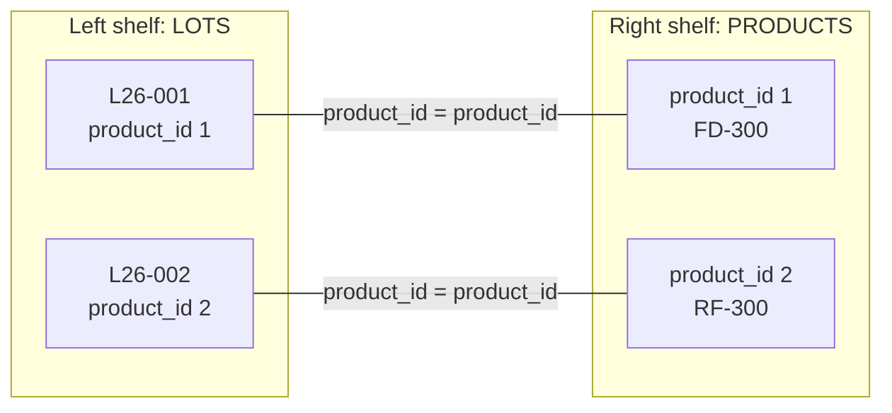
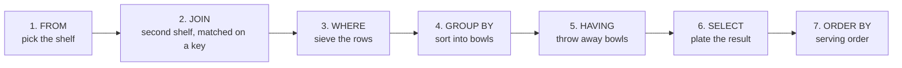
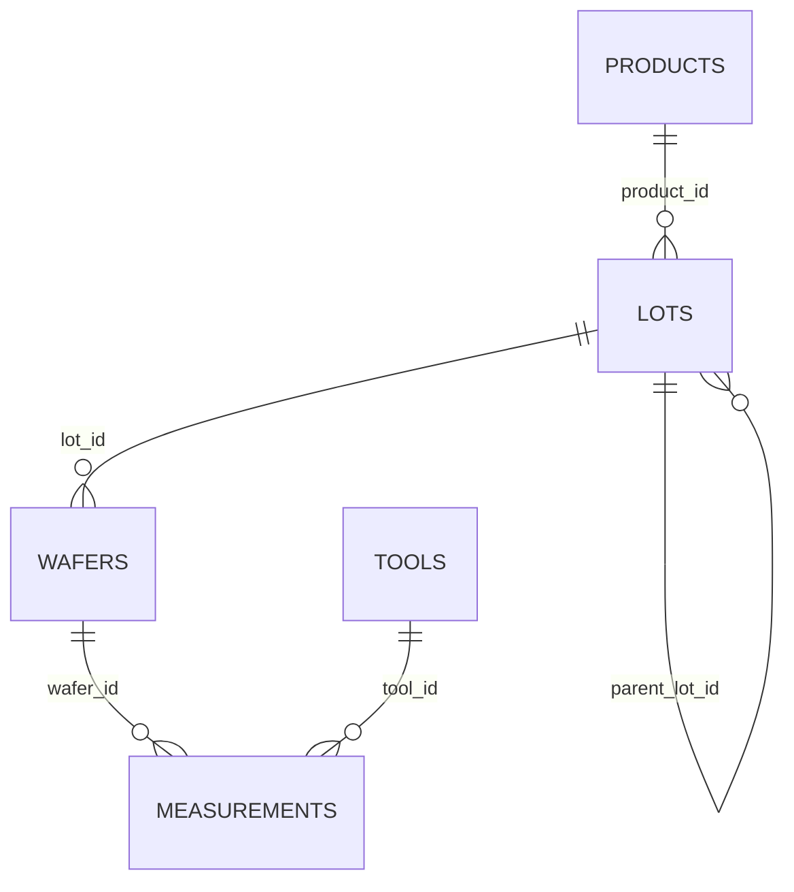
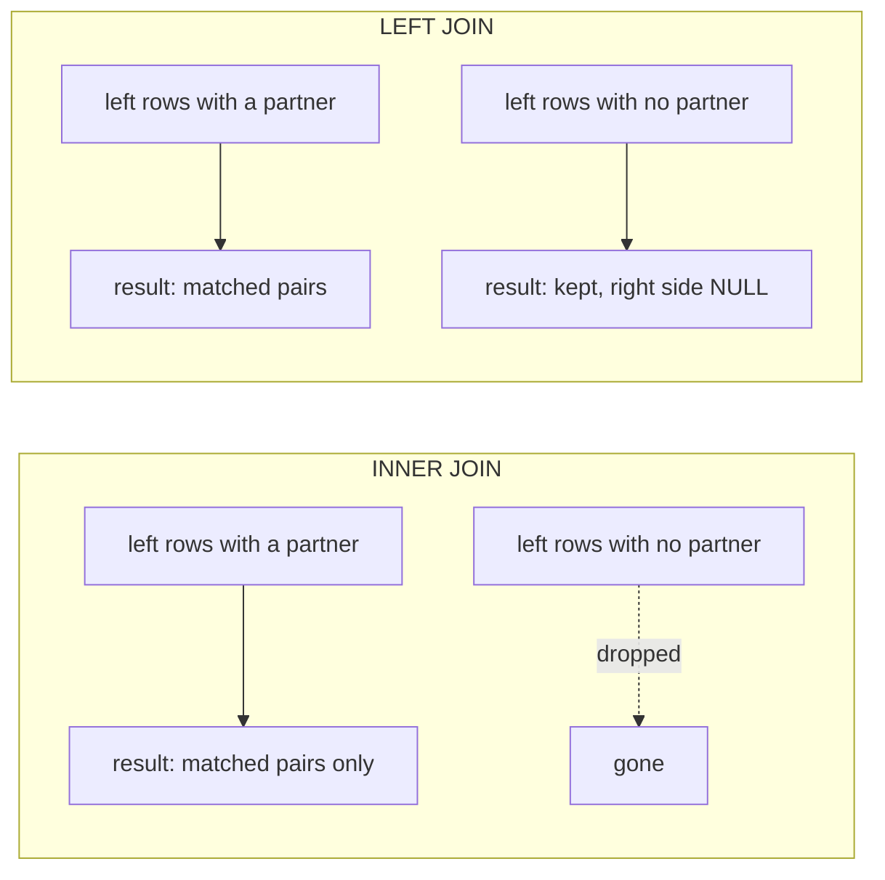

# Joins: bringing a second shelf to the counter

So far every query used one table. But Maya's questions rarely stay on one shelf. "Which product is lot L26-003?" needs `LOTS` and `PRODUCTS`. "Which tool measured this wafer?" needs `MEASUREMENTS` and `TOOLS`. A **join** lines up rows from two tables so you can use both in one query.

**By the end of this page you can:**

- write `INNER JOIN ... ON` with table aliases
- join three and four tables by following the map
- use `LEFT JOIN` to keep rows that have no partner
- find "things that never happened" with the anti-join pattern
- avoid the `COUNT(*)` trap on outer joins, the accidental cross join and `ORA-00918`
- join a table to itself
- recognise the old `(+)` syntax in legacy code

## The analogy: two shelves and a ticket number

Picture a repair shop with two shelves. On the left shelf are the **customer cards**: name, phone number, ticket number. On the right shelf are the **repair cards**: ticket number, what was fixed, the price. Nobody wrote the customer's name on the repair card. Only the ticket number is on both.

To answer "How much did Mrs Lopez pay?" you:

1. take her customer card, read the ticket number,
2. find the repair card with the same ticket number,
3. put the two side by side.

The ticket number is the **join column**. The rule "ticket numbers must be equal" is the **join condition**, and it is the string that ties one shelf to the other. In the fab, the strings are the columns from the map on the meet-the-fab page: `product_id`, `lot_id`, `wafer_id`, `tool_id`.

The analogy stops here: a customer might have several repair cards. Then the customer card is shown once per repair card. A join produces one result row for each matching *pair*, so one lot with 5 wafers appears 5 times when you join `LOTS` to `WAFERS`.



## The mental map, one more station

`JOIN` belongs to the `FROM` station. First you bring all the shelves to the counter and match them up. Only then does `WHERE` start sieving.



The four-step method gets one extra question: **"Is everything I need on one shelf?"** If not, find the tables on the map and the columns that link them.

And here is the map from the meet-the-fab page again, trimmed to the lines. Every join you write follows one of them.



## INNER JOIN: only the pairs that match

Maya: "For each lot, I want the product code and family, not just a number."

The lot knows `product_id`. The code and family are in `PRODUCTS`. The join column is `product_id`.

```sql
SELECT lots.lot_id, products.product_code, products.family
FROM   lots
JOIN   products ON lots.product_id = products.product_id
ORDER  BY lots.lot_id;
```

<!--gen-->
```text
LOT_ID     PRODUCT_CODE FAMILY
---------- ------------ --------------
L26-001    FD-300       FD-SOI
L26-002    RF-300       RF-SOI
L26-003    FD-300       FD-SOI
L26-003A   FD-300       FD-SOI
L26-003B   FD-300       FD-SOI
L26-003B1  FD-300       FD-SOI
L26-004    PWR-200      Power-SOI
L26-005    PHO-300      Photonics-SOI
L26-006    RF-300       RF-SOI
L26-007    FD-300       FD-SOI
L26-007A   FD-300       FD-SOI
L26-008    PWR-200      Power-SOI
L26-009    PHO-300      Photonics-SOI
L26-010    RF-300       RF-SOI
L26-011    FD-300       FD-SOI
L26-012    PHO-300      Photonics-SOI
```

Read the join in words: "from `lots`, join `products`, matching rows where the lot's `product_id` equals the product's `product_id`". `JOIN` on its own means `INNER JOIN`, and that is the form everyone writes. An **inner join** keeps only rows that found a partner. A lot with no product, or a product with no lots, would vanish from the result. Note that `SIC-150` is not in the list. Nobody has made a lot of it yet.

### Aliases: short names for tables

Typing `products.product_code` gets tiring. Give each table a short **alias** right after its name, and use it everywhere in the query. Pick letters that remind you of the table.

```sql
SELECT l.lot_id, p.product_code, p.family, l.status
FROM   lots l
JOIN   products p ON p.product_id = l.product_id
WHERE  l.status = 'HOLD';
```

<!--gen-->
```text
LOT_ID     PRODUCT_CODE FAMILY         STATUS
---------- ------------ -------------- --------
L26-003B   FD-300       FD-SOI         HOLD
L26-005    PHO-300      Photonics-SOI  HOLD
```

`WHERE` works on the joined rows exactly as before. Once you give a table an alias you must use the alias, not the full name, for that table in the query.

### Three tables: lots, wafers and products

Maya: "List the wafers of the PHO-300 product, with their lot and grade." Wafers know their lot, lots know their product. Walk along the map: `WAFERS` to `LOTS` to `PRODUCTS`. Add one `JOIN` for each step.

```sql
SELECT w.wafer_id, l.lot_id, p.product_code, w.grade
FROM   wafers w
JOIN   lots l     ON l.lot_id = w.lot_id
JOIN   products p ON p.product_id = l.product_id
WHERE  p.product_code = 'PHO-300'
ORDER  BY w.wafer_id;
```

<!--gen-->
```text
WAFER_ID     LOT_ID     PRODUCT_CODE GRADE
------------ ---------- ------------ ------
L26-005-01   L26-005    PHO-300      PRIME
L26-005-02   L26-005    PHO-300      PRIME
L26-005-03   L26-005    PHO-300      PRIME
L26-005-04   L26-005    PHO-300      PRIME
L26-009-01   L26-009    PHO-300      PRIME
L26-009-02   L26-009    PHO-300      PRIME
L26-009-03   L26-009    PHO-300      PRIME
L26-009-04   L26-009    PHO-300      PRIME
L26-009-05   L26-009    PHO-300      TEST
L26-012-01   L26-012    PHO-300      PRIME
L26-012-02   L26-012    PHO-300      PRIME
L26-012-03   L26-012    PHO-300
L26-012-04   L26-012    PHO-300
```

Each `JOIN` has its own `ON`. Think of it as adding one shelf at a time, each tied to the one before.

### Comparing FINAL thickness with the target

Maya: "How far is each FINAL reading from the product's target?" The reading is in `MEASUREMENTS`, the target is in `PRODUCTS`. The path is measurements, wafers, lots, products: four tables, three joins.

```sql
SELECT m.wafer_id,
       p.product_code,
       m.thickness_nm,
       p.target_thk_nm,
       ROUND(m.thickness_nm - p.target_thk_nm, 2) AS diff_nm
FROM   measurements m
JOIN   wafers w   ON w.wafer_id = m.wafer_id
JOIN   lots l     ON l.lot_id = w.lot_id
JOIN   products p ON p.product_id = l.product_id
WHERE  m.step = 'FINAL'
AND    l.lot_id = 'L26-003B'
ORDER  BY m.wafer_id;
```

<!--gen-->
```text
WAFER_ID     PRODUCT_CODE THICKNESS_NM TARGET_THK_NM    DIFF_NM
------------ ------------ ------------ ------------- ----------
L26-003B-01  FD-300               12.5            12         .5
L26-003B-02  FD-300              12.64            12        .64
```

Two readings, 0.5 nm and 0.64 nm over target. This is the lot that went on hold for being too thick. The columns come from three different tables but sit in one row, which is the whole point of a join.

Now the question the last page could not answer. Maya: "What is the average FINAL thickness per product, next to its target?"

```sql
SELECT p.product_code,
       p.target_thk_nm,
       COUNT(*)                    AS readings,
       ROUND(AVG(m.thickness_nm), 1) AS avg_nm
FROM   measurements m
JOIN   wafers w   ON w.wafer_id = m.wafer_id
JOIN   lots l     ON l.lot_id = w.lot_id
JOIN   products p ON p.product_id = l.product_id
WHERE  m.step = 'FINAL'
GROUP  BY p.product_code, p.target_thk_nm
ORDER  BY p.product_code;
```

<!--gen-->
```text
PRODUCT_CODE TARGET_THK_NM   READINGS     AVG_NM
------------ ------------- ---------- ----------
FD-300                  12         29         12
PHO-300                220          9      219.1
PWR-200               1500          9       1528
RF-300                  75         15       74.8
```

Now the numbers make sense: each average sits close to its own target. `PWR-200` is the highest at 28 nm over, because the scrapped lot `L26-008` is among its readings. Joins decide *what a row is*; `GROUP BY` then sorts those rows into bowls. The two work together without trouble, in the order of the map. Note that `p.target_thk_nm` is in the `GROUP BY` because it appears in the `SELECT`, the rule from the last page.

### Which tool measured each wafer

Maya: "Which tool measured wafer L26-001-01 at each step, and what kind of tool is it?"

```sql
SELECT m.wafer_id, m.step, m.tool_id, t.tool_type, t.bay, m.thickness_nm
FROM   measurements m
JOIN   tools t ON t.tool_id = m.tool_id
WHERE  m.wafer_id = 'L26-001-01'
ORDER  BY m.meas_time;
```

<!--gen-->
```text
WAFER_ID     STEP     TOOL_ID TOOL_TYPE    BAY  THICKNESS_NM
------------ -------- ------- ------------ ---- ------------
L26-001-01   SPLIT    SPL02   SPLIT        B1          15.81
L26-001-01   ANNEAL   ANL02   ANNEAL       B2          13.53
L26-001-01   FINAL    MET01   METROLOGY    B3          11.89
```

`m.tool_id` already has the tool name. The join adds the details about the tool that only `TOOLS` holds: its type and its bay.

## LEFT JOIN: keep everything from the left shelf

An inner join drops rows with no partner. Often that is the very row Maya is asking about. A **left join** keeps every row from the left table (the one before the word `JOIN`) and fills the right-hand columns with `NULL` when no partner exists.



Maya: "List every product and its lots. I want to see products that have none." Start from `PRODUCTS`, since you want every product.

```sql
SELECT p.product_code, l.lot_id
FROM   products p
LEFT   JOIN lots l ON l.product_id = p.product_id
ORDER  BY p.product_code, l.lot_id;
```

<!--gen-->
```text
PRODUCT_CODE LOT_ID
------------ ----------
FD-300       L26-001
FD-300       L26-003
FD-300       L26-003A
FD-300       L26-003B
FD-300       L26-003B1
FD-300       L26-007
FD-300       L26-007A
FD-300       L26-011
PHO-300      L26-005
PHO-300      L26-009
PHO-300      L26-012
PWR-200      L26-004
PWR-200      L26-008
RF-300       L26-002
RF-300       L26-006
RF-300       L26-010
SIC-150
```

`SIC-150` is back, with a blank (`NULL`) lot. The blank means "no matching row on the right".

### The anti-join: things that never happened

To list only the unmatched ones, keep the left join and ask for rows where the right-hand key is `NULL`. This is called an **anti-join**. Pick a column on the right that can never be `NULL` for a real row, usually its primary key.

Maya: "Which products have no lots?"

```sql
SELECT p.product_code, p.family
FROM   products p
LEFT   JOIN lots l ON l.product_id = p.product_id
WHERE  l.lot_id IS NULL;
```

<!--gen-->
```text
PRODUCT_CODE FAMILY
------------ --------------
SIC-150      SiC
```

Maya: "Which tools have never taken a measurement?"

```sql
SELECT t.tool_id, t.tool_type, t.bay
FROM   tools t
LEFT   JOIN measurements m ON m.tool_id = t.tool_id
WHERE  m.meas_id IS NULL
ORDER  BY t.tool_id;
```

<!--gen-->
```text
TOOL_ID TOOL_TYPE    BAY
------- ------------ ----
CMP01   POLISH       B4
IMP01   IMPLANT      B1
```

`CMP01` (polish) and `IMP01` (implant) have no readings at all. Their types suggest they process wafers rather than measure them, which would explain it, but the database cannot tell you that. Only the people on the floor can.

Maya: "Which lots have wafers but no measurements yet?" Here you chain: lots to wafers (inner, we only want lots with wafers), then wafers to measurements (left, we want wafers without readings).

```sql
SELECT l.lot_id, l.status, COUNT(*) AS wafers_without_readings
FROM   lots l
JOIN   wafers w ON w.lot_id = l.lot_id
LEFT   JOIN measurements m ON m.wafer_id = w.wafer_id
WHERE  m.meas_id IS NULL
GROUP  BY l.lot_id, l.status;
```

<!--gen-->
```text
LOT_ID     STATUS   WAFERS_WITHOUT_READINGS
---------- -------- -----------------------
L26-012    ACTIVE                         4
```

One lot, `L26-012`, with all four of its wafers still unmeasured. It is also the newest lot (started on 29 September), which may be why nobody has measured it yet. The query shows the gap, not the reason.

### The COUNT(*) trap on outer joins

Maya: "How many lots does each product have?" You use a left join so `SIC-150` appears. Watch the two ways of counting.

```sql
SELECT p.product_code,
       COUNT(*)        AS count_star,
       COUNT(l.lot_id) AS count_lots
FROM   products p
LEFT   JOIN lots l ON l.product_id = p.product_id
GROUP  BY p.product_code
ORDER  BY p.product_code;
```

<!--gen-->
```text
PRODUCT_CODE COUNT_STAR COUNT_LOTS
------------ ---------- ----------
FD-300                8          8
PHO-300               3          3
PWR-200               2          2
RF-300                3          3
SIC-150               1          0
```

`SIC-150` shows `count_star = 1` and `count_lots = 0`. The left join created one row for it with a `NULL` lot. `COUNT(*)` counts that row. `COUNT(l.lot_id)` skips the `NULL`, so it gives the honest zero. On an outer join, **count a column from the right-hand table**, never `*`.

## RIGHT JOIN and FULL JOIN, briefly

A **right join** is a left join seen from the other side: keep every row of the table on the right. Most people just swap the tables and use `LEFT JOIN`. These two give the same answer for "tools never used":

```sql
SELECT t.tool_id
FROM   measurements m
RIGHT  JOIN tools t ON t.tool_id = m.tool_id
WHERE  m.meas_id IS NULL
ORDER  BY t.tool_id;
```

<!--gen-->
```text
TOOL_ID
-------
CMP01
IMP01
```

A **full join** keeps unmatched rows from both sides. It is rare. A typical use is a data check that compares two lists and shows what is missing on either side.

```sql
SELECT p.product_code, l.lot_id
FROM   products p
FULL   JOIN lots l ON l.product_id = p.product_id
WHERE  p.product_id IS NULL
OR     l.lot_id IS NULL;
```

<!--gen-->
```text
PRODUCT_CODE LOT_ID
------------ ----------
SIC-150
```

Only `SIC-150` shows up (a product with no lot). Every lot has a product, so nothing is missing on the other side.

## Forgetting the join condition: the cross join explosion

If two tables are put together with no condition, the database pairs **every row of one with every row of the other**. That is a **cross join**. There are 5 products and 9 tools:

```sql
SELECT COUNT(*) AS pairs
FROM   products
CROSS  JOIN tools;
```

<!--gen-->
```text
     PAIRS
----------
        45
```

5 times 9 is 45. No "product-tool" pair means anything in the fab, so those rows are noise. With big tables this grows fast: 1,000 rows times 1,000 rows is a million rows, and a query that never seems to finish.

A cross join sometimes has a purpose, such as building every combination to check. When it appears by accident, it is nearly always a missing or wrong `ON`. Look at the row count: if a join returns far more rows than either table, suspect the condition.

In the ANSI form, Oracle helps you. Writing `JOIN` without `ON` is an error:

```sql
SELECT COUNT(*)
FROM   products
JOIN   tools;
```

<!--gen-->
```text
JOIN   tools
           *
ERROR at line 3:
ORA-00905: missing keyword
```

The old comma style does not protect you. It gives you the 45 rows silently:

```sql
SELECT COUNT(*) AS pairs
FROM   products, tools;
```

<!--gen-->
```text
     PAIRS
----------
        45
```

## Column ambiguity: ORA-00918

Both `LOTS` and `WAFERS` have a column called `lot_id`. If you just write `lot_id`, Oracle cannot tell which one you mean.

```sql
SELECT lot_id, wafer_id
FROM   lots l
JOIN   wafers w ON w.lot_id = l.lot_id;
```

<!--gen-->
```text
SELECT lot_id, wafer_id
       *
ERROR at line 1:
ORA-00918: column ambiguously defined
```

`ORA-00918: column ambiguously defined` is your cue to put the alias in front: `l.lot_id` or `w.lot_id`. They hold the same value here because of the join condition, so either one works. Get into the habit of prefixing **every** column in a join query. It also makes the query easier to read next month.

## A table joined to itself

The `parent_lot_id` column in `LOTS` points at another row of `LOTS`: a split or reworked lot remembers the lot it came from. To show a lot next to its parent, use the same table twice with two different aliases. One alias plays the child, one plays the parent. This is a **self join**.

Maya: "Which lots were split or reworked, and from which lot, and what was the parent's status?"

```sql
SELECT child.lot_id,
       child.lot_type,
       parent.lot_id  AS parent_lot,
       parent.status  AS p_status
FROM   lots child
JOIN   lots parent ON child.parent_lot_id = parent.lot_id
ORDER  BY child.lot_id;
```

<!--gen-->
```text
LOT_ID     LOT_TYPE PARENT_LOT   P_STATUS
---------- -------- ------------ --------
L26-003A   SPLIT    L26-003      ACTIVE
L26-003B   SPLIT    L26-003      ACTIVE
L26-003B1  REWORK   L26-003B     HOLD
L26-007A   SPLIT    L26-007      ACTIVE
```

Four child lots. It is an inner join, so lots with no parent (the plain `PROD` lots) are not shown. Use `LEFT JOIN` if you want them too, with a blank parent. Read the condition as "the child's parent_lot_id equals the parent's lot_id". Same table, two roles.

## You will meet this in old code: the (+) syntax

Before ANSI joins existed in Oracle, joins were written with tables separated by commas and the condition in `WHERE`. A left join used `(+)` on the side that may be missing. You will see this in old scripts and applications. It still works in 19c, but write `LEFT JOIN` yourself.

```sql
SELECT p.product_code, l.lot_id
FROM   products p, lots l
WHERE  l.product_id (+) = p.product_id
AND    p.product_code = 'SIC-150';
```

<!--gen-->
```text
PRODUCT_CODE LOT_ID
------------ ----------
SIC-150
```

Read `l.product_id (+) = p.product_id` as "lots may be missing here". It is the same left join as before, hidden in the `WHERE`. The comma style is also where the silent cross join comes from: forget the line in `WHERE` and the database does not warn you.

## Common mistakes

- **Forgetting `ON`, or joining on the wrong column.** Count the rows. A join of 16 lots and 66 wafers should give about 66 rows, not a thousand.
- **Not prefixing columns.** `ORA-00918`. Always write `alias.column`.
- **Inner join where you needed a left join.** Rows that "should be there" vanish with no error. This is the most expensive mistake because nothing warns you.
- **`COUNT(*)` with a left join.** Count a column from the right-hand table.
- **Filtering the right table in `WHERE` after a left join.** `WHERE m.step = 'FINAL'` throws out the `NULL` rows and quietly turns the left join back into an inner join. Put such a condition in the `ON` clause: `ON m.tool_id = t.tool_id AND m.step = 'FINAL'`.
- **Joining on columns that happen to look alike.** Use the keys on the map, not any two columns with the same name.

## Check your understanding

1. In the repair-shop picture, what is the join condition?
2. You inner-join `PRODUCTS` to `LOTS`. How many rows does `SIC-150` contribute, and why?
3. How do you list the tools that never took a measurement?
4. `SELECT lot_id FROM lots l JOIN wafers w ON w.lot_id = l.lot_id` fails. Why, and what is the fix?

<details>
<summary>Answers</summary>

1. Ticket numbers are equal on both cards.
2. None. No lot has `product_id` 5, so no pair matches and an inner join drops it.
3. Left join `TOOLS` to `MEASUREMENTS` on `tool_id` and keep the rows where a column of `MEASUREMENTS` (its primary key, `meas_id`) is `NULL`.
4. `lot_id` exists in both tables, so Oracle raises `ORA-00918`. Write `l.lot_id`.

</details>

## Further reading

- [Oracle Database 19c SQL Language Reference: Joins](https://docs.oracle.com/en/database/oracle/oracle-database/19/sqlrf/Joins.html)
- [Oracle Database 19c SQL Language Reference: SELECT](https://docs.oracle.com/en/database/oracle/oracle-database/19/sqlrf/SELECT.html)
