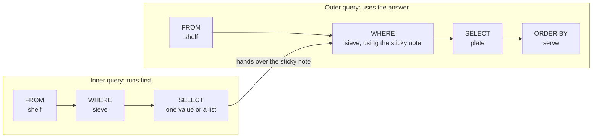
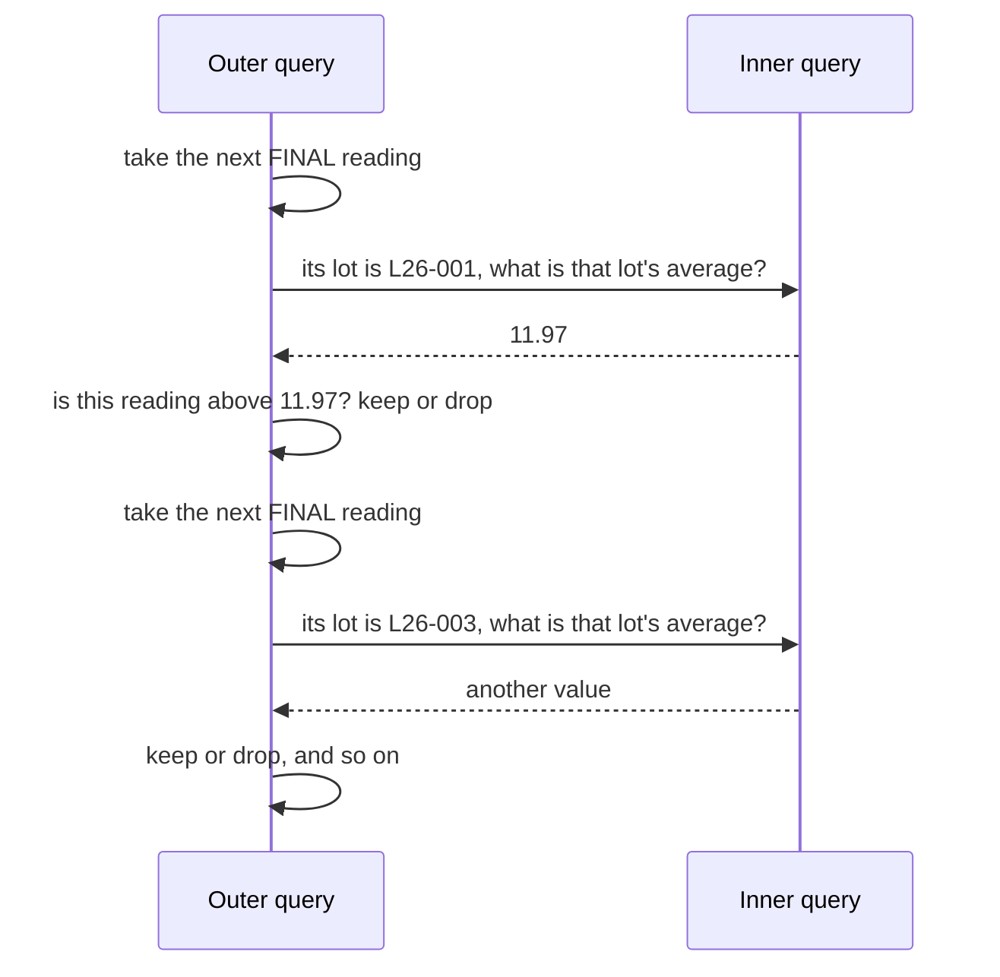
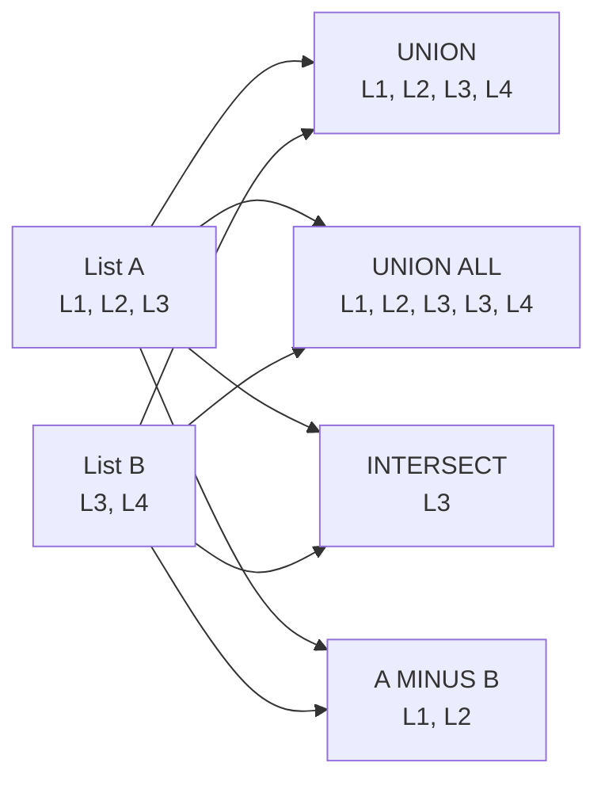

# Subqueries and set operators: a question inside a question

Sometimes you cannot answer a question until you have answered a smaller one first. "Who is taller than the class average?" needs the average before it can start. A **subquery** is that smaller question, written inside the bigger one. This page also covers **set operators**, which glue the results of two queries together like two guest lists.

**By the end of this page you can:**

- put a query inside `WHERE` to compare against a value or a list
- choose between `IN`, `NOT IN`, `EXISTS` and `NOT EXISTS`, and explain the `NOT IN` and `NULL` trap
- read a correlated subquery as "check the rule again for each row"
- use a subquery in `FROM` (an inline view) and give it a name with `WITH`
- combine two queries with `UNION`, `UNION ALL`, `INTERSECT` and `MINUS`
- decide when a join reads better than a subquery

This page assumes you have met joins and `GROUP BY` on the previous pages.

## The analogy: a sticky note

Picture a teacher with a class list. A parent asks: "Which children are taller than the class average?"

The teacher cannot answer straight away. First they measure everyone and work out the average. They write it on a **sticky note**: 152 cm. Then they walk down the list and compare each child with the sticky note.

A subquery is the sticky note. The database works out the small answer first, holds it, and then uses it while it answers the big question.

Set operators are a different idea: two guest lists.

| Operation | What you do with the two lists | Oracle word |
| --- | --- | --- |
| Merge the lists and cross out repeats | A person on both lists appears once | `UNION` |
| Staple the lists together | A person on both lists appears twice | `UNION ALL` |
| Keep only people on both lists | The overlap | `INTERSECT` |
| People on the first list who are not on the second | First minus second | `MINUS` |

The analogy stops here: guests on a paper list are always visible, but a database list can hold `NULL`, a "we do not know" entry. `NULL` is the reason one of the most common subquery bugs exists, and we will meet it in a moment.

## The mental map, a little bigger

We add one more idea to the kitchen. A subquery is a **second, smaller kitchen order** that runs first and hands its result to the main one.



Earlier stations are still there: `JOIN` brings a second shelf alongside, `GROUP BY` sorts into bowls, `HAVING` throws bowls away. A subquery is not a new station. It is a whole small kitchen order that you may place inside `WHERE`, inside `FROM`, or inside `SELECT`.

## The scalar subquery: one value

A **scalar** subquery returns exactly one row with one column, a single value. You can use it wherever a single number or text would fit.

Maya asks: "Which FINAL readings are thicker than the average FINAL reading?"

First, the sticky note on its own:

```sql
SELECT ROUND(AVG(thickness_nm), 2) AS avg_final_nm
FROM   measurements
WHERE  step = 'FINAL';
```

<!--gen-->
```text
AVG_FINAL_NM
------------
      277.35
```

Now put that query in brackets where the number would go:

```sql
SELECT wafer_id, thickness_nm
FROM   measurements
WHERE  step = 'FINAL'
AND    thickness_nm > (SELECT AVG(thickness_nm)
                       FROM   measurements
                       WHERE  step = 'FINAL')
ORDER  BY thickness_nm DESC;
```

<!--gen-->
```text
WAFER_ID     THICKNESS_NM
------------ ------------
L26-008-04         1582.6
L26-008-02        1580.16
L26-008-03        1570.47
L26-008-01        1551.89
L26-004-05        1509.67
L26-004-01        1496.48
L26-004-02        1490.27
L26-004-04        1489.32
L26-004-03        1481.49
```

Why not type `277.35` into the query? Because the average moves every time a measurement is added. The subquery recalculates it for you each time you run the query.

Look at the result again. Only 9 readings are above the average, and they are all large numbers. The average of 277 mixes products whose FINAL target is 12 nm with products whose target is 1500 nm. The query is correct, but the question is a weak one. Later on this page, a correlated subquery asks a fairer question.

If the inner query returns more than one row where one value is needed, Oracle stops you:

```sql
SELECT wafer_id
FROM   measurements
WHERE  thickness_nm > (SELECT thickness_nm FROM measurements WHERE step = 'FINAL');
```

<!--gen-->
```text
WHERE  thickness_nm > (SELECT thickness_nm FROM measurements WHERE step = 'FINAL')
                       *
ERROR at line 3:
ORA-01427: single-row subquery returns more than one row
```

That error (`ORA-01427`) is the teaching point. The brackets contain a list, and `>` needs one value. For a list, use `IN`.

## A list from a subquery: IN

`IN` checks whether a value is somewhere in a list. The list can come from a subquery.

Maya asks: "Show me the lots made for our 300 mm products."

```sql
SELECT lot_id, product_id, status
FROM   lots
WHERE  product_id IN (SELECT product_id
                      FROM   products
                      WHERE  diameter_mm = 300)
ORDER  BY lot_id;
```

<!--gen-->
```text
LOT_ID     PRODUCT_ID STATUS
---------- ---------- --------
L26-001             1 SHIPPED
L26-002             2 SHIPPED
L26-003             1 ACTIVE
L26-003A            1 SHIPPED
L26-003B            1 HOLD
L26-003B1           1 ACTIVE
L26-005             4 HOLD
L26-006             2 SHIPPED
L26-007             1 ACTIVE
L26-007A            1 ACTIVE
L26-009             4 ACTIVE
L26-010             2 ACTIVE
L26-011             1 ACTIVE
L26-012             4 ACTIVE
```

The inner query returns product 1, 2 and 4. The outer query keeps the lots whose `product_id` is in that list. If a new 300 mm product is added tomorrow, the query includes its lots without any change.

## The NOT IN trap

`NOT IN` sounds like the natural way to say "not on the list". It has a nasty habit when the list contains `NULL`.

Start small, with no tables at all. `dual` is Oracle's one-row practice table.

```sql
SELECT 'row returned' AS result FROM dual WHERE 1 IN (1, 2, NULL);
```

<!--gen-->
```text
RESULT
------------
row returned
```

```sql
SELECT 'row returned' AS result FROM dual WHERE 3 NOT IN (1, 2, NULL);
```

<!--gen-->
```text

```

The first returns a row. The second returns an empty result, though 3 is clearly not 1 or 2. Here is why. `3 NOT IN (1, 2, NULL)` means `3 <> 1 AND 3 <> 2 AND 3 <> NULL`. The last test is neither true nor false, it is *unknown*, because we do not know what `NULL` is. One unknown inside an `AND` means the whole row cannot be kept.

Now the same thing with real data. Maya asks: "Which lots are not the parent of any other lot?" In other words, lots that nobody was split or reworked from. The column `parent_lot_id` holds the parent, and it is `NULL` for lots that have no parent.

```sql
SELECT lot_id
FROM   lots
WHERE  lot_id NOT IN (SELECT parent_lot_id FROM lots);
```

<!--gen-->
```text

```

No rows, even though most lots are nobody's parent. Twelve of the sixteen lots have `NULL` in `parent_lot_id`, so the list contains `NULL`, and `NOT IN` can never say yes.

There are two fixes. The first removes the `NULL`s from the list:

```sql
SELECT lot_id
FROM   lots
WHERE  lot_id NOT IN (SELECT parent_lot_id
                      FROM   lots
                      WHERE  parent_lot_id IS NOT NULL)
ORDER  BY lot_id;
```

<!--gen-->
```text
LOT_ID
----------
L26-001
L26-002
L26-003A
L26-003B1
L26-004
L26-005
L26-006
L26-007A
L26-008
L26-009
L26-010
L26-011
L26-012
```

The second, usually safer, is `NOT EXISTS`, which we meet next. It does not care about `NULL`.

> **Rule of thumb:** with `NOT IN`, either be certain the list has no `NULL`, or use `NOT EXISTS`. A `NOT IN` that works today can start returning nothing the day a `NULL` arrives.

## EXISTS and NOT EXISTS: is there at least one?

`EXISTS` asks a yes or no question: "does the inner query find at least one row?" It does not look at the values. That is why `SELECT 1` is the usual style inside it: the `1` is never used.

The inner query refers to a column of the outer query. This is called **correlation**, and the next section explains it. For now, read the inner `WHERE` as "for this lot".

Maya asks: "Which lots have never been measured?" A lot is measured through its wafers, so the inner query goes from the lot to its wafers to their measurements.

```sql
SELECT l.lot_id, l.status
FROM   lots l
WHERE  NOT EXISTS (SELECT 1
                   FROM   wafers w
                   JOIN   measurements m ON m.wafer_id = w.wafer_id
                   WHERE  w.lot_id = l.lot_id);
```

<!--gen-->
```text
LOT_ID     STATUS
---------- --------
L26-012    ACTIVE
```

One lot, `L26-012`, has wafers but nobody has measured them yet.

The positive version, `EXISTS`: "Which lots have at least one wafer graded SCRAP?"

```sql
SELECT l.lot_id, l.status
FROM   lots l
WHERE  EXISTS (SELECT 1
               FROM   wafers w
               WHERE  w.lot_id = l.lot_id
               AND    w.grade = 'SCRAP')
ORDER  BY l.lot_id;
```

<!--gen-->
```text
LOT_ID     STATUS
---------- --------
L26-008    SCRAPPED
```

Now the case where `NOT IN` and `NOT EXISTS` should agree. Maya asks: "Which products have no lots?"

```sql
SELECT p.product_code
FROM   products p
WHERE  p.product_id NOT IN (SELECT l.product_id FROM lots l);
```

<!--gen-->
```text
PRODUCT_CODE
------------
SIC-150
```

```sql
SELECT p.product_code
FROM   products p
WHERE  NOT EXISTS (SELECT 1 FROM lots l WHERE l.product_id = p.product_id);
```

<!--gen-->
```text
PRODUCT_CODE
------------
SIC-150
```

Both give `SIC-150`. They agree here because `lots.product_id` is declared `NOT NULL`, so the list can never hold a `NULL`. The `parent_lot_id` example above shows what happens when it can. `NOT EXISTS` gives the right answer in both cases, so many people use it by default.

And the question about tools that never took a measurement:

```sql
SELECT t.tool_id, t.tool_type
FROM   tools t
WHERE  NOT EXISTS (SELECT 1 FROM measurements m WHERE m.tool_id = t.tool_id)
ORDER  BY t.tool_id;
```

<!--gen-->
```text
TOOL_ID TOOL_TYPE
------- ------------
CMP01   POLISH
IMP01   IMPLANT
```

Two tools, `CMP01` (polish) and `IMP01` (implant), have never taken a measurement. That makes sense: only splitting, annealing and metrology tools measure wafers. Further down, the same question is answered with `MINUS`.

## Correlated subqueries: re-checking the rule for each person

So far each inner query could run once, on its own. A **correlated** subquery cannot. It mentions a column of the outer row, so the answer changes for every outer row.

Think of a queue at a ticket desk. The rule is "children go free if they are younger than the average of their own class". The clerk takes the first child, looks up *that child's* class, works out *that class's* average, and decides. Then the next child, whose class may differ, so the average is worked out again.

Maya asks the fairer version of the earlier question: "Which wafers have a FINAL thickness above the average FINAL thickness of their own lot?"

```sql
SELECT w.lot_id, m.wafer_id, m.thickness_nm
FROM   measurements m
JOIN   wafers w ON w.wafer_id = m.wafer_id
WHERE  m.step = 'FINAL'
AND    m.thickness_nm > (SELECT AVG(m2.thickness_nm)
                         FROM   measurements m2
                         JOIN   wafers w2 ON w2.wafer_id = m2.wafer_id
                         WHERE  m2.step = 'FINAL'
                         AND    w2.lot_id = w.lot_id)
ORDER  BY w.lot_id, m.wafer_id;
```

<!--gen-->
```text
LOT_ID     WAFER_ID     THICKNESS_NM
---------- ------------ ------------
L26-001    L26-001-02          11.99
L26-001    L26-001-03          12.06
L26-001    L26-001-04          12.03
L26-002    L26-002-01          75.57
L26-002    L26-002-03          75.02
L26-002    L26-002-05          75.19
L26-003    L26-003-01          12.07
L26-003    L26-003-02          12.07
L26-003A   L26-003A-01          12.1
L26-003A   L26-003A-03         11.98
L26-003B   L26-003B-02         12.64
L26-003B1  L26-003B1-01         12.1
L26-004    L26-004-01        1496.48
L26-004    L26-004-05        1509.67
L26-005    L26-005-01         221.07
L26-005    L26-005-02         219.76
L26-006    L26-006-03          75.47
L26-006    L26-006-05          74.79
L26-007    L26-007-01          12.05
L26-007    L26-007-02          12.08
L26-007A   L26-007A-01         12.02
L26-008    L26-008-02        1580.16
L26-008    L26-008-04         1582.6
L26-009    L26-009-01         222.79
L26-009    L26-009-02         220.11
L26-009    L26-009-05         221.72
L26-010    L26-010-01           75.6
L26-010    L26-010-03          75.64
L26-010    L26-010-04          75.03
L26-010    L26-010-05          75.15
L26-011    L26-011-01          12.03
L26-011    L26-011-05          12.09
```

The key line is `w2.lot_id = w.lot_id`. The inner query uses `w.lot_id` from the outer row. The outer table has the alias `w` and the inner one `w2`, so you can tell them apart. Now each lot is judged against itself, so the result has rows from many lots, including the 12 nm and the 1500 nm ones. (Lot `L26-012` has no FINAL readings, so it cannot appear.)

Here is the conversation between the two queries.



The numbers in the diagram are only for illustration. The point is the loop: ask, answer, decide, repeat. Oracle may find a cleverer way to get the same result, but you should read the query as if it loops.

## A subquery in FROM: the inline view

A subquery can also take the place of a table name. The database builds the small result, and the outer query treats it as a table. This is called an **inline view**.

Maya asks: "For each lot, what is the average FINAL thickness, and which lots average above 100 nm?" This needs a filter on an average. You could do it with `HAVING`. Here is the inline view version, which is handy when you want to join or compare the averages afterwards:

```sql
SELECT lot_avg.lot_id, lot_avg.avg_final_nm
FROM  (SELECT w.lot_id, ROUND(AVG(m.thickness_nm), 2) AS avg_final_nm
       FROM   wafers w
       JOIN   measurements m ON m.wafer_id = w.wafer_id
       WHERE  m.step = 'FINAL'
       GROUP  BY w.lot_id) lot_avg
WHERE  lot_avg.avg_final_nm > 100
ORDER  BY lot_avg.avg_final_nm DESC;
```

<!--gen-->
```text
LOT_ID     AVG_FINAL_NM
---------- ------------
L26-008         1571.28
L26-004         1493.45
L26-009          219.78
L26-005          218.27
```

The bracketed query is the bowl-sorting you learned in `GROUP BY`. The outer query then sieves the bowls. Notice that the inline view needs an alias (`lot_avg`), just like a table.

## WITH: a named sticky note

When the inline view gets long, or you use it twice, give it a name at the top with `WITH`. This is called a **common table expression**. The query below returns the same answer as the one above, but reads top to bottom: first the note, then the question.

```sql
WITH lot_avg AS (
  SELECT w.lot_id, ROUND(AVG(m.thickness_nm), 2) AS avg_final_nm
  FROM   wafers w
  JOIN   measurements m ON m.wafer_id = w.wafer_id
  WHERE  m.step = 'FINAL'
  GROUP  BY w.lot_id
)
SELECT lot_id, avg_final_nm
FROM   lot_avg
WHERE  avg_final_nm > 100
ORDER  BY avg_final_nm DESC;
```

<!--gen-->
```text
LOT_ID     AVG_FINAL_NM
---------- ------------
L26-008         1571.28
L26-004         1493.45
L26-009          219.78
L26-005          218.27
```

The name `lot_avg` exists only for this one statement. Nothing is stored.

## ANY and ALL, briefly

`ANY` means "true for at least one value in the list". `ALL` means "true for every value in the list".

Maya asks: "Are any FINAL readings thicker than every ANNEAL reading?" Since the ANNEAL readings go up to 1702.9 nm, the answer should be no.

```sql
SELECT wafer_id, thickness_nm
FROM   measurements
WHERE  step = 'FINAL'
AND    thickness_nm > ALL (SELECT thickness_nm
                           FROM   measurements
                           WHERE  step = 'ANNEAL');
```

<!--gen-->
```text

```

No rows. `> ALL` means "bigger than the biggest", and `> ANY` means "bigger than the smallest". Many people write `> (SELECT MAX(...))` or `> (SELECT MIN(...))` instead, which says the same thing more plainly.

## Subquery or join?

Many questions can be written either way. Here is the 300 mm question from before, as a join:

```sql
SELECT l.lot_id, l.product_id, l.status
FROM   lots l
JOIN   products p ON p.product_id = l.product_id
WHERE  p.diameter_mm = 300
ORDER  BY l.lot_id;
```

<!--gen-->
```text
LOT_ID     PRODUCT_ID STATUS
---------- ---------- --------
L26-001             1 SHIPPED
L26-002             2 SHIPPED
L26-003             1 ACTIVE
L26-003A            1 SHIPPED
L26-003B            1 HOLD
L26-003B1           1 ACTIVE
L26-005             4 HOLD
L26-006             2 SHIPPED
L26-007             1 ACTIVE
L26-007A            1 ACTIVE
L26-009             4 ACTIVE
L26-010             2 ACTIVE
L26-011             1 ACTIVE
L26-012             4 ACTIVE
```

Same rows as the `IN` version. Which reads better?

| Use | When |
| --- | --- |
| A **join** | You want columns from both tables in the result, for example the product code next to each lot |
| A **subquery** with `IN` or `EXISTS` | You only filter by the other table and show nothing from it. Also safe when the other table could match a row several times, because a join would repeat the row |
| `NOT EXISTS` | "Has no matching row" questions. A join cannot say "none" without an outer join and an `IS NULL` test |
| A **correlated** subquery | The comparison value changes per row, like "above my own lot's average" |

Modern Oracle often turns one form into the other internally, so choose the one that is easier for a person to read.

## Set operators: combining two lists

A set operator takes two complete `SELECT` statements and produces one result. We use two small lists of lots to see the difference.



Maya asks two questions that she then combines. List A: "lots on hold". List B: "lots with priority 1".

```sql
SELECT lot_id FROM lots WHERE status = 'HOLD'
UNION
SELECT lot_id FROM lots WHERE priority = 1
ORDER  BY lot_id;
```

<!--gen-->
```text
LOT_ID
----------
L26-003
L26-003A
L26-003B
L26-003B1
L26-005
L26-010
```

`L26-003B` is on both lists (on hold, and priority 1). `UNION` shows it once. `UNION ALL` just staples:

```sql
SELECT lot_id FROM lots WHERE status = 'HOLD'
UNION ALL
SELECT lot_id FROM lots WHERE priority = 1
ORDER  BY lot_id;
```

<!--gen-->
```text
LOT_ID
----------
L26-003
L26-003A
L26-003B
L26-003B
L26-003B1
L26-005
L26-010
```

`L26-003B` now appears twice. `UNION ALL` is faster because it does not have to look for repeats, so use it when you know there are none, or when you want to count every occurrence.

Only the lots on both lists:

```sql
SELECT lot_id FROM lots WHERE status = 'HOLD'
INTERSECT
SELECT lot_id FROM lots WHERE priority = 1;
```

<!--gen-->
```text
LOT_ID
----------
L26-003B
```

On the first list but not the second:

```sql
SELECT lot_id FROM lots WHERE status = 'HOLD'
MINUS
SELECT lot_id FROM lots WHERE priority = 1;
```

<!--gen-->
```text
LOT_ID
----------
L26-005
```

`L26-005` is on hold but is only priority 2.

Now a real fab question. Maya asks: "Which tools never took a measurement?" All tools, minus the tools that appear in `measurements`:

```sql
SELECT tool_id FROM tools
MINUS
SELECT tool_id FROM measurements
ORDER  BY tool_id;
```

<!--gen-->
```text
TOOL_ID
-------
CMP01
IMP01
```

Same two tools as the `NOT EXISTS` query. `MINUS` removes repeated rows. The order of its result is not guaranteed, so add an `ORDER BY` at the end when order matters. In other databases the word is `EXCEPT`. Oracle 19c uses `MINUS`.

### Rules for set operators

- Both queries must return the **same number of columns**, and the columns must match in type, position by position. The names do not have to match. The column names in the result come from the **first** query.
- `ORDER BY` goes **once, at the very end**, not after each query. In it you can only use column names or positions from the first query.
- Without brackets, the operators are worked out from top to bottom.

What happens when the column counts differ:

```sql
SELECT lot_id, status FROM lots
UNION
SELECT tool_id FROM tools;
```

<!--gen-->
```text
SELECT lot_id, status FROM lots
*
ERROR at line 1:
ORA-01789: query block has incorrect number of result columns
```

`ORA-01789` is another error that teaches: the two lists must have the same shape.

And a type mismatch, text against a number:

```sql
SELECT lot_id FROM lots
UNION
SELECT product_id FROM products;
```

<!--gen-->
```text
SELECT lot_id FROM lots
       *
ERROR at line 1:
ORA-01790: expression must have same datatype as corresponding expression
```

## Common mistakes

- **`NOT IN` against a column that can be `NULL`.** You get no rows and no error. Use `NOT EXISTS`, or add `WHERE column IS NOT NULL` inside the subquery.
- **A scalar subquery that returns several rows.** `ORA-01427`. Use `IN`, or make the subquery return one row.
- **A correlated subquery without the link.** If you forget `w2.lot_id = w.lot_id`, the inner query ignores the outer row and every row is compared with one overall average.
- **Using `UNION` when you meant `UNION ALL`.** `UNION` quietly removes repeated rows, so counts can come out lower than you expect.
- **Putting `ORDER BY` in the middle of a set operation.** It belongs once, at the end.
- **No alias on an inline view.** Oracle can use the view only if it has a name, as with any table.

## Check your understanding

1. In the sticky-note analogy, what is the sticky note, and when is it written?
2. Why does `WHERE x NOT IN (SELECT col FROM t)` return nothing when `col` contains a `NULL`?
3. What is the difference between `UNION` and `UNION ALL`, and which one is faster?
4. Write the question "which wafers have no measurements" as a `NOT EXISTS` query. Which table do you start from?

<details>
<summary>Answers</summary>

1. The sticky note is the result of the inner query. The database works it out first, then the outer query uses it.
2. `x NOT IN (a, b, NULL)` expands to `x <> a AND x <> b AND x <> NULL`. The last test is unknown, so the row is never kept.
3. `UNION` removes repeated rows, `UNION ALL` keeps everything. `UNION ALL` is faster because it skips the search for repeats.
4. Start from `WAFERS`: `SELECT w.wafer_id FROM wafers w WHERE NOT EXISTS (SELECT 1 FROM measurements m WHERE m.wafer_id = w.wafer_id)`.

</details>

## Further reading

- [Oracle Database 19c SQL Language Reference: Using Subqueries](https://docs.oracle.com/en/database/oracle/oracle-database/19/sqlrf/Using-Subqueries.html)
- [Oracle Database 19c SQL Language Reference: The UNION [ALL], INTERSECT, MINUS Operators](https://docs.oracle.com/en/database/oracle/oracle-database/19/sqlrf/Set-Operators.html)
- [Oracle Database 19c SQL Language Reference: Conditions](https://docs.oracle.com/en/database/oracle/oracle-database/19/sqlrf/Conditions.html)
