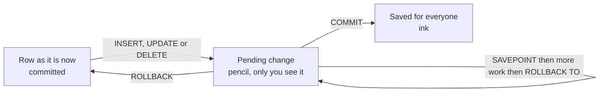
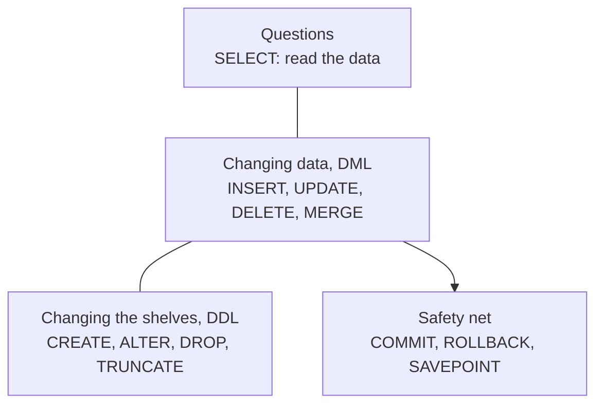
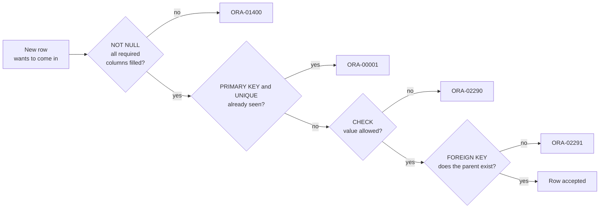
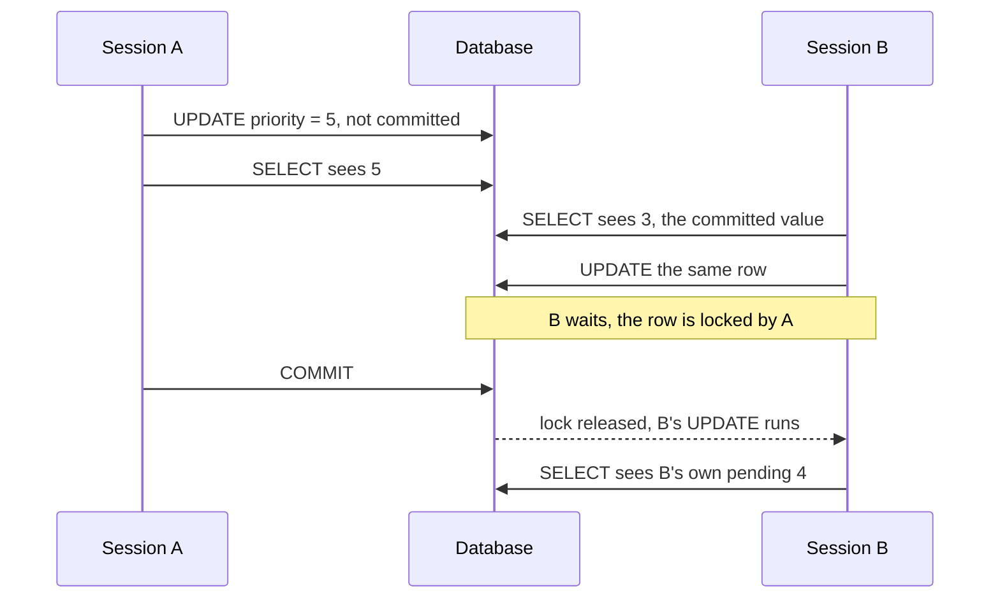

# Creating tables and changing data

So far you have only looked at data. This page is about changing it: building new tables, adding rows, fixing rows and removing rows. These are the commands that can hurt, so the page also teaches the safety net: transactions. Every example works on tables with the prefix `BX_` that we create ourselves. We never touch the five FAB_LAB tables. At the end there is a clean-up step that removes everything we made.

**By the end of this page you can:**

- create a table with data types and constraints
- add rows with `INSERT` (one row, with a column list, and from a query)
- change rows with `UPDATE` and remove them with `DELETE`, and say why `WHERE` matters
- explain the difference between `DELETE`, `TRUNCATE` and `DROP`
- use `COMMIT`, `ROLLBACK` and `SAVEPOINT`
- explain why a second session cannot see your uncommitted change
- create a simple view

## The analogy: a notebook, pencil and ink

Imagine a notebook that the whole team shares. When you want to change an entry, you first write it in **pencil**. You can see your pencil notes. Nobody else can. If you change your mind, you rub them out. When you are happy, you go over the pencil in **ink**, and from that moment everybody sees the change and it cannot be rubbed out.

| In the notebook | In Oracle | Command |
| --- | --- | --- |
| Writing in pencil | Making a change that is not final yet | `INSERT`, `UPDATE`, `DELETE` |
| Going over it in ink | Making the change permanent and visible to everyone | `COMMIT` |
| Rubbing out your pencil notes | Throwing away everything since the last ink | `ROLLBACK` |
| Putting a bookmark in the notebook | A named point you can go back to without losing earlier pencil work | `SAVEPOINT` |

The pencil-and-ink period is called a **transaction**. It starts with your first change and ends at `COMMIT` or `ROLLBACK`.

The analogy stops in one place: in a real notebook you can rub out only what you wrote. In Oracle, a `ROLLBACK` throws away *all* your pending changes since the last `COMMIT`, unless you use a `SAVEPOINT` to say how far back to go.



## The mental map, a little bigger

Everything up to now was a question: kitchen order `FROM`, `WHERE`, `SELECT`, `ORDER BY`, plus `JOIN`, `GROUP BY` and `HAVING`. This page adds the other kind of statement.



- **DML** means *data manipulation language*: it changes rows. It waits for your `COMMIT`.
- **DDL** means *data definition language*: it changes the structure, such as creating or dropping a table. It commits by itself, the moment it runs.

That one difference, "DML waits, DDL commits at once", explains most surprises on this page.

## CREATE TABLE: build a new shelf

A table is a name, a list of columns, and a data type for each one. These are the types you will use most.

| Type | Holds | Example |
| --- | --- | --- |
| `NUMBER(p)` or `NUMBER(p,s)` | A number with `p` digits in total and `s` after the decimal point | `NUMBER(8,2)` holds 123456.78 |
| `VARCHAR2(n)` | Text up to `n` bytes | `VARCHAR2(12)` |
| `DATE` | A date **and** a time to the second | `DATE '2026-10-12'` |
| `TIMESTAMP` | A date and a time with fractions of a second | `SYSTIMESTAMP` |

### Constraints: the bouncers at the door

A **constraint** is a rule written into the table. Every row that tries to get in is stopped at the door if it breaks a rule. This is much safer than hoping every program remembers to check.



The order of the bouncers in the picture is for reading. Oracle may check them in a different order, but a row has to pass all of them.

| Constraint | Rule | Plain meaning |
| --- | --- | --- |
| `NOT NULL` | The column must have a value | "You cannot leave this box blank" |
| `PRIMARY KEY` | Unique and not null | "A ticket number: no two rows share it" |
| `UNIQUE` | No two rows share the value | "No two products may have the same code" |
| `CHECK` | The value must pass a test | "Status must be one of these four words" |
| `FOREIGN KEY` | The value must exist in another table's key | "The product you name must really exist" |

We build a small copy of the fab idea, two tables joined by a foreign key, plus a log table with an automatic id. Run this block as `FAB_LAB`. In DBeaver use **Execute Script** (`Alt + X`) so all statements run.

```sql
CREATE TABLE bx_products (
  product_id     NUMBER(4)     CONSTRAINT bx_products_pk PRIMARY KEY,
  product_code   VARCHAR2(12)  NOT NULL CONSTRAINT bx_products_code_uk UNIQUE,
  target_thk_nm  NUMBER(8,2)   NOT NULL CONSTRAINT bx_products_thk_ck CHECK (target_thk_nm > 0)
);

CREATE TABLE bx_lots (
  lot_id      VARCHAR2(12)  CONSTRAINT bx_lots_pk PRIMARY KEY,
  product_id  NUMBER(4)     NOT NULL CONSTRAINT bx_lots_product_fk REFERENCES bx_products (product_id),
  status      VARCHAR2(8)   DEFAULT 'ACTIVE' NOT NULL
                            CONSTRAINT bx_lots_status_ck CHECK (status IN ('ACTIVE','HOLD','SHIPPED','SCRAPPED')),
  priority    NUMBER(1)     DEFAULT 3 CONSTRAINT bx_lots_prio_ck CHECK (priority BETWEEN 1 AND 5),
  start_date  DATE          DEFAULT SYSDATE,
  created_at  TIMESTAMP     DEFAULT SYSTIMESTAMP
);

CREATE TABLE bx_events (
  event_id   NUMBER GENERATED ALWAYS AS IDENTITY CONSTRAINT bx_events_pk PRIMARY KEY,
  lot_id     VARCHAR2(12)  NOT NULL,
  note       VARCHAR2(100),
  logged_at  TIMESTAMP     DEFAULT SYSTIMESTAMP
);
```

<!--gen-->
```text

```

No output means success. (In DBeaver you see "Updated Rows: 0" for each statement.) Three things in that script are worth reading slowly:

- **`CONSTRAINT bx_lots_pk PRIMARY KEY`** gives the rule a name. If you skip the name, Oracle makes up an ugly one like `SYS_C0012345`, and your error messages become harder to read.
- **`DEFAULT 'ACTIVE'`** is what the column gets when the `INSERT` does not mention it.
- **`GENERATED ALWAYS AS IDENTITY`** makes Oracle fill `event_id` with 1, 2, 3 and so on. You never supply it. Older Oracle code does the same job with a **sequence** (a number counter object, `CREATE SEQUENCE`) and `seq_name.NEXTVAL` in the `INSERT`. You will see both.

Let Oracle list the rules it now enforces:

```sql
SELECT CAST(table_name AS VARCHAR2(12))      AS tbl,
       CAST(constraint_name AS VARCHAR2(20)) AS constraint_name,
       constraint_type                AS typ
FROM   user_constraints
WHERE  table_name LIKE 'BX\_%' ESCAPE '\'
AND    constraint_name NOT LIKE 'SYS\_%' ESCAPE '\'
ORDER  BY table_name, constraint_name;
```

<!--gen-->
```text
TBL          CONSTRAINT_NAME      T
------------ -------------------- -
BX_EVENTS    BX_EVENTS_PK         P
BX_LOTS      BX_LOTS_PK           P
BX_LOTS      BX_LOTS_PRIO_CK      C
BX_LOTS      BX_LOTS_PRODUCT_FK   R
BX_LOTS      BX_LOTS_STATUS_CK    C
BX_PRODUCTS  BX_PRODUCTS_CODE_UK  U
BX_PRODUCTS  BX_PRODUCTS_PK       P
BX_PRODUCTS  BX_PRODUCTS_THK_CK   C
```

The type letter means: `P` primary key, `U` unique, `C` check (and `NOT NULL`), `R` foreign key (R for "referential"). `NOT NULL` rules are also constraints (type `C`). We left them unnamed, so Oracle named them `SYS_C...` and the query above hides them.

## INSERT: add rows

`INSERT` adds a row. The safe style is to name the columns, so the statement still works if someone adds a column to the table later.

First we put parents in. This uses `INSERT ... SELECT`, which adds every row a query returns. It is the quickest way to copy data from one table to another.

```sql
INSERT INTO bx_products (product_id, product_code, target_thk_nm)
SELECT product_id, product_code, target_thk_nm
FROM   products;

COMMIT;

SELECT product_id, product_code, target_thk_nm FROM bx_products ORDER BY product_id;
```

<!--gen-->
```text
PRODUCT_ID PRODUCT_CODE TARGET_THK_NM
---------- ------------ -------------
         1 FD-300                  12
         2 RF-300                  75
         3 PWR-200               1500
         4 PHO-300                220
         5 SIC-150                500
```

We ended with `COMMIT` so these five rows stay for the following examples. Now single-row inserts into `bx_lots`, one with every column named, one that leaves out the columns that have defaults:

```sql
INSERT INTO bx_lots (lot_id, product_id, status, priority)
VALUES ('BX-001', 1, 'HOLD', 1);

INSERT INTO bx_lots (lot_id, product_id)
VALUES ('BX-002', 2);

SELECT lot_id, product_id, status, priority FROM bx_lots ORDER BY lot_id;
```

<!--gen-->
```text
LOT_ID     PRODUCT_ID STATUS     PRIORITY
---------- ---------- -------- ----------
BX-001              1 HOLD              1
BX-002              2 ACTIVE            3
```

`BX-002` got `ACTIVE` and priority 3 from the defaults. Text goes in single quotes, numbers do not.

An identity column is filled in for you. If you try to supply the value yourself, Oracle refuses (that error is the teaching point):

```sql
INSERT INTO bx_events (lot_id, note) VALUES ('BX-001', 'placed on hold');
INSERT INTO bx_events (lot_id, note) VALUES ('BX-002', 'created');
INSERT INTO bx_events (event_id, lot_id, note) VALUES (99, 'BX-002', 'I choose the id');

SELECT event_id, lot_id, note FROM bx_events ORDER BY event_id;
```

<!--gen-->
```text
INSERT INTO bx_events (event_id, lot_id, note) VALUES (99, 'BX-002', 'I choose the id')
                       *
ERROR at line 1:
ORA-32795: cannot insert into a generated always identity column

  EVENT_ID LOT_ID     NOTE
---------- ---------- ----------------------------------------------------------------------------------------------------
         1 BX-001     placed on hold
         2 BX-002     created
```

The first two rows got ids 1 and 2 on their own. The third failed with `ORA-32795`, because `GENERATED ALWAYS` means "only Oracle chooses".

## The bouncers at work: breaking every rule on purpose

The best way to understand a constraint is to meet its error message. First put one valid lot in permanently, then try four bad rows. Every failure leaves the table unchanged.

```sql
INSERT INTO bx_lots (lot_id, product_id) VALUES ('BX-010', 1);
COMMIT;

-- 1. Same primary key again
INSERT INTO bx_lots (lot_id, product_id) VALUES ('BX-010', 2);

-- 2. A status that is not on the allowed list
INSERT INTO bx_lots (lot_id, product_id, status) VALUES ('BX-011', 1, 'BROKEN');

-- 3. A product that does not exist
INSERT INTO bx_lots (lot_id, product_id) VALUES ('BX-012', 99);

-- 4. A required column left empty
INSERT INTO bx_lots (lot_id, product_id) VALUES ('BX-013', NULL);
```

<!--gen-->
```text
INSERT INTO bx_lots (lot_id, product_id) VALUES ('BX-010', 2)
*
ERROR at line 1:
ORA-00001: unique constraint (FAB_LAB.BX_LOTS_PK) violated

INSERT INTO bx_lots (lot_id, product_id, status) VALUES ('BX-011', 1, 'BROKEN')
*
ERROR at line 1:
ORA-02290: check constraint (FAB_LAB.BX_LOTS_STATUS_CK) violated

INSERT INTO bx_lots (lot_id, product_id) VALUES ('BX-012', 99)
*
ERROR at line 1:
ORA-02291: integrity constraint (FAB_LAB.BX_LOTS_PRODUCT_FK) violated - parent key not found

INSERT INTO bx_lots (lot_id, product_id) VALUES ('BX-013', NULL)
                                                           *
ERROR at line 1:
ORA-01400: cannot insert NULL into ("FAB_LAB"."BX_LOTS"."PRODUCT_ID")
```

Read each message from the bottom up:

| Error | Bouncer | What it says |
| --- | --- | --- |
| `ORA-00001: unique constraint (FAB_LAB.BX_LOTS_PK) violated` | primary key or unique | That lot id is taken. The name in brackets tells you which rule. |
| `ORA-02290: check constraint (FAB_LAB.BX_LOTS_STATUS_CK) violated` | check | `BROKEN` is not an allowed status. |
| `ORA-02291: integrity constraint (FAB_LAB.BX_LOTS_PRODUCT_FK) violated - parent key not found` | foreign key | Product 99 does not exist. |
| `ORA-01400: cannot insert NULL into ("FAB_LAB"."BX_LOTS"."PRODUCT_ID")` | not null | A required column has no value. |

The foreign key also protects in the other direction. You cannot delete a parent that still has children:

```sql
DELETE FROM bx_products WHERE product_id = 1;
```

<!--gen-->
```text
DELETE FROM bx_products WHERE product_id = 1
*
ERROR at line 1:
ORA-02292: integrity constraint (FAB_LAB.BX_LOTS_PRODUCT_FK) violated - child record found
```

`ORA-02292` says "child record found": lot `BX-010` still points at product 1. Think of the rule on a library card index: you cannot throw away the card for an author while books by that author are still on the shelf.

## UPDATE: change rows

`UPDATE` changes the values in rows you select with `WHERE`. For these exercises we make our own copy of the real `LOTS` table with `CREATE TABLE ... AS SELECT`. It copies the columns, the rows and the `NOT NULL` rules. It does not copy primary keys, foreign keys or check constraints.

```sql
CREATE TABLE bx_lots_copy AS SELECT * FROM lots;

SELECT COUNT(*) AS rows_in_copy FROM bx_lots_copy;
```

<!--gen-->
```text
ROWS_IN_COPY
------------
          16
```

Now Maya says: "Lot L26-005 is released from hold. Put it back to ACTIVE and clear the reason."

```sql
UPDATE bx_lots_copy
SET    status = 'ACTIVE',
       hold_reason = NULL
WHERE  lot_id = 'L26-005';

SELECT lot_id, status, hold_reason FROM bx_lots_copy WHERE lot_id = 'L26-005';
```

<!--gen-->
```text
LOT_ID     STATUS   HOLD_REASON
---------- -------- --------------------------------
L26-005    ACTIVE
```

One row was changed because the `WHERE` named one lot. The change is pending: it is in pencil. (The tool that produced this page rolls it back at the end of the block.)

### The danger of forgetting WHERE

`UPDATE` without `WHERE` changes **every row**. The database does exactly what you typed. This is why we practise on a copy.

```sql
UPDATE bx_lots_copy SET status = 'SCRAPPED';

SELECT status, COUNT(*) AS lots FROM bx_lots_copy GROUP BY status;
```

<!--gen-->
```text
STATUS         LOTS
-------- ----------
SCRAPPED         16
```

All sixteen lots are now scrapped, shipped ones included. Now the safety net:

```sql
UPDATE bx_lots_copy SET status = 'SCRAPPED';
ROLLBACK;

SELECT status, COUNT(*) AS lots FROM bx_lots_copy GROUP BY status ORDER BY status;
```

<!--gen-->
```text
STATUS         LOTS
-------- ----------
ACTIVE            8
HOLD              2
SCRAPPED          1
SHIPPED           5
```

`ROLLBACK` rubbed out the pencil, and the statuses are back. This is only possible because nothing was committed. After a `COMMIT`, it is too late.

> **Habit worth building:** before you run an `UPDATE` or `DELETE`, run the same `WHERE` in a `SELECT` and check the rows it finds. If the count surprises you, stop.

## DELETE, TRUNCATE and DROP

Three ways to get rid of things, from gentle to final. Picture the shared notebook again.

| Command | In the notebook | Can you roll it back? | Kind |
| --- | --- | --- | --- |
| `DELETE FROM t WHERE ...` | Rub out some entries (or all, if you leave out `WHERE`) | Yes, until you commit | DML |
| `TRUNCATE TABLE t` | Tear out every page but keep the empty notebook | No, it commits | DDL |
| `DROP TABLE t` | Throw the whole notebook away | No, it commits | DDL |

`DELETE` is the careful one: it removes rows one by one and remembers how to undo them. `TRUNCATE` is quick on big tables because it does not keep that undo information, and the price is that it is final. `DROP` removes the table, its rows, its columns and its rules.

```sql
CREATE TABLE bx_scratch AS SELECT * FROM lots;

DELETE FROM bx_scratch WHERE status = 'SCRAPPED';
SELECT COUNT(*) AS after_delete FROM bx_scratch;

ROLLBACK;
SELECT COUNT(*) AS after_rollback FROM bx_scratch;

TRUNCATE TABLE bx_scratch;
ROLLBACK;
SELECT COUNT(*) AS after_truncate_and_rollback FROM bx_scratch;
```

<!--gen-->
```text
AFTER_DELETE
------------
          15

AFTER_ROLLBACK
--------------
            16

AFTER_TRUNCATE_AND_ROLLBACK
---------------------------
                          0
```

The `DELETE` was undone, the `TRUNCATE` was not. The `ROLLBACK` after `TRUNCATE` had nothing to roll back, because `TRUNCATE` had already committed.

```sql
DROP TABLE bx_scratch PURGE;

SELECT COUNT(*) FROM bx_scratch;
```

<!--gen-->
```text
SELECT COUNT(*) FROM bx_scratch
                     *
ERROR at line 1:
ORA-00942: table or view does not exist
```

`ORA-00942: table or view does not exist` is the teaching point: the table is gone. Without `PURGE`, Oracle 19c moves a dropped table to a **recycle bin** first, so a mistake can be undone with `FLASHBACK TABLE ... TO BEFORE DROP`. `PURGE` skips the bin.

## MERGE: update if it exists, insert if it does not

Sometimes the incoming data holds both new rows and changes to existing rows. `MERGE` handles both in one statement. It compares each incoming row with the table using a join condition. A match is updated, a non-match is inserted.

Maya says: "Here are two lots. L26-001 is an old lot that now gets priority 1. L26-100 is new."

```sql
MERGE INTO bx_lots_copy t
USING (SELECT 'L26-001' AS lot_id, 1 AS priority FROM dual
       UNION ALL
       SELECT 'L26-100', 2 FROM dual) s
ON    (t.lot_id = s.lot_id)
WHEN MATCHED THEN
  UPDATE SET t.priority = s.priority
WHEN NOT MATCHED THEN
  INSERT (lot_id, product_id, lot_type, start_date, status, priority)
  VALUES (s.lot_id, 1, 'PROD', DATE '2026-10-12', 'ACTIVE', s.priority);

SELECT lot_id, product_id, status, priority
FROM   bx_lots_copy
WHERE  lot_id IN ('L26-001', 'L26-100')
ORDER  BY lot_id;
```

<!--gen-->
```text
LOT_ID     PRODUCT_ID STATUS     PRIORITY
---------- ---------- -------- ----------
L26-001             1 SHIPPED           1
L26-100             1 ACTIVE            2
```

The old lot changed its priority and the new lot was added. The `INSERT` lists all the `NOT NULL` columns, because the copy kept those rules.

## COMMIT, ROLLBACK and SAVEPOINT in one picture

A `SAVEPOINT` is a bookmark inside a transaction. `ROLLBACK TO name` goes back to the bookmark and keeps everything before it.

```sql
INSERT INTO bx_lots (lot_id, product_id) VALUES ('BX-020', 1);
SAVEPOINT after_first;

INSERT INTO bx_lots (lot_id, product_id) VALUES ('BX-021', 2);
INSERT INTO bx_lots (lot_id, product_id) VALUES ('BX-022', 2);
SELECT lot_id FROM bx_lots WHERE lot_id LIKE 'BX-02%' ORDER BY lot_id;

ROLLBACK TO after_first;
SELECT lot_id FROM bx_lots WHERE lot_id LIKE 'BX-02%' ORDER BY lot_id;

COMMIT;
SELECT lot_id FROM bx_lots WHERE lot_id LIKE 'BX-02%' ORDER BY lot_id;
```

<!--gen-->
```text
LOT_ID
----------
BX-020
BX-021
BX-022

LOT_ID
----------
BX-020

LOT_ID
----------
BX-020
```

Step by step: three lots were pending, `ROLLBACK TO after_first` removed the last two, and the `COMMIT` made `BX-020` permanent. The clean-up at the bottom removes it.

### DDL commits for you

Remember: DDL commits implicitly. Watch what happens when a `CREATE TABLE` sits in the middle of a transaction:

```sql
INSERT INTO bx_lots (lot_id, product_id) VALUES ('BX-030', 1);

CREATE TABLE bx_tiny (x NUMBER);

ROLLBACK;

SELECT lot_id FROM bx_lots WHERE lot_id = 'BX-030';
```

<!--gen-->
```text
LOT_ID
----------
BX-030
```

You asked for a rollback, and `BX-030` is still there. The `CREATE TABLE` committed the pending insert first. Treat DDL as a built-in `COMMIT`.

### DBeaver and auto-commit

DBeaver starts in **Auto-Commit** mode: it sends a `COMMIT` after every statement. In that mode a `ROLLBACK` has nothing to undo, and the examples above would behave differently from what you read here. Before any practice that uses `ROLLBACK`, switch to manual mode:

1. Open a SQL editor on the `fab-lab` connection.
2. In the main toolbar, find the **transaction mode** button. It shows **Auto** when auto-commit is on. Click it and choose **Manual Commit**.
3. The toolbar now shows **Commit** and **Rollback** buttons and a counter of pending statements.

The Commit and Rollback buttons do the same as the statements. Switch back to Auto when you are done with the exercise, or you will wonder why a change "has not saved" when you open a second tab.

## Two sessions: why other people do not see your pencil

Oracle gives every reader a consistent view of the data. Your uncommitted change is visible only to you. Anyone else reading the same row sees the last committed (inked) value. This is called **read consistency**, and it means nobody ever sees a half-finished change.

You can see it for yourself with two DBeaver tabs. This is the experiment, written for the table `bx_lots_copy` that we already created:

1. Put DBeaver in **Manual Commit** mode, as above.
2. Open **two separate SQL editors** on the `fab-lab` connection. Name them tab A and tab B. Each tab must be a real, separate session. In the connection settings, look for the option **Open separate connection for each editor** and make sure it is ticked. It is usually on by default, but check.
3. **Tab A:** run `UPDATE bx_lots_copy SET priority = 5 WHERE lot_id = 'L26-001';` Do not commit.
4. **Tab A:** run `SELECT lot_id, priority FROM bx_lots_copy WHERE lot_id = 'L26-001';` It shows priority 5.
5. **Tab B:** run the same `SELECT`. It shows the old value, 3. Tab A's change is still in pencil.
6. **Tab B:** run `UPDATE bx_lots_copy SET priority = 4 WHERE lot_id = 'L26-001';` The statement does not finish. Tab B is **waiting**, because Tab A holds a lock on that row.
7. **Tab A:** click **Commit**. Tab B's update now completes.
8. **Tab B:** click **Rollback** to leave the data alone, and **Tab A** does the same for any other pending work.



We ran the same steps from two SQL\*Plus windows to check the claims above: Session B read 3 while A's change was pending, and B's `UPDATE` waited about as long as A took to commit, then went through. Reading never waits in Oracle. Only two sessions trying to *change the same row* do.

## A simple view

A **view** is a saved query with a name. It stores no rows of its own. Each time you read it, the query runs against the current data. Think of a window cut into a wall: the view is the window, the table is the room.

Maya says: "I look at held lots all day. Can I have a shortcut?"

```sql
CREATE OR REPLACE VIEW bx_hold_lots_v AS
SELECT lot_id, status, hold_reason
FROM   bx_lots_copy
WHERE  status = 'HOLD';

SELECT * FROM bx_hold_lots_v;
```

<!--gen-->
```text
LOT_ID     STATUS   HOLD_REASON
---------- -------- --------------------------------
L26-003B   HOLD     Thickness out of spec at FINAL
L26-005    HOLD
```

Now change the table and read the view again. The view follows:

```sql
UPDATE bx_lots_copy SET status = 'HOLD', hold_reason = 'Particle check' WHERE lot_id = 'L26-010';

SELECT * FROM bx_hold_lots_v ORDER BY lot_id;
```

<!--gen-->
```text
LOT_ID     STATUS   HOLD_REASON
---------- -------- --------------------------------
L26-003B   HOLD     Thickness out of spec at FINAL
L26-005    HOLD
L26-010    HOLD     Particle check
```

`L26-010` appears in the view the moment the table row changes, even before a commit, because it is the same session that made the change. Another session would see it only after the commit.

## Clean up: leave nothing behind

Every table we made starts with `BX_`. Drop them in the order that respects the foreign key: the child before the parent (or use `CASCADE CONSTRAINTS`). `PURGE` skips the recycle bin.

```sql
DROP VIEW bx_hold_lots_v;
DROP TABLE bx_events PURGE;
DROP TABLE bx_lots PURGE;
DROP TABLE bx_products PURGE;
DROP TABLE bx_lots_copy PURGE;
DROP TABLE bx_tiny PURGE;

SELECT table_name FROM user_tables WHERE table_name LIKE 'BX\_%' ESCAPE '\';
```

<!--gen-->
```text

```

An empty result means everything is gone. If you ever forget which `BX_` objects exist, `SELECT object_name, object_type FROM user_objects WHERE object_name LIKE 'BX\_%' ESCAPE '\';` lists them. Your five original tables were never touched.

## Common mistakes

- **`UPDATE` or `DELETE` without `WHERE`.** It affects every row. Check the `WHERE` with a `SELECT` first, and work on a copy when you are learning.
- **Expecting `ROLLBACK` to undo a `TRUNCATE`, `DROP` or `CREATE`.** DDL commits by itself. Nothing is left to roll back.
- **Forgetting to `COMMIT` and walking away.** Your change is pencil. Other people cannot see it, and it may hold a lock that makes their updates wait.
- **Working in auto-commit and expecting `ROLLBACK` to help.** In auto-commit mode DBeaver commits every statement. Switch to manual mode first.
- **`INSERT` without a column list.** It works until someone adds a column, then it fails. Name the columns.
- **Putting a number in quotes or text without quotes.** Numbers have no quotes. Text and `DATE '...'` literals do.
- **Dropping the parent table first.** A foreign key blocks it. Drop children first.

## Check your understanding

1. In the notebook analogy, what are pencil and ink in Oracle?
2. You ran an `INSERT`, then a `CREATE TABLE`, then `ROLLBACK`. Is the inserted row still there?
3. Name the difference between `DELETE FROM t` and `TRUNCATE TABLE t`.
4. Which error tells you a `CHECK` constraint was broken, and which one tells you a parent row is missing?

<details>
<summary>Answers</summary>

1. Pencil is a change before `COMMIT`. Only your session sees it. Ink is a committed change that everyone sees.
2. Yes. `CREATE TABLE` is DDL and commits the pending insert first, so the `ROLLBACK` has nothing left to undo.
3. `DELETE` is DML: it can be rolled back and can use a `WHERE`. `TRUNCATE` removes all rows at once, commits immediately and cannot be rolled back.
4. `ORA-02290` is a check constraint violation. `ORA-02291` is a foreign key violation with the parent key not found.

</details>

## Further reading

- [Oracle Database 19c SQL Language Reference: CREATE TABLE](https://docs.oracle.com/en/database/oracle/oracle-database/19/sqlrf/CREATE-TABLE.html)
- [Oracle Database 19c SQL Language Reference: INSERT](https://docs.oracle.com/en/database/oracle/oracle-database/19/sqlrf/INSERT.html)
- [Oracle Database 19c SQL Language Reference: UPDATE](https://docs.oracle.com/en/database/oracle/oracle-database/19/sqlrf/UPDATE.html)
- [Oracle Database 19c SQL Language Reference: MERGE](https://docs.oracle.com/en/database/oracle/oracle-database/19/sqlrf/MERGE.html)
- [Oracle Database 19c SQL Language Reference: COMMIT](https://docs.oracle.com/en/database/oracle/oracle-database/19/sqlrf/COMMIT.html)
- [Oracle Database 19c SQL Language Reference: CREATE VIEW](https://docs.oracle.com/en/database/oracle/oracle-database/19/sqlrf/CREATE-VIEW.html)
