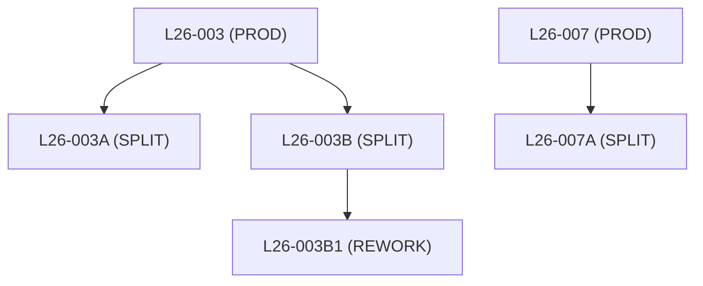

# Trees: hierarchical queries

Some tables point at themselves. In FAB_LAB, a lot that was split or reworked stores the lot it came from in `parent_lot_id`. Maya's questions about those lots ("where did this lot come from?", "which lots belong to L26-003?") cannot be answered with one join, because nobody knows in advance how many generations there are. Oracle has a clause for this, `CONNECT BY`, and standard SQL has a second way, the recursive `WITH`.

Want to see it move first? Open the animated page: [05-trees.html](../tutorials/05-trees.html). It walks a tree one step at a time.

**By the end of this page you can:**

- read a self-referencing table as a family tree
- write a query with `START WITH` and `CONNECT BY PRIOR` and indent the result with `LEVEL`
- show the full path, the root and the leaves of every row
- sort children under their parents with `ORDER SIBLINGS BY`
- walk up from a child to its ancestors
- explain why a condition in `WHERE` and the same condition in `CONNECT BY` give different results
- stop a loop in bad data with `NOCYCLE`
- write the same walk as a recursive `WITH`, with `SEARCH DEPTH FIRST` and `CYCLE`

## The question this answers

Lot L26-003B1 is on hold and Maya asks two things. Where did it come from? And if its source lot is bad, which other lots came from the same source? The first needs the parent, then the parent's parent, up to the original lot. The second needs the children, then their children, down to the last one. A join finds one step. Join `lots` to itself twice and you see grandparents, but nobody knows how many generations a family has, and a fixed number of joins either misses deep lots or has more joins than needed. A hierarchical query repeats the single step for as many generations as there are.

## The analogy: a family tree

Imagine a family written down as a list. Each person has one line that says only who their parent is. Gran has no parent. The lines are in no particular order.

| Person | Parent | Lives |
|---|---|---|
| Cousin | Uncle | at home |
| Gran | nobody | at home |
| Uncle | Gran | abroad |
| Mum | Gran | at home |

The list never says "Gran has children Mum and Uncle". To find someone's children you must search the list for lines whose parent is that person. A hierarchical query repeats that one search over and over.

- Walking down: "who comes from Gran?" Start at Gran, find her children (Mum, Uncle), then their children (Cousin), and stop when a search finds nobody new. Counting generations: Gran 1, Mum 2, Uncle 2, Cousin 3. This is `CONNECT BY PRIOR id = parent`.
- Walking up: "where does Cousin come from?" Start at Cousin, read the parent (Uncle), then Uncle's parent (Gran), and stop when the parent is blank. Same clause, sides swapped.
- Leaving someone out: "list Gran's family, but not people living abroad". If you write the whole family first and cross out Uncle, Cousin is still on the list. If you refuse to step onto Uncle while searching, you never find Cousin. The first is `WHERE`, the second is a condition inside `CONNECT BY`.

**Where the picture breaks.**

- You would notice at once if the list said Gran's parent is Cousin. Oracle only notices when it walks into the loop, and then stops with `ORA-01436`. `NOCYCLE` makes it skip the repeated row.
- Each line has one parent box, so this is a tree and not a real family. A lot made by merging two lots cannot be stored in one `parent_lot_id`.

## What Oracle actually does

1. Evaluate `FROM` and any joins first.
2. `START WITH` picks the root rows, which are `LEVEL` 1. Without it every row is a root.
3. Find the children of the row you are on. `PRIOR` marks the row you are standing on, so `PRIOR lot_id = parent_lot_id` reads "a row is a child if its `parent_lot_id` equals the `lot_id` of the row I am on". Each child is `LEVEL` + 1.
4. Go depth first: return a row, walk down into its children, and only then take the next sibling.
5. A branch stops when the test finds no child. A condition inside `CONNECT BY` also stops a branch: a row that fails it is never visited, and nothing below it is reached.
6. `WHERE` is applied last, to the rows the walk produced. It hides rows but cannot stop the walk.
7. A normal `ORDER BY` loses the tree order. `ORDER SIBLINGS BY` sorts brothers and sisters and keeps every child under its parent.

The recursive `WITH` reaches the same rows differently: it runs the anchor once, then runs the recursive query on what the previous round found, one generation at a time, until a round finds nothing. That is breadth first.

| In Oracle | In the family list |
|---|---|
| `parent_lot_id` | the "Parent" column |
| `START WITH` | the person you start from |
| `CONNECT BY PRIOR lot_id = parent_lot_id` | find the children of the person I am on (down) |
| `CONNECT BY lot_id = PRIOR parent_lot_id` | go to the person named as my parent (up) |
| `LEVEL` | the generation |
| `WHERE` on a hierarchical query | crossing a name off the finished list |
| condition inside `CONNECT BY` | refusing to step onto that person |

The picture below follows the lots and the sessions.



## The data

Only four lots have a parent.

```sql
SELECT lot_id, parent_lot_id
FROM   lots
WHERE  parent_lot_id IS NOT NULL
ORDER  BY lot_id;
```

```text
LOT_ID     PARENT_LOT
---------- ----------
L26-003A   L26-003
L26-003B   L26-003
L26-003B1  L26-003B
L26-007A   L26-007
```

L26-003B1 points at L26-003B, which points at L26-003. That is two jumps, and a plain self-join would need one join per jump. With a tree of unknown depth you would never know how many to write.

## The basic form

```text
SELECT ...
FROM   table
START  WITH  <which rows are the roots>
CONNECT BY PRIOR <parent's key> = <child's pointer to its parent>
```

`START WITH` picks the people at the top of the walk. `CONNECT BY PRIOR lot_id = parent_lot_id` says how to go down one step: "the next row is one whose `parent_lot_id` equals the `lot_id` of the row I am standing on". `PRIOR` marks the column that belongs to the row you are standing on (the parent). `LEVEL` is a pseudocolumn that counts the generation: 1 for a root, 2 for its children, and so on.

Maya: "Show me every lot with its generation."

```sql
SELECT LEVEL AS lvl, lot_id, status
FROM   lots
START  WITH parent_lot_id IS NULL
CONNECT BY PRIOR lot_id = parent_lot_id;
```

```text
       LVL LOT_ID     STATUS
---------- ---------- --------
         1 L26-001    SHIPPED
         1 L26-002    SHIPPED
         1 L26-003    ACTIVE
         2 L26-003A   SHIPPED
         2 L26-003B   HOLD
         3 L26-003B1  ACTIVE
         1 L26-004    SHIPPED
         1 L26-005    HOLD
         1 L26-006    SHIPPED
         1 L26-007    ACTIVE
         2 L26-007A   ACTIVE
         1 L26-008    SCRAPPED
         1 L26-009    ACTIVE
         1 L26-010    ACTIVE
         1 L26-011    ACTIVE
         1 L26-012    ACTIVE
```

All 16 lots appear, because all 16 are either a root or below one. Each family is listed together: L26-003 comes first, then its children, then its grandchild.

### Indent it so it looks like a tree

`LPAD(' ', 2 * (LEVEL - 1))` makes two spaces per generation. Putting it in front of the lot id draws the tree. `ORDER SIBLINGS BY` sorts the children of each parent, and keeps every child under its own parent.

```sql
SELECT LEVEL AS lvl,
       LPAD(' ', 2 * (LEVEL - 1)) || lot_id AS lot_tree,
       lot_type, status
FROM   lots
START  WITH parent_lot_id IS NULL
CONNECT BY PRIOR lot_id = parent_lot_id
ORDER  SIBLINGS BY lot_id;
```

```text
       LVL LOT_TREE               LOT_TYPE STATUS
---------- ---------------------- -------- --------
         1 L26-001                PROD     SHIPPED
         1 L26-002                PROD     SHIPPED
         1 L26-003                PROD     ACTIVE
         2   L26-003A             SPLIT    SHIPPED
         2   L26-003B             SPLIT    HOLD
         3     L26-003B1          REWORK   ACTIVE
         1 L26-004                PROD     SHIPPED
         1 L26-005                PROD     HOLD
         1 L26-006                PROD     SHIPPED
         1 L26-007                PROD     ACTIVE
         2   L26-007A             SPLIT    ACTIVE
         1 L26-008                PROD     SCRAPPED
         1 L26-009                PROD     ACTIVE
         1 L26-010                PROD     ACTIVE
         1 L26-011                PROD     ACTIVE
         1 L26-012                PROD     ACTIVE
```

DBeaver's grid may trim leading spaces, so the indent shows more clearly in the text view of the results panel. The LEVEL column carries the same information either way.

### Start at one person only

Maya: "Only the L26-003 family, please." Change `START WITH` to name the one root.

```sql
SELECT LEVEL AS lvl,
       LPAD(' ', 2 * (LEVEL - 1)) || lot_id AS lot_tree,
       lot_type
FROM   lots
START  WITH lot_id = 'L26-003'
CONNECT BY PRIOR lot_id = parent_lot_id
ORDER  SIBLINGS BY lot_id;
```

```text
       LVL LOT_TREE               LOT_TYPE
---------- ---------------------- --------
         1 L26-003                PROD
         2   L26-003A             SPLIT
         2   L26-003B             SPLIT
         3     L26-003B1          REWORK
```

### A plain ORDER BY breaks the tree

`ORDER BY` sorts the finished list and ignores the family structure. Here it sorts by lot id, largest first.

```sql
SELECT LEVEL AS lvl, LPAD(' ', 2 * (LEVEL - 1)) || lot_id AS lot_tree
FROM   lots
START  WITH parent_lot_id IS NULL
CONNECT BY PRIOR lot_id = parent_lot_id
ORDER  BY lot_id DESC;
```

```text
       LVL LOT_TREE
---------- ----------------------
         1 L26-012
         1 L26-011
         1 L26-010
         1 L26-009
         1 L26-008
         2   L26-007A
         1 L26-007
         1 L26-006
         1 L26-005
         1 L26-004
         3     L26-003B1
         2   L26-003B
         2   L26-003A
         1 L26-003
         1 L26-002
         1 L26-001
```

The children now stand above their parents. Use `ORDER SIBLINGS BY` when you want the tree shape. Use a plain `ORDER BY` when you want a flat list and do not care about the shape.

## Path, root and leaf

Three more tools tell you where a row sits.

- `SYS_CONNECT_BY_PATH(column, separator)` joins the values from the root down to the current row, with the separator in front of each one.
- `CONNECT_BY_ROOT column` gives the value of that column in the root row of the current row's tree.
- `CONNECT_BY_ISLEAF` is 1 when the row has no children, otherwise 0.

```sql
SELECT lot_id,
       LTRIM(SYS_CONNECT_BY_PATH(lot_id, '/'), '/') AS path,
       CONNECT_BY_ROOT lot_id AS root_lot,
       CONNECT_BY_ISLEAF AS is_leaf
FROM   lots
START  WITH parent_lot_id IS NULL
CONNECT BY PRIOR lot_id = parent_lot_id
ORDER  SIBLINGS BY lot_id;
```

```text
LOT_ID     PATH                                     ROOT_LOT        IS_LEAF
---------- ---------------------------------------- ------------ ----------
L26-001    L26-001                                  L26-001               1
L26-002    L26-002                                  L26-002               1
L26-003    L26-003                                  L26-003               0
L26-003A   L26-003/L26-003A                         L26-003               1
L26-003B   L26-003/L26-003B                         L26-003               0
L26-003B1  L26-003/L26-003B/L26-003B1               L26-003               1
L26-004    L26-004                                  L26-004               1
L26-005    L26-005                                  L26-005               1
L26-006    L26-006                                  L26-006               1
L26-007    L26-007                                  L26-007               0
L26-007A   L26-007/L26-007A                         L26-007               1
L26-008    L26-008                                  L26-008               1
L26-009    L26-009                                  L26-009               1
L26-010    L26-010                                  L26-010               1
L26-011    L26-011                                  L26-011               1
L26-012    L26-012                                  L26-012               1
```

`SYS_CONNECT_BY_PATH` always starts with the separator, so the example uses `LTRIM` to remove the leading `/`. Without it you would get `/L26-003/L26-003A`.

A production lot with no children (L26-001) is both a root and a leaf, so `is_leaf` is 1 for it.

### Count per family

`CONNECT_BY_ROOT` is the handle for totals per tree. Put the walk in an inline view and group by the root in the outer query.

```sql
SELECT root_lot, COUNT(*) AS lots_in_family
FROM  (SELECT CONNECT_BY_ROOT lot_id AS root_lot
       FROM   lots
       START  WITH parent_lot_id IS NULL
       CONNECT BY PRIOR lot_id = parent_lot_id)
GROUP  BY root_lot
HAVING COUNT(*) > 1
ORDER  BY root_lot;
```

```text
ROOT_LOT     LOTS_IN_FAMILY
------------ --------------
L26-003                   4
L26-007                   2
```

Wafers per family is the same walk joined to `WAFERS`:

```sql
SELECT f.root_lot, COUNT(w.wafer_id) AS wafers
FROM  (SELECT lot_id, CONNECT_BY_ROOT lot_id AS root_lot
       FROM   lots
       START  WITH parent_lot_id IS NULL
       CONNECT BY PRIOR lot_id = parent_lot_id) f
JOIN   wafers w ON w.lot_id = f.lot_id
GROUP  BY f.root_lot
ORDER  BY f.root_lot;
```

```text
ROOT_LOT         WAFERS
------------ ----------
L26-001               5
L26-002               5
L26-003              12
L26-004               5
L26-005               4
L26-006               5
L26-007               7
L26-008               4
L26-009               5
L26-010               5
L26-011               5
L26-012               4
```

The L26-003 family has 12 wafers: 5 in the production lot plus 3, 2 and 2 in its three descendants. Counting wafers by the original lot id alone would have said 5.

## WHERE removes a person, CONNECT BY removes a branch

Maya: "Show the L26-003 family without the lots that are on hold." There are two ways to write it, and the answers differ.

The first puts the condition in `WHERE`. Oracle builds the whole tree first and then removes the rows that fail the test.

```sql
SELECT LEVEL AS lvl, LPAD(' ', 2 * (LEVEL - 1)) || lot_id AS lot_tree, status
FROM   lots
WHERE  status <> 'HOLD'
START  WITH lot_id = 'L26-003'
CONNECT BY PRIOR lot_id = parent_lot_id
ORDER  SIBLINGS BY lot_id;
```

```text
       LVL LOT_TREE               STATUS
---------- ---------------------- --------
         1 L26-003                ACTIVE
         2   L26-003A             SHIPPED
         3     L26-003B1          ACTIVE
```

L26-003B is gone, but its child L26-003B1 is still there at level 3, hanging in the air. It is like cutting one person out of the family photo and leaving the children standing in the gap.

The second puts the condition in `CONNECT BY`. Now the walk refuses to step onto a held lot, so everything below it is never reached.

```sql
SELECT LEVEL AS lvl, LPAD(' ', 2 * (LEVEL - 1)) || lot_id AS lot_tree, status
FROM   lots
START  WITH lot_id = 'L26-003'
CONNECT BY PRIOR lot_id = parent_lot_id AND status <> 'HOLD'
ORDER  SIBLINGS BY lot_id;
```

```text
       LVL LOT_TREE               STATUS
---------- ---------------------- --------
         1 L26-003                ACTIVE
         2   L26-003A             SHIPPED
```

Ask yourself which one Maya meant. "Lots that are not on hold" is the first. "Everything that is still moving in this family" is the second.

## Walking up

To go from a child to its ancestors, move `PRIOR` to the other side. `CONNECT BY lot_id = PRIOR parent_lot_id` reads: "the next row is the one whose id is the parent of the row I am on". Start from the lot you care about.

Maya: "A customer complained about a wafer from L26-003B1. Which lots is it descended from?"

```sql
SELECT LEVEL AS steps_up, lot_id,
       SYS_CONNECT_BY_PATH(lot_id, ' < ') AS path,
       CONNECT_BY_ISLEAF AS is_top
FROM   lots
START  WITH lot_id = 'L26-003B1'
CONNECT BY lot_id = PRIOR parent_lot_id;
```

```text
  STEPS_UP LOT_ID     PATH                                       IS_TOP
---------- ---------- ---------------------------------------- ----------
         1 L26-003B1   < L26-003B1                                      0
         2 L26-003B    < L26-003B1 < L26-003B                           0
         3 L26-003     < L26-003B1 < L26-003B < L26-003                 1
```

`LEVEL` now counts the steps away from where you started, and `CONNECT_BY_ISLEAF` is 1 on the oldest ancestor, because walking up it has no further row to go to.

If you put `PRIOR` on the wrong side, you walk the wrong way. Starting from a lot that has no children, you get only the start row:

```sql
SELECT LEVEL, lot_id
FROM   lots
START  WITH lot_id = 'L26-003B1'
CONNECT BY PRIOR lot_id = parent_lot_id;
```

```text
     LEVEL LOT_ID
---------- ----------
         1 L26-003B1
```

## When the data loops

If bad data makes a row its own ancestor, the walk would never end, and Oracle stops it. You can see this without damaging a table, by building a faulty copy inside a `WITH` clause in which L26-007 claims to be the child of its own child.

```sql
WITH lots_bad AS (
  SELECT lot_id,
         CASE lot_id WHEN 'L26-007' THEN 'L26-007A' ELSE parent_lot_id END AS parent_lot_id
  FROM   lots
)
SELECT LEVEL AS lvl, lot_id, parent_lot_id
FROM   lots_bad
START  WITH lot_id = 'L26-007'
CONNECT BY PRIOR lot_id = parent_lot_id;
```

```text
ERROR:
ORA-01436: CONNECT BY loop in user data
```

Add `NOCYCLE` and Oracle returns the rows and stops at the loop. `CONNECT_BY_ISCYCLE` is 1 on the row that would have closed the circle, which tells you where to look for the bad data.

```sql
WITH lots_bad AS (
  SELECT lot_id,
         CASE lot_id WHEN 'L26-007' THEN 'L26-007A' ELSE parent_lot_id END AS parent_lot_id
  FROM   lots
)
SELECT LEVEL AS lvl, lot_id, parent_lot_id, CONNECT_BY_ISCYCLE AS is_cycle
FROM   lots_bad
START  WITH lot_id = 'L26-007'
CONNECT BY NOCYCLE PRIOR lot_id = parent_lot_id;
```

```text
       LVL LOT_ID     PARENT_LOT   IS_CYCLE
---------- ---------- ---------- ----------
         1 L26-007    L26-007A            0
         2 L26-007A   L26-007             1
```

(The column heading `PARENT_LOT` is cut by SQL*Plus. DBeaver shows the whole name.)

## The other way to write it: recursive WITH

`CONNECT BY` is Oracle's own syntax. Standard SQL has a different way to do the same job, called a recursive subquery in a `WITH` clause. Oracle has supported it since 11.2, and it also works in PostgreSQL, SQL Server and others. It takes more typing but it is more flexible.

It has two halves joined with `UNION ALL`:

1. the anchor: the starting rows, like `START WITH`
2. the recursive part: a join from the rows found so far to the table, like `CONNECT BY PRIOR`

The name of the `WITH` query must be followed by a column list in brackets. Each column in that list matches a column in the anchor, in order.

```sql
WITH family (lot_id, parent_lot_id, lvl, path) AS (
  SELECT lot_id, parent_lot_id, 1, CAST(lot_id AS VARCHAR2(200))
  FROM   lots
  WHERE  parent_lot_id IS NULL
  UNION ALL
  SELECT c.lot_id, c.parent_lot_id, f.lvl + 1, f.path || ' > ' || c.lot_id
  FROM   family f
  JOIN   lots c ON c.parent_lot_id = f.lot_id
)
SELECT lvl, lot_id, path
FROM   family
WHERE  lvl > 1
ORDER  BY path;
```

```text
       LVL LOT_ID     PATH
---------- ---------- ----------------------------------------
         2 L26-003A   L26-003 > L26-003A
         2 L26-003B   L26-003 > L26-003B
         3 L26-003B1  L26-003 > L26-003B > L26-003B1
         2 L26-007A   L26-007 > L26-007A
```

There is no `LEVEL` here; you build your own counter (`lvl`) by adding 1 each time. Oracle takes the type of each column from the anchor part. The `CAST ... AS VARCHAR2(200)` in the anchor declares the path column wide enough for the longer text that the recursive part builds. On our test server the query also ran without the cast, but it is a safe habit when a text column grows with every level. If you leave out the column list after the name, Oracle stops with `ORA-32039: recursive WITH clause must have column alias list`.

Because the result of a recursive `WITH` has no built-in tree order, Oracle gives you a clause for it: `SEARCH DEPTH FIRST BY column SET new_column`. It adds a number that follows a depth first walk (a parent, then all of its descendants, then the next parent). Sort by that number and you have the tree back. `SEARCH BREADTH FIRST` numbers all of one generation before the next.

```sql
WITH family (lot_id, parent_lot_id, lvl) AS (
  SELECT lot_id, parent_lot_id, 1 FROM lots WHERE parent_lot_id IS NULL
  UNION ALL
  SELECT c.lot_id, c.parent_lot_id, f.lvl + 1
  FROM   family f JOIN lots c ON c.parent_lot_id = f.lot_id
)
SEARCH DEPTH FIRST BY lot_id SET walk_order
SELECT walk_order, LPAD(' ', 2*(lvl-1)) || lot_id AS lot_tree, lvl
FROM   family
ORDER  BY walk_order;
```

```text
WALK_ORDER LOT_TREE                      LVL
---------- ---------------------- ----------
         1 L26-001                         1
         2 L26-002                         1
         3 L26-003                         1
         4   L26-003A                      2
         5   L26-003B                      2
         6     L26-003B1                   3
         7 L26-004                         1
         8 L26-005                         1
         9 L26-006                         1
        10 L26-007                         1
        11   L26-007A                      2
        12 L26-008                         1
        13 L26-009                         1
        14 L26-010                         1
        15 L26-011                         1
        16 L26-012                         1
```

The same output as `ORDER SIBLINGS BY lot_id`. The `BY lot_id` part decides how siblings are ordered.

For loops, `CYCLE column SET flag TO 'Y' DEFAULT 'N'` marks a row when its column value has already appeared higher up in its own branch, and stops the walk below that row. Here it is on the same broken copy as before:

```sql
WITH lots_bad AS (
  SELECT lot_id,
         CASE lot_id WHEN 'L26-007' THEN 'L26-007A' ELSE parent_lot_id END AS parent_lot_id
  FROM   lots
),
family (lot_id, parent_lot_id, lvl) AS (
  SELECT lot_id, parent_lot_id, 1 FROM lots_bad WHERE lot_id = 'L26-007'
  UNION ALL
  SELECT c.lot_id, c.parent_lot_id, f.lvl + 1
  FROM   family f JOIN lots_bad c ON c.parent_lot_id = f.lot_id
)
CYCLE lot_id SET is_cycle TO 'Y' DEFAULT 'N'
SELECT lvl, lot_id, is_cycle
FROM   family;
```

```text
       LVL LOT_ID     IS_CYCLE
---------- ---------- --------
         1 L26-007    N
         2 L26-007A   N
         3 L26-007    Y
```

L26-007 turns up a second time at level 3, so it is flagged `Y` and the walk stops there.

Which one should you use? `CONNECT BY` is shorter and has the handy pseudocolumns. Recursive `WITH` is the one to pick when the query must also run on another database, or when each step has to calculate something (a running total, a path, a different join per level).

## Three common misreadings

**"PRIOR means the previous row in the result."** It means the row the walk is standing on, which is the parent of the row being looked for. In `CONNECT BY PRIOR lot_id = parent_lot_id` the standing row supplies `lot_id`, so the walk goes down. Swap the sides and it goes up.

**"A plain ORDER BY keeps the tree tidy."** It sorts the whole result and throws the tree order away. For the L26-003 family, `ORDER BY lot_id DESC` returns L26-003B1, L26-003B, L26-003A, L26-003: levels 3, 2, 2, 1, and nothing sits under its parent. Use `ORDER SIBLINGS BY lot_id`.

**"A condition in WHERE and one in CONNECT BY do the same."** `WHERE status <> 'HOLD'` removes the held lot after the walk: three rows come back, including the orphaned L26-003B1. The same test in `CONNECT BY` stops the walk at the held lot: two rows come back.

## Common mistakes

- `PRIOR` on the wrong side. `PRIOR lot_id = parent_lot_id` walks down. `lot_id = PRIOR parent_lot_id` walks up. If you only get your start row back, check this first.
- No `START WITH`. Every row becomes a root, and the same family shows up several times. In FAB_LAB the plain `SELECT COUNT(*) FROM lots CONNECT BY PRIOR lot_id = parent_lot_id` returns 21 rows for 16 lots, because L26-003B1 is counted as a root, again under L26-003B, and again under L26-003.
- A plain `ORDER BY` on a tree. Use `ORDER SIBLINGS BY` when you want the tree order.
- A branch filter written in `WHERE`. It removes single rows and leaves their children behind.
- Forgetting that `SYS_CONNECT_BY_PATH` starts with the separator.
- ORA-01436 on loops. Find the bad row with `NOCYCLE` and `CONNECT_BY_ISCYCLE`, then fix the data.
- A recursive `WITH` without the column list after the name (ORA-32039). Add the list.

## Check your understanding

1. Write the `START WITH` and `CONNECT BY` lines that list L26-003B and everything below it.
2. A query that starts at L26-003A and uses `CONNECT BY PRIOR lot_id = parent_lot_id` returns one row. Why?
3. What does `CONNECT_BY_ISLEAF` return for L26-007, and why?
4. You want every lot in the L26-007 family, but not L26-007 itself. How do you drop the root?
5. What error do you get if a recursive `WITH` has no column list after its name?

<details>
<summary>Answers</summary>

1. `START WITH lot_id = 'L26-003B' CONNECT BY PRIOR lot_id = parent_lot_id`
2. L26-003A has no children, so there is no row whose `parent_lot_id` equals `L26-003A` and only the start row comes back. To get its ancestors, write `CONNECT BY lot_id = PRIOR parent_lot_id`.
3. 0. L26-007 has a child, L26-007A. Only L26-007A, which has no children, has `is_leaf` = 1 in that family.
4. Add `WHERE LEVEL > 1`. The root is level 1 and is removed after the walk.
5. `ORA-32039: recursive WITH clause must have column alias list`.

</details>

## Further reading

- [Oracle Database SQL Language Reference 19c: Hierarchical Queries](https://docs.oracle.com/en/database/oracle/oracle-database/19/sqlrf/Hierarchical-Queries.html)
- [Oracle Database SQL Language Reference 19c: SELECT, subquery factoring clause](https://docs.oracle.com/en/database/oracle/oracle-database/19/sqlrf/SELECT.html)
- [ORACLE-BASE: Hierarchical queries](https://oracle-base.com/articles/misc/hierarchical-queries)
- [ORACLE-BASE: Recursive subquery factoring](https://oracle-base.com/articles/11g/recursive-subquery-factoring-11gr2)

Practise it in [Lab 11](../labs/lab-11-trees-and-text.md).
