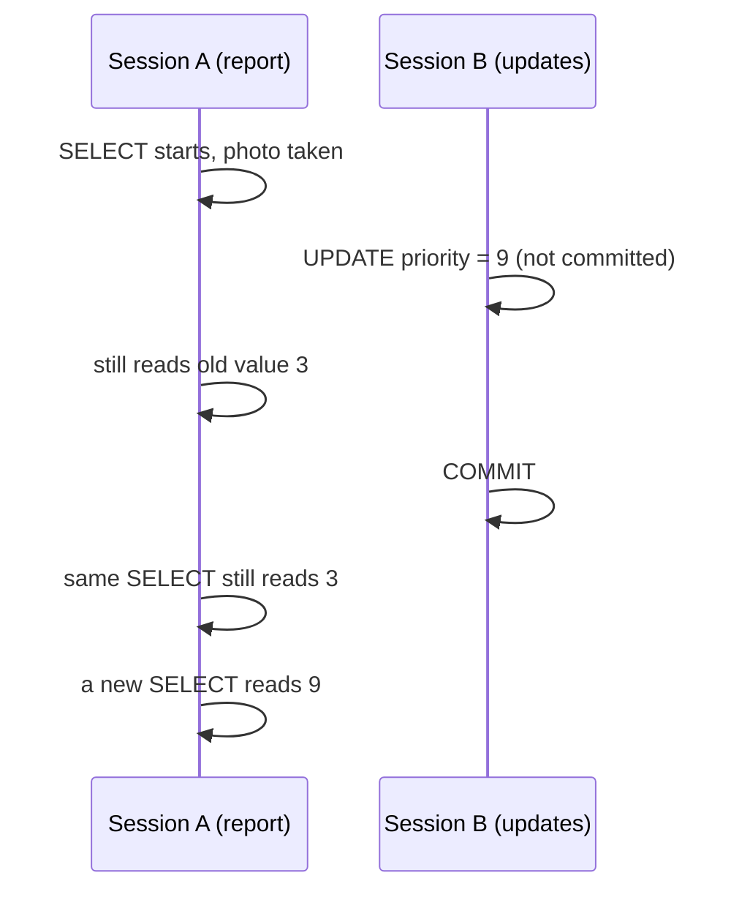

# What your SELECT sees: read consistency, flashback and FOR UPDATE

In the basics you learned how to change data safely with `COMMIT`, `ROLLBACK` and `SAVEPOINT`, and you saw that a second session does not see your uncommitted change. This page is about the same events seen from the reader's side. When you run a report while other people are changing the tables, what exactly do you get? Can the numbers shift under you halfway through? Can you look at the table as it was ten minutes ago? And is there ever a `SELECT` that gets in other people's way?

The animated version is here: [07-what-your-select-sees.html](../tutorials/07-what-your-select-sees.html). It shows two sessions side by side.

**By the end of this page you can:**

- explain what a query sees while others change the data, and why it never waits for them
- say what "statement-level read consistency" means for a long report
- explain `ORA-01555: snapshot too old` in plain words
- read an older state of a table with `AS OF TIMESTAMP`, and list the versions of a row with `VERSIONS BETWEEN`
- lock rows on purpose with `SELECT ... FOR UPDATE`, with `NOWAIT`, `WAIT n` and `SKIP LOCKED`
- spot the open-transaction trap in DBeaver

The pencil, ink and `COMMIT` ideas are in [Creating tables and changing data](../../basics/topics/08-changing-data.md) and are not repeated here.

## The question this answers

Maya starts a report that reads thousands of rows and takes a few minutes. In the middle of it a colleague changes a row she has not reached yet and commits. What should the report show for that row? If it shows the new value, the report mixes data from two moments and its totals may not add up. If it waits for the colleague, one slow update could stop every report in the building. Oracle's answer is neither. The report shows the data as it was when it started, and it never waits. That raises three practical questions: how can the report still see old data after someone has changed it, how far back can you look on purpose, and when do you actually want other sessions to wait?

## The analogy: a photograph

When you press Enter on a `SELECT`, Oracle takes a photograph of the data at that moment. You read the photograph. If someone changes the real table while you are reading, your photograph does not change.

| Time | What happens | What Maya's long report shows |
|---|---|---|
| 09:00:00 | Maya starts a report | 3 |
| 09:00:10 | Ben changes L26-001 to 9, not yet saved | 3 |
| 09:00:20 | Ben saves (`COMMIT`) | 3 |
| 09:00:40 | Maya starts a new report | 9 |

Maya's first report keeps showing 3 from start to finish, even though the real value changed in the middle. The new report is a new photograph.

- The photo album. Oracle keeps a record of old values for a while (undo). That is why you can ask for the table as it was ten minutes ago, with `AS OF TIMESTAMP`. The album has limited space. Ask too far back and the old pages are gone.
- The reserved sticker. `SELECT ... FOR UPDATE` puts a "reserved" sticker on the rows. Anyone else who wants to change them must wait, give up at once (`NOWAIT`), give up after a few seconds (`WAIT n`), or skip the reserved rows (`SKIP LOCKED`). The sticker comes off at `COMMIT` or `ROLLBACK`.

**Where the picture breaks.**

- The photograph is taken per statement, not per session. Two `SELECT`s in a row can show different data if someone commits between them. `SET TRANSACTION READ ONLY` makes them share one photograph.
- The album holds only the rows that changed, not full copies, and the default is about 15 minutes (`undo_retention` of 900 seconds). Your database may differ.
- A plain `SELECT` ignores the reserved sticker. Stickers only stop people who want to change the same rows.

## What Oracle actually does

1. When a statement starts, Oracle records the current point of the database's own logical clock, the snapshot point (SCN). Only the order of changes matters, not the time of day.
2. Reading a row, Oracle checks the row's latest change against the snapshot point. If it was committed before, the row is used as is. If it changed afterwards, or the change is not committed, the row is not used as it stands.
3. In that case Oracle reads the row's earlier version from undo, undoing changes on a private copy newest first until it reaches a version that was committed at the snapshot point. The table itself is never changed.
4. The result is the committed data as of the statement's start: never uncommitted work from others, never later changes. Your own uncommitted changes are visible to you.
5. No row lock is taken. Readers do not block writers and writers do not block readers. If the undo needed has been reused, a long report can fail with `ORA-01555`.
6. Flashback query is the same machinery with a snapshot point you choose: `AS OF TIMESTAMP` or `AS OF SCN`. The limits are the undo still available (`ORA-01555`, snapshot too old) and the age of the table's definition (`ORA-01466`).
7. `SELECT ... FOR UPDATE` is different. It does not read an old picture. It locks the current committed version of the rows it returns. If another transaction holds a lock, it waits, fails at once with `NOWAIT` (`ORA-00054`), gives up after `WAIT n` seconds (`ORA-30006`), or leaves the locked rows out with `SKIP LOCKED`. `COMMIT` or `ROLLBACK` releases the locks.

| In Oracle | With the photograph |
|---|---|
| statement starts | the photograph is taken |
| uncommitted change | an unsaved change, in nobody else's photograph |
| undo | the photo album |
| `AS OF TIMESTAMP` | "show me the photo from ten minutes ago" |
| `ORA-01555` | the old album pages are gone |
| `ORA-01466` | the table did not exist yet |
| `FOR UPDATE` | a "reserved" sticker |

The picture below follows the lots and the sessions.



## What a query sees

Two rules cover almost everything.

1. A query never sees changes that are not committed yet.
2. A query never sees changes committed after it started.

The proof needs two sessions. These were two separate SQL*Plus windows against the same database, both logged in as the same user, on a private copy of `LOTS` called `MY_LOTS_COPY`. Session B updates a row and keeps its transaction open for 10 seconds. Session A reads the same row twice.

Session B (the writer):

```sql
UPDATE my_lots_copy SET priority = 9 WHERE lot_id = 'L26-001';
-- no COMMIT yet; ten seconds later:
COMMIT;
```

```text
B 04:40:08 updating L26-001 priority to 9, no commit
B 04:40:18 committed
```

Session A (the reader), started a moment after B:

```sql
SELECT lot_id, priority FROM my_lots_copy WHERE lot_id = 'L26-001';
```

```text
AT_TIME    LOT_ID         PRIORITY
---------- ------------ ----------
A 04:40:12 L26-001               3

AT_TIME    LOT_ID         PRIORITY
---------- ------------ ----------
A 04:40:22 L26-001               9
```

At 04:40:12 B's change was still in pencil. A saw the old value 3, and the answer came back at once, without any waiting. At 04:40:22 B had committed, so a new query saw 9. The clock times show the two things worth remembering: the first query was not delayed by B's open update, and the second query found the committed value.

Readers do not block writers, and writers do not block readers. That is different from some other databases, and it is why a report can run on a busy system.

### A long report stays consistent

The photograph belongs to the whole statement, not to each row. A report that takes five minutes sees all its rows as of the moment it started, even if somebody commits a change in minute two. Totals add up, and a row cannot be counted in one place and also in another because it moved while you were reading.

This was tested with one PL/SQL block in session A that opens a query, then waits 8 seconds before it fetches the row. In those 8 seconds, session B changes the row back to 3 and commits.

```text
04:40:33 A query opened (this is the moment the photograph is taken)
04:40:41 A fetched priority = 9 from the cursor opened 8 seconds ago
04:40:41 A a new query now sees priority = 3
04:40:36 B changed priority back to 3 and committed
```

B committed its change at 04:40:36. A fetched at 04:40:41 and still got 9, the value from 04:40:33. A new query one line later saw 3.

This rule is called statement-level read consistency. It holds for each statement. Two different statements in the same session each take their own photograph, so the second one can see a change that the first one did not. If you need several queries to agree with each other, put `SET TRANSACTION READ ONLY;` first. Every query until your next `COMMIT` or `ROLLBACK` then reads from one photograph. Test run, with session B committing a change after A's first read:

```text
T          PRIORITY
-------- ----------
04:43:36          5
T          PRIORITY
-------- ----------
04:43:44          5
```

B had committed 6 at about 04:43:39. A still saw 5 at 04:43:44, and a read-only transaction cannot change data at all (`ORA-01456`). After A's `COMMIT`, the next query showed 6.

## ORA-01555: snapshot too old

To rebuild the old photograph Oracle needs the earlier versions of changed rows, kept in undo. Undo space is reused. If a report runs so long, and the system is changing data so fast, that the earlier version it needs has been overwritten, Oracle cannot rebuild the picture. It stops your query with:

```text
ORA-01555: snapshot too old
```

It is not data corruption and nothing is lost. Think of a photo album with a limited number of pages, where the oldest pages get reused. Your query asked for a page that has gone.

It usually has one of three causes: a very long query, an undo area that is too small for the rate of change, or a loop that commits after every row while reading from the table it is changing. The first thing to try is to run the report outside the busiest hours or to make the query faster. Changing undo settings is a DBA decision. This course does not simulate the error, because it needs an overloaded undo area to appear.

## Flashback query: the old photo album

`AS OF TIMESTAMP` asks for the table as it was at an earlier time. It works on any table you can select from, and it needs no special privilege on the schema in this course. The limit is how far back the undo still goes. The default is 900 seconds (15 minutes) on this test server, but your database may differ.

A short test on `MY_LOTS_COPY`. The row L26-001 started with priority 3. Steps: change it to 7 and commit; wait; note the time; wait; change it to 8 and commit; then ask for the time that was noted.

```sql
UPDATE my_lots_copy SET priority = 7 WHERE lot_id = 'L26-001';
COMMIT;
-- wait about ten seconds, then:
SELECT TO_CHAR(SYSTIMESTAMP, 'YYYY-MM-DD HH24:MI:SS') AS t_noted FROM dual;
-- wait about ten seconds, then:
UPDATE my_lots_copy SET priority = 8 WHERE lot_id = 'L26-001';
COMMIT;
```

```text
T_NOTED
--------------------
2026-10-13 04:42:41
```

Now compare now and then:

```sql
SELECT priority AS now_priority
FROM   my_lots_copy
WHERE  lot_id = 'L26-001';

SELECT priority AS then_priority
FROM   my_lots_copy
       AS OF TIMESTAMP TO_TIMESTAMP('2026-10-13 04:42:41', 'YYYY-MM-DD HH24:MI:SS')
WHERE  lot_id = 'L26-001';
```

```text
NOW_PRIORITY
------------
           8

THEN_PRIORITY
-------------
            7
```

(That run was done with a bind variable instead of a typed literal, with the same result: 8 now and 7 then. On your own run, the time you note will be different, and so will the rest of the timestamps in this section.)

The `AS OF` clause goes right after the table name, before the alias and the `WHERE`. Instead of a time you can give a relative moment, such as `AS OF TIMESTAMP SYSTIMESTAMP - INTERVAL '10' MINUTE`, or a system change number with `AS OF SCN n`.

### Who changed it, and when: VERSIONS BETWEEN

To see every committed version of a row, not just one point in time, use `VERSIONS BETWEEN`. `MINVALUE` and `MAXVALUE` mean "as far back as undo goes" and "up to now". `VERSIONS_STARTTIME` and `VERSIONS_OPERATION` are pseudocolumns that describe each version. In `VERSIONS_OPERATION`, `U` is an update.

```sql
SELECT versions_starttime, versions_endtime, versions_operation AS op, priority
FROM   my_lots_copy
       VERSIONS BETWEEN TIMESTAMP MINVALUE AND MAXVALUE
WHERE  lot_id = 'L26-001'
ORDER  BY versions_starttime NULLS FIRST;
```

```text
VERSIONS_STARTTIME           VERSIONS_ENDTIME             OP   PRIORITY
---------------------------- ---------------------------- -- ----------
                             13-OCT-26 04.42.31 AM                    3
13-OCT-26 04.42.31 AM        13-OCT-26 04.42.52 AM        U           7
13-OCT-26 04.42.52 AM        13-OCT-26 04.42.58 AM        U           8
13-OCT-26 04.42.58 AM                                     U           9
```

The first row is the starting value, which has no start time because it was there from the beginning. The last row has no end time because it is the current value. Three updates, four versions.

### Getting rows back

Flashback does not change anything by itself. It lets you read the old rows, and then you use ordinary `INSERT` or `UPDATE` to bring them back, followed by a `COMMIT`. Two lots deleted and committed by mistake:

```sql
DELETE FROM my_lots_copy WHERE lot_id IN ('L26-012', 'L26-011');
COMMIT;

SELECT COUNT(*) AS now_rows FROM my_lots_copy;
SELECT COUNT(*) AS rows_then
FROM   my_lots_copy AS OF TIMESTAMP TO_TIMESTAMP('2026-10-13 04:42:41', 'YYYY-MM-DD HH24:MI:SS');

INSERT INTO my_lots_copy
SELECT *
FROM   my_lots_copy AS OF TIMESTAMP TO_TIMESTAMP('2026-10-13 04:42:41', 'YYYY-MM-DD HH24:MI:SS')
WHERE  lot_id IN ('L26-012', 'L26-011');
COMMIT;
```

```text
  NOW_ROWS
----------
        14

 ROWS_THEN
----------
        16

2 rows created.
```

After the insert, the table had 16 rows again.

### When flashback says no

- `ORA-01466: unable to read data - table definition has changed`. You asked for a moment before the table was created, or before a structural change. In this test it appeared three times: when the requested time was before the table existed, when it was a few seconds after the creation, and after a `TRUNCATE TABLE`. Truncate is also the reason you cannot flash back to rows that were removed this way. Use `DELETE`, not `TRUNCATE`, if you want to keep that option.
- Oracle matches a timestamp to a system change number in steps of about three seconds. Ask for a moment less than a few seconds after a commit and you may get the older picture. Leave a gap of several seconds, as the exercise above does.
- `ORA-01555` again: you went back further than the undo still reaches.
- Flashback query shows what was committed. It cannot show a change that was rolled back.
- Flashback is for repairs and investigation, not for backups. A real backup is a DBA's job.

## SELECT ... FOR UPDATE: the one SELECT that locks

A plain `SELECT` takes no locks. `SELECT ... FOR UPDATE` is the exception. It reads the rows and locks them, as an `UPDATE` would, so that nobody else can change them until you finish with `COMMIT` or `ROLLBACK`. You use it when you will read a row, think, and then update it, and you must be sure no one changes it in between: for example, a booking clerk who reads the next free slot and then takes it.

A plain `SELECT` does not start a transaction. `FOR UPDATE` does. This was checked in one session by looking at `V$TRANSACTION`:

```text
WHAT                      OPEN_TX
---------------------- ----------
start                           0
after plain SELECT              0
after FOR UPDATE                1
after ROLLBACK                  0
after UPDATE                    1
```

That query needs the `V$` views, which you can read because `FAB_LAB` was given `SELECT_CATALOG_ROLE` in Lab 0. The check itself is not something to do in daily work, it only shows that a plain read leaves nothing open.

The test: session B locks two rows and holds the lock for 14 seconds.

Session B:

```sql
SELECT lot_id, status
FROM   my_lots_copy
WHERE  lot_id IN ('L26-001', 'L26-002')
FOR UPDATE;
-- hold it, then ROLLBACK after 14 seconds
```

Session A then tries four things.

```sql
-- 1. a plain SELECT: not blocked
SELECT lot_id, status FROM my_lots_copy WHERE lot_id IN ('L26-001', 'L26-002') ORDER BY lot_id;
```

```text
LOT_ID       STATUS
------------ --------
L26-001      SHIPPED
L26-002      SHIPPED
```

```sql
-- 2. do not wait at all
SELECT lot_id FROM my_lots_copy WHERE lot_id = 'L26-001' FOR UPDATE NOWAIT;
```

```text
ORA-00054: resource busy and acquire with NOWAIT specified or timeout expired
```

```sql
-- 3. wait up to 3 seconds
SELECT lot_id FROM my_lots_copy WHERE lot_id = 'L26-001' FOR UPDATE WAIT 3;
```

```text
04:40:55 A start waiting
ORA-30006: resource busy; acquire with WAIT timeout expired or DTP service is
unavailable
04:40:58 A gave up
```

```sql
-- 4. take only the rows that are free
SELECT lot_id FROM my_lots_copy
WHERE  lot_id IN ('L26-001', 'L26-002', 'L26-003', 'L26-004')
ORDER  BY lot_id
FOR UPDATE SKIP LOCKED;
```

```text
LOT_ID
------------
L26-003
L26-004
```

A plain `FOR UPDATE` with no option waits for as long as it takes. In the test it started at 04:40:58 and got the lock at 04:41:06, the moment B rolled back.

| Option | What happens when a row is locked by someone else |
| --- | --- |
| nothing | wait, as long as it takes |
| `NOWAIT` | stop at once with ORA-00054 |
| `WAIT n` | wait n seconds, then stop with ORA-30006 |
| `SKIP LOCKED` | leave the locked rows out and return the rest |

`SKIP LOCKED` suits a queue of jobs where several workers each take whatever is free. It is also easy to misuse: the rows you did not get are simply missing from the answer, with no message.

Lock only what you need. A `FOR UPDATE` with no `WHERE` locks the whole table for everybody else.

## The DBeaver trap for people who only read

DBeaver starts in Auto-Commit mode, which means every statement is committed at once. That is the safe setting for a person who only reads. Some people switch to Manual Commit mode, for example for a lab, and then forget to switch back.

A plain `SELECT` in Manual Commit mode does no harm, as the table above shows: no transaction is started. The trouble starts when the editor runs something that does start one: a `SELECT ... FOR UPDATE`, or an `UPDATE`, `INSERT` or `DELETE` that someone tried and left. DBeaver now shows the pending-statements counter, and the rows stay locked until someone clicks Commit or Rollback. That editor tab might be hidden behind ten others, and its owner might have gone to lunch. Anyone else who tries to change those rows waits, and the other person's tool seems to hang for no reason.

Habits that avoid it:

- Look at the transaction mode button before you run anything. It says **Auto** or **Manual**.
- In Manual mode, if the counter shows pending statements, decide: **Commit** or **Rollback**. Do not leave it open.
- Close the editor tab, or the connection, when you finish. If a transaction is still open, DBeaver asks what to do with it. Choose Rollback unless you know the changes are wanted.
- Do not run `FOR UPDATE` in an exploratory query. It is for code that is going to update the row next.

## What you will see in the two DBeaver windows

For [Lab 12](../labs/lab-12-what-your-select-sees.md) you open two SQL editors on the `fab-lab` connection, as in Lab 7. Both are set to Manual Commit mode, and the option **Open separate connection for each editor** is ticked, so that the two tabs are really two sessions. Call them tab A and tab B. Put them side by side if you can.

1. In tab B, update a row and do not commit. The transaction counter in tab B shows 1 pending statement.
2. In tab A, run a `SELECT` on that row. The grid comes back at once with the old value. The counter in tab A shows nothing pending.
3. In tab B, click **Commit**. In tab A, run the `SELECT` again, and the new value appears.
4. In tab B, run a `SELECT ... FOR UPDATE NOWAIT` on a row, and in tab A try the same row. Tab A shows an error dialog with ORA-00054 straight away. Try `WAIT 5`, and the tab shows a spinner for five seconds and then ORA-30006.
5. In tab B, click **Rollback** to release the lock.

## Three common misreadings

**"My SELECT has to wait while someone else is changing the row."** It does not. In a test, session B updated L26-001 from 3 to 9 without committing and session A's plain `SELECT` returned 3 at once. Only `FOR UPDATE` can wait, because it asks for a lock rather than a picture.

**"Two SELECTs in my session see the same data."** Only if you ask for it. Every statement takes its own snapshot, so in a normal session a second read after another session's commit shows the new value. A session that began with `SET TRANSACTION READ ONLY` kept showing the old value in a test and showed the new one only after its own `COMMIT`.

**"AS OF TIMESTAMP can take me back as far as I like, and it restores the table."** It reads an old picture and changes nothing. It stops at the undo that is left (`ORA-01555`, 900 seconds by default), and it cannot go back before the table's definition last changed: a table created five minutes ago gives `ORA-01466` for any earlier time. To bring old values back, read them with `AS OF` and write them with an ordinary `INSERT` or `UPDATE`.

## Common mistakes

- Expecting a report to see a change that was committed after it started. It will not. Run it again.
- Expecting to see a colleague's uncommitted change. You never will.
- Thinking a long query locks the table. A plain `SELECT` takes no lock, so it blocks nobody.
- Asking flashback for a time that is too recent, too old, or before the table was created or truncated.
- Forgetting `COMMIT` after you put rows back from a flashback query.
- Using `FOR UPDATE` without a `WHERE`, or leaving it open in a DBeaver tab.
- Reading `SKIP LOCKED` output as the complete answer.

## Check your understanding

1. A colleague updates a lot's status and has not committed. You run `SELECT status FROM lots WHERE lot_id = ...`. Do you wait? Which value do you see?
2. Your report starts at 10:00 and takes ten minutes. At 10:03 somebody commits a change to a row your report has not read yet. Does the report include it?
3. You get `ORA-01555`. Has any data been lost?
4. Write a query that shows `MY_LOTS_COPY` as it was fifteen minutes ago, for lot `L26-003`.
5. What is the difference between `FOR UPDATE NOWAIT` and `FOR UPDATE SKIP LOCKED`?

<details>
<summary>Answers</summary>

1. You do not wait. You see the last committed value, not the colleague's pending one.
2. No. The report reads as of 10:00, the moment the statement started, so the change committed at 10:03 is not in it.
3. No. Oracle could not rebuild the old picture because the undo it needed had been reused. Nothing is lost. Run the query again, ideally when the system is quieter, or ask your DBA about the undo size.
4. `SELECT * FROM my_lots_copy AS OF TIMESTAMP SYSTIMESTAMP - INTERVAL '15' MINUTE WHERE lot_id = 'L26-003';` (It fails with ORA-01466 if the table is younger than fifteen minutes, and with ORA-01555 if the undo no longer reaches that far.)
5. `NOWAIT` raises an error if any wanted row is locked. `SKIP LOCKED` returns the free rows and silently leaves out the locked ones.

</details>

## Further reading

- [Oracle Database Concepts 19c: Data Concurrency and Consistency](https://docs.oracle.com/en/database/oracle/oracle-database/19/cncpt/data-concurrency-and-consistency.html)
- [Oracle Database SQL Language Reference 19c: SELECT (flashback query and FOR UPDATE)](https://docs.oracle.com/en/database/oracle/oracle-database/19/sqlrf/SELECT.html)
- [ORACLE-BASE: Flashback Query](https://oracle-base.com/articles/9i/flashback-query-9i)
- [ORACLE-BASE: SELECT ... FOR UPDATE SKIP LOCKED](https://oracle-base.com/articles/misc/skip-locked)

Practise it in [Lab 12](../labs/lab-12-what-your-select-sees.md).
