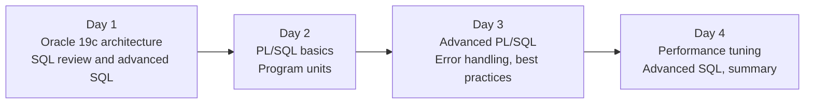

# Oracle Database 19c PL/SQL and Advanced SQL

These pages are the reading material for the four-day course. They follow the slides used in class and go into more detail, with worked examples and links to Oracle's documentation. Read a topic page after the session that covers it, or before a lab when you want to check how something works.

## The four days

| Day | Topics |
| --- | --- |
| 1 | Introduction to Oracle Database 19c: overview, installation and configuration, architecture, tools. SQL review and advanced SQL: analytic functions, hierarchical queries, advanced grouping |
| 2 | Introduction to PL/SQL: blocks, variables, data types, control structures. Program units: procedures, functions, packages, triggers, autonomous transactions |
| 3 | Advanced PL/SQL: collections, BULK COLLECT and FORALL, dynamic SQL, records. Error handling and debugging. PL/SQL best practices |
| 4 | Performance tuning: optimisation, execution plans, indexing, hints. Advanced SQL: joins, recursive queries, regular expressions, full-text search. Course summary |

Day 1 is available now. The pages for Days 2 to 4 will be added as the course goes on.

## Before the first day

Every participant works on their own Oracle 19c database. Install it before Day 1 by following [Install Oracle Database 19c on Windows](before-you-start/install-oracle-19c-windows.md). The install takes about an hour, most of it waiting for the database to be created.

## How the material is organised

Each day has topic pages and labs. A topic page explains one subject, shows SQL you can run yourself, and ends with a few questions to check your understanding and a list of further reading. The labs are hands-on exercises on your own database. All labs use the same lab user, FAB_LAB, which holds a small invented wafer-fab schema: products, tools, lots, wafers and measurements. The names and numbers in it are made up for the course.

The SQL on these pages was tested on a real Oracle database. Values that depend on the installation, such as memory sizes or file paths, will be different on your machine.
