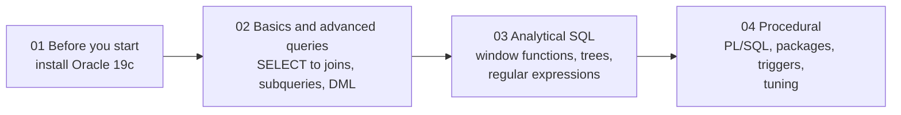

**Website:** [www.trainingmaterial.in](https://www.trainingmaterial.in)  
**Code:** `855784`

---

# Oracle Database 19c PL/SQL and Advanced SQL

These pages are the reading material and lab pack for the course. They go into more detail than the sessions, with worked examples you can run yourself. Read a topic page after the session that covers it, or before a lab when you want to check how something works.

The course has four parts. You work through them in order, on your own Oracle 19c database.

## The four parts

| Part | Folder | What it covers |
| --- | --- | --- |
| 1 | [01-before-you-start](01-before-you-start/install-oracle-19c-windows.md) | Installing Oracle Database 19c on Windows and checking that it works. Do this before the first session |
| 2 | [02-basics-and-advanced-queries](02-basics-and-advanced-queries/README.md) | How Oracle works, then SELECT, WHERE, NULL and functions, GROUP BY, joins, subqueries and set operators, and changing data. Ends with a joins assessment |
| 3 | [03-analytical](03-analytical/topics/01-window-functions.md) | Window functions and ranking, running totals with LAG and LEAD, report shapes (ROLLUP, CUBE, PIVOT), hierarchical queries, regular expressions, and read consistency with flashback and FOR UPDATE |
| 4 | [04-procedural](04-procedural/lab/lab-13-first-plsql-blocks.md) | PL/SQL blocks, loops and cursors, exceptions, functions and procedures, packages and triggers, and a first look at tuning |

## Before the first session

Every participant works on their own Oracle 19c database. Install it by following [Install Oracle Database 19c on Windows](01-before-you-start/install-oracle-19c-windows.md). The install takes about an hour, most of it waiting for the database to be created.

## How the material is organised

Each part has topic pages, labs, scripts and solutions.

- **Topic pages** explain one subject at a time, with SQL you can run. They are short; read one, then do the lab that goes with it.
- **Labs** are hands-on exercises on your own database. They give hints in layers so you can get unstuck without being handed the answer.
- **Scripts** are the SQL files a lab asks you to run, such as creating the lab user or loading the data.
- **Solutions** hold the full answers. Your trainer releases them after each lab.

### Labs at a glance

| Part | Labs |
| --- | --- |
| 02 Basics and advanced queries | [Lab 1](02-basics-and-advanced-queries/labs/lab-1-connect-and-load.md) Connect and load, [Lab 2](02-basics-and-advanced-queries/labs/lab-2-first-queries.md) First queries, [Lab 3](02-basics-and-advanced-queries/labs/lab-3-nulls-and-functions.md) NULL and functions, [Lab 4](02-basics-and-advanced-queries/labs/lab-4-summarising.md) Summarising, [Lab 5](02-basics-and-advanced-queries/labs/lab-5-joins.md) Joins, [Lab 6](02-basics-and-advanced-queries/labs/lab-6-subqueries-and-sets.md) Subqueries and sets, [Lab 7](02-basics-and-advanced-queries/labs/lab-7-changing-data.md) Changing data, and the [joins assessment](02-basics-and-advanced-queries/labs/assessment/assessment.md) |
| 03 Analytical | [Lab 8](03-analytical/labs/lab-8-window-functions-and-ranking.md) Window functions and ranking, [Lab 9](03-analytical/labs/lab-9-running-totals-and-lag-lead.md) Running totals, LAG and LEAD, [Lab 10](03-analytical/labs/lab-10-report-shapes.md) Report shapes, [Lab 11](03-analytical/labs/lab-11-trees-and-text.md) Trees and text, [Lab 12](03-analytical/labs/lab-12-what-your-select-sees.md) What your SELECT sees |
| 04 Procedural | [Lab 13](04-procedural/lab/lab-13-first-plsql-blocks.md) First PL/SQL blocks, [Lab 14](04-procedural/lab/lab-14-loops-and-cursors.md) Loops and cursors, [Lab 15](04-procedural/lab/lab-15-exceptions.md) Exceptions, [Lab 16](04-procedural/lab/lab-16-functions-and-procedures.md) Functions and procedures, [Lab 17](04-procedural/lab/lab-17-packages-and-triggers.md) Packages and triggers, [Lab 18](04-procedural/lab/lab-18-tuning-a-little.md) Tuning a little |

For a quick reminder of syntax while you work, keep the one-page [query cheat sheet](02-basics-and-advanced-queries/query-cheat-sheet.md) open.

## The lab data

All labs use one lab user, **FAB_LAB**, which holds a small invented wafer-fab schema: products, tools, lots, wafers and measurements. The names and numbers are made up for the course. Part 2 explains the tables in [Meet the fab](02-basics-and-advanced-queries/topics/02-meet-the-fab.md), and the lab user and data are created in [Lab 1](02-basics-and-advanced-queries/labs/lab-1-connect-and-load.md).

Later labs need extra tables: a history of what happened to each lot, a larger table for tuning, and an error log. These come from a small data add-on. Its four SQL files and the order to run them in are described in the [add-on readme](03-analytical/labs/scripts/readme.md).

## Tools

| Item | Value |
| --- | --- |
| Database | Your own Oracle 19c, installed on your laptop |
| Tool | DBeaver Community |
| Lab user | `FAB_LAB`, in your pluggable database (PDB) |

The SQL on these pages was tested on a real Oracle database. Values that depend on the installation, such as memory sizes or file paths, will be different on your machine.
