# Oracle Database 19c: SQL Basics

This is the first part of the course Oracle Database 19c PL/SQL and Advanced SQL. It assumes you have used a database a little and have never been taught SQL properly, or you learnt it a long time ago. By the end you can read a plain-English question, work out which tables hold the answer, and write the query.

You will learn on one small, invented database called **FAB_LAB**, the records of a wafer fab. Every question comes from **Maya**, the shift manager. She asks in plain English. You turn her question into SQL, run it on your own Oracle 19c, and read the answer.

## The map for the whole course

```mermaid
flowchart LR
    A["1. How Oracle works<br/>who answers your query"] --> B["2. Meet the fab<br/>the five tables"]
    B --> C["3. First queries<br/>SELECT, WHERE, ORDER BY"]
    C --> D["4. NULL and functions<br/>missing values, tidy output"]
    D --> E["5. Summarising<br/>COUNT, SUM, GROUP BY"]
    E --> F["6. Joins<br/>use two tables at once"]
    F --> G["7. Subqueries and sets<br/>a question inside a question"]
    G --> H["8. Changing data<br/>INSERT, UPDATE, COMMIT"]
    H --> I["Next: advanced SQL,<br/>then PL/SQL"]
```

## How to use these pages

Each topic page is short and has real queries you can paste into DBeaver. Read a page, then do the lab straight after it. The labs give hints in layers, so you can get unstuck without being handed the answer. Full answers are in the solutions, which your trainer releases after each lab.

| Step | Topic page | Lab |
| --- | --- | --- |
| 1 | [How Oracle works, in plain words](topics/01-how-oracle-works.md) | [Lab 1: Connect and load the lab data](labs/lab-1-connect-and-load.md) |
| 2 | [Meet the fab](topics/02-meet-the-fab.md) | |
| 3 | [Your first queries](topics/03-your-first-queries.md) | [Lab 2: First queries](labs/lab-2-first-queries.md) |
| 4 | [NULL and functions](topics/04-nulls-and-functions.md) | [Lab 3: NULL and functions](labs/lab-3-nulls-and-functions.md) |
| 5 | [Summarising with GROUP BY](topics/05-summarising-with-group-by.md) | [Lab 4: Summarising](labs/lab-4-summarising.md) |
| 6 | [Joins](topics/06-joins.md) | [Lab 5: Joins](labs/lab-5-joins.md) |
| 7 | [Subqueries and set operators](topics/07-subqueries-and-set-operators.md) | [Lab 6: Subqueries and sets](labs/lab-6-subqueries-and-sets.md) |
| 8 | [Creating tables and changing data](topics/08-changing-data.md) | [Lab 7: Changing data](labs/lab-7-changing-data.md) |

Keep the [query cheat sheet](query-cheat-sheet.md) open next to you. It is one page.

## What you need

| Item | Value |
| --- | --- |
| Database | Your own Oracle 19c, installed on your laptop |
| Tool | DBeaver Community |
| Admin user | `SYSTEM`, password `NobleProg@123`, only to create the lab user |
| Lab user | `FAB_LAB`, password `Lab_2026`, in your PDB |
| Scripts | [`lab0_create_user.sql`](labs/scripts/lab0_create_user.sql) and [`lab1_fab_lab_data.sql`](labs/scripts/lab1_fab_lab_data.sql) |

## Three habits that will save you time

1. **Write Maya's question as a comment above your query.** If the answer looks odd, compare the question with what you wrote.
2. **Build a query in layers.** Start with `SELECT * FROM one_table`. Add `WHERE`. Add the columns. Add the sort. Run it each time. A query that worked a minute ago and now fails tells you exactly which layer is wrong.
3. **Read the result and not just the query.** Count the rows. Does the number make sense? Is a row missing that you expected?

## After the basics

The rest of the course builds on this: analytic functions, hierarchical queries and advanced grouping, then PL/SQL (blocks, procedures, functions, packages, triggers), collections and bulk processing, error handling, performance tuning, best practices, and advanced SQL topics. All of it uses the same FAB_LAB tables, so keep them as you leave them at the end of Lab 7.
