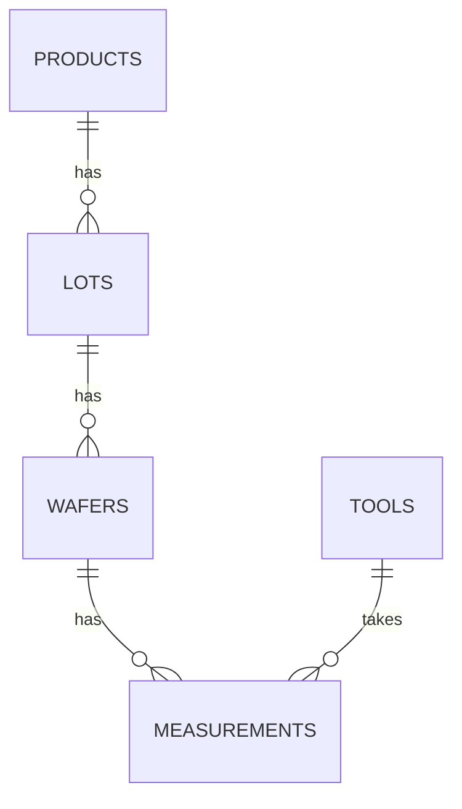

# Lab 3: SQL review

In this lab you write joins, subqueries, set operator queries and a small transaction against FAB_LAB, the invented wafer-fab schema you loaded in Lab 1. The questions are A1 to A7. Several of them are built around a trap that gives wrong numbers in real reports, so read the checkpoints carefully: a query that runs is not always a query that is right.

| | |
| --- | --- |
| Time | 25 minutes |
| Connection | FAB_LAB, password `Lab_2026`, on your PDB service (`localhost:1521`), as set up in [Lab 1](lab-1-connect-and-configure.md) |
| Script | [`lab3_sql_review.sql`](scripts/lab3_sql_review.sql): the questions and hints, with space for your answers |
| Core questions | A1, A2, A6. Do these first, then the rest if you have time |
| You finish with | Your own working query for each question you tackled, checked against the checkpoints, and the data unchanged |

Keep your answers. Days 2 to 4 use the same schema.

## What this lab practises

| Questions | Topic page |
| --- | --- |
| A1 to A6 | [SQL review: joins, subqueries, set operators and NULLs](../module-2/01-sql-review.md) |
| A7 | [Transaction control](../module-2/02-transaction-control.md) |

## The lab schema

The data is invented for the course. Product names and numbers are illustrative and do not come from any real fab.

| Table | Rows | Columns |
| --- | --- | --- |
| PRODUCTS | 5 | product_id, product_code, family, diameter_mm, target_thk_nm |
| TOOLS | 9 | tool_id, tool_type (SPLIT, ANNEAL, METROLOGY, POLISH, IMPLANT), bay |
| LOTS | 16 | lot_id, product_id, lot_type (PROD, SPLIT, REWORK), parent_lot_id, start_date, status (ACTIVE, HOLD, SHIPPED, SCRAPPED), priority, hold_reason |
| WAFERS | 66 | wafer_id, lot_id, slot_no, grade (PRIME, TEST, SCRAP, or empty when not graded yet) |
| MEASUREMENTS | 186 | meas_id, wafer_id, step (SPLIT, ANNEAL, FINAL), tool_id, meas_time, thickness_nm, defect_count |

Relationships:

```text
PRODUCTS 1---n LOTS 1---n WAFERS 1---n MEASUREMENTS n---1 TOOLS
                 |
                 +-- parent_lot_id -> LOTS.lot_id  (the lot a split or rework came from)
```

Lot and wafer IDs are readable: wafer `L26-003-02` is slot 2 of lot `L26-003`. Lot `L26-003B` is a split of `L26-003`, and `L26-003B1` is a rework of `L26-003B`. `target_thk_nm` is the product's target thickness in nanometres; `thickness_nm` is the thickness measured on a wafer at a process step.



## How to work

1. Connect as FAB_LAB in SQL Developer and open `lab3_sql_review.sql`. Run its first statement, `ALTER SESSION SET NLS_DATE_FORMAT = 'YYYY-MM-DD HH24:MI';`, so that dates show with the time.
2. Each question has a hint underneath. Try the question without the hint first.
3. Write your query in the empty lines under the question, put the cursor in it, and press Ctrl+Enter (Run Statement). The result appears in the Query Result panel.
4. Compare your result with the checkpoint for that question.

Question A7 changes data on purpose. Finish it with ROLLBACK, as the question says, and do not COMMIT anything in this lab: Labs 4 and 5 and the next days rely on the data as it was loaded. If you think you changed the data, run `fab_lab_data.sql` again as FAB_LAB.

## Questions

| Q | Question | Hint |
| --- | --- | --- |
| A1 (core) | Lots with their product code and family (inner join) | `JOIN products ON product_id` |
| A2 (core) | Every product with its number of lots, including products with none (outer join) | `LEFT JOIN`, and COUNT a column from the right-hand table, not `COUNT(*)` |
| A3 | Wafers in lot L26-003 whose FINAL thickness is above the lot's average FINAL thickness (correlated subquery) | Correlated subquery: the inner query refers to the outer wafer's lot |
| A4 | Tools that have never recorded a measurement (MINUS) | `MINUS` |
| A5 | Lots that have wafers but no measurements yet (NOT EXISTS) | `EXISTS` and `NOT EXISTS` |
| A6 (core) | Lots on HOLD without a hold reason: why does `''` not show up with `= ''`? | Compare `= ''` with `IS NULL`. What does Oracle store for an empty string? |
| A7 | DML in a transaction: put a lot on hold, check, then undo it | `UPDATE`, `SAVEPOINT`, `DELETE`, `ROLLBACK TO SAVEPOINT`, `ROLLBACK` |

Notes on some questions:

- A2: picture a restaurant counting its guests per table. A LEFT JOIN keeps the empty tables in the list, which is what you want, but `COUNT(*)` then counts each empty table as one guest.
- A3: the FINAL thickness is in MEASUREMENTS (rows with `step = 'FINAL'`), and the lot is in WAFERS, so both the outer query and the subquery join the two tables.
- A6: try three queries. First list the lots with status HOLD and their hold reason (wrap it in `NVL(hold_reason, '(null)')` so that a NULL is visible). Then count the lots `WHERE hold_reason = ''`, and then the lots `WHERE hold_reason IS NULL`.
- A7: use lot L26-010. Set its status to HOLD with a hold reason, create a savepoint, delete the lot's measurements (its wafers are `L26-010-01` to `L26-010-05`, so `wafer_id LIKE 'L26-010-%'` finds them), count them, roll back to the savepoint, count again, then roll back the whole transaction and check the lot's status.

## Checkpoints

These are the results a correct query gives. Spacing and column headings may differ from yours; the values must match.

| Q | Check |
| --- | --- |
| A1 | 16 rows, one per lot |
| A2 | Five products. SIC-150 shows 0. If it shows 1, look at what you counted |
| A3 | 2 rows, both 12.07 |
| A4 | CMP01, IMP01 |
| A5 | L26-012 |
| A6 | Two lots on HOLD, one of them without a reason. `= ''` finds 0 rows. Why? |
| A7 | 0 measurements after the DELETE, 15 again after the rollback to the savepoint, status ACTIVE after the full ROLLBACK |

## Debrief questions

- In A2, why does `COUNT(*)` give SIC-150 a count of 1?
- In A6, what does Oracle store when you insert `''` into a VARCHAR2 column, and how must you search for it?
- In A7, which changes were still pending after `ROLLBACK TO SAVEPOINT`, and could another session see them?

## Troubleshooting

| Symptom | Fix |
| --- | --- |
| ORA-00942: table or view does not exist | You are connected as SYSTEM, not FAB_LAB, or the data script did not run. Check the connection at the top right of the worksheet |
| ORA-00918: column ambiguously defined | A column such as `lot_id` or `product_id` exists in both joined tables. Prefix it with the table alias |
| ORA-25154: column part of USING clause cannot have qualifier | With `JOIN ... USING (col)`, write `col`, not `t.col`, everywhere in the query |
| ORA-00979: not a GROUP BY expression | A column in the SELECT list is neither in GROUP BY nor inside an aggregate |
| ORA-01789: query block has incorrect number of result columns | The two queries around MINUS select a different number of columns |
| Dates show without the time | Run the `ALTER SESSION SET NLS_DATE_FORMAT` line at the top of the script |
| Counts are off after A7, or L26-010 stays on HOLD | You committed the A7 changes. Run `fab_lab_data.sql` again as FAB_LAB to reload the data |

## Further reading

- [Oracle Database SQL Language Reference, 19c](https://docs.oracle.com/en/database/oracle/oracle-database/19/sqlrf/index.html)
- [Oracle Database Concepts, 19c](https://docs.oracle.com/en/database/oracle/oracle-database/19/cncpt/index.html) (transactions, and data concurrency and consistency)
