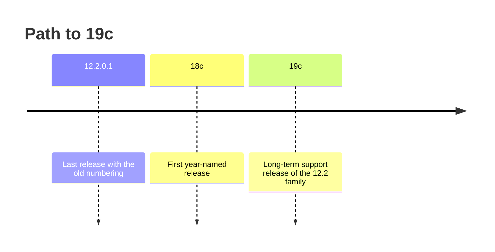

# Oracle Database 19c overview

This page places Oracle Database 19c in Oracle's release history, explains why so many production systems run it, and describes the editions you may meet. It ends with the 19c features this course touches and one that it does not.

## What this module covers

Module 1 is about the database server itself: what 19c is, how a 19c database is laid out (container and pluggable databases), how it is installed and configured, how clients reach it, and what happens inside the instance when you run SQL. The rest of the course builds on this. You cannot write good PL/SQL, or tune a slow query, without a picture of what the instance does with the code you send it.

The topic pages for the module are:

- [Multitenant architecture](02-multitenant-architecture.md)
- [Installing Oracle 19c](03-installing-oracle-19c.md)
- [Oracle Net and the listener](04-oracle-net-and-the-listener.md)
- [Configuration and parameters](05-configuration-and-parameters.md)
- [Instance and database](06-instance-and-database.md)
- [Memory: SGA and PGA](07-memory-sga-and-pga.md), [Background processes](08-background-processes.md), [Storage structures](09-storage-structures.md) and [COMMIT, redo and undo](10-commit-redo-and-undo.md)
- [Tools](11-tools.md) and [The data dictionary](12-data-dictionary.md)

## Where 19c sits in the release history

Up to 12c, Oracle versions had numbers such as 11.2.0.4 and 12.2.0.1. Year-named releases started with 18c. The family that 19c belongs to looks like this:

| Release | Notes |
| --- | --- |
| 12.2.0.1 | Last release with the old numbering |
| 18c | First year-named release |
| 19c | Final release of the 12.2 family |



19c is the **long-term support release** of that family: the release Oracle supports for many years, longer than the releases around it. That is why teams standardise on it, and why most of the Oracle systems you will meet in production today run 19c. A fab treats a qualified process recipe the same way: once it has been qualified, nobody wants to requalify it every year, so it stays in use for a long time. The newer long-term release is 23ai. Everything taught on Days 1 to 3 of this course works on both.

Support end dates have been extended more than once. Do not rely on a date you remember or read in a blog post; check Oracle's Lifetime Support Policy (linked under Further reading) when you need one.

### Base release and Release Updates

The 19c software you download is version 19.3, the **base release**. Oracle then ships **Release Updates** (RUs), and each one raises the second number of the version: 19.4, 19.5 and so on into the 19.20s. A production system usually runs a recent RU, not 19.3. You can see your exact version with:

```sql
SELECT banner_full FROM v$version;
```

On the small test database used to prepare these pages (21c Express Edition, not 19c) the result was:

```text
BANNER_FULL
--------------------------------------------------------------------------------
Oracle Database 21c Express Edition Release 21.0.0.0.0 - Production
Version 21.3.0.0.0
```

On your 19c install the first line names Oracle Database 19c and your edition, and the second line shows the version, for example 19.3.0.0.0 before patching.

## Editions

Oracle Database is sold in editions. The SQL and PL/SQL in this course are the same in all of them; what changes is the server size allowed and which extra features you may use.

| Edition | Who uses it | What to know |
| --- | --- | --- |
| Enterprise Edition (EE) | Most production systems | Full feature set. Some features are separately licensed options or packs, for example Multitenant, Partitioning, the Diagnostics Pack and the Tuning Pack |
| Standard Edition 2 (SE2) | Smaller servers | Limited to small servers; several EE features and options are not available |
| Express Edition (XE) and Free | Learning, development, small apps | Free of charge, with caps on memory and CPU |

There is no 19c Express Edition. The free editions are 18c XE, 21c XE and 23ai Free. That is why this course asks you to install 19c Enterprise Edition on your own machine for training, and why the sample output on these pages comes from a 21c XE test database: it was the free version available to prepare the material.

Being licensed for a feature matters as much as having it installed: Oracle's licensing manual states that you must be licensed for an option in order to use any of its features. The Database Licensing Information User Manual lists what each edition includes.

## How 19c fits into a typical site

Most organisations run several Oracle databases: one per application, or one per environment (production, test, development). With 19c these are usually **container databases** that each hold one or more **pluggable databases**, one per application. The [Multitenant architecture](02-multitenant-architecture.md) page explains this. As an invented example, a wafer fab could run its manufacturing execution system (MES), its reporting database and its equipment-data store as three pluggable databases in one 19c container database.

Some of that data starts life in spreadsheets, and a public case from 2020 shows where that can go wrong. Public Health England pulled lab results as CSV files into the old .XLS Excel format, which holds at most 65,536 rows. Records past that limit were dropped without any warning, so 15,841 positive COVID cases from 25 September to 2 October 2020 were left out of the daily totals. The fix was to split the data across several files. A database table has no such row ceiling, and an insert that fails raises an error you can see and handle. Even so, after any bulk load, compare the row count in the table with the row count in the source.

Developers connect to these databases with SQL Developer or another client, and write SQL and PL/SQL that runs inside the server. DBAs install, patch, back up and tune them. Both groups need the same mental model of the instance, which is what the rest of Module 1 gives you.

## 19c features you will meet this week

- LISTAGG DISTINCT. LISTAGG concatenates values from several rows into one string. 19c added the DISTINCT keyword, which removes duplicates before concatenating. You will use LISTAGG in Lab 5.
- JSON in SQL and PL/SQL. 19c can store, query and generate JSON with SQL functions such as JSON_VALUE, JSON_TABLE and JSON_OBJECT, and has PL/SQL object types for JSON.
- SQL Developer. Oracle's free graphical IDE. You will use it for the labs and, on Day 3, for PL/SQL debugging. See [Tools](11-tools.md).

One 19c feature you will read about but not use on your laptop is **Automatic Indexing**, where the database creates, rebuilds and drops indexes itself based on the workload. It is available only on Exadata and Autonomous Database (Oracle's licensing manual lists it for Enterprise Edition on Engineered Systems and the Exadata cloud service), not on an ordinary Enterprise Edition install such as your laptop.

## Check your understanding

1. Why do so many organisations standardise on 19c rather than 18c or 21c?
2. Your colleague says the server runs "19.3". What does that tell you about its patch level?
3. Can you install a free 19c Express Edition for a developer laptop?
4. Where should you look up the end date of support for 19c?

## Further reading

- [Oracle Database Concepts 19c, chapter 1: Introduction to Oracle Database](https://docs.oracle.com/en/database/oracle/oracle-database/19/cncpt/introduction-to-oracle-database.html)
- [Oracle Database Licensing Information User Manual 19c, chapter 1: Licensing Information](https://docs.oracle.com/en/database/oracle/oracle-database/19/dblic/Licensing-Information.html)
- [Oracle Database New Features Guide 19c, Application Development: LISTAGG DISTINCT Option](https://docs.oracle.com/en/database/oracle/oracle-database/19/newft/application-development.html)
- [Oracle Database New Features Guide 19c, Big Data and Data Warehousing Solutions: Automatic Indexing](https://docs.oracle.com/en/database/oracle/oracle-database/19/newft/big-data-and-data-warehousing-solutions.html)
- [Oracle Lifetime Support Policy](https://www.oracle.com/support/lifetime-support/)
- [ORACLE-BASE: LISTAGG DISTINCT in Oracle Database 19c](https://oracle-base.com/articles/19c/listagg-distinct-19c)
- [The Register, 5 October 2020: the Excel row limit behind England's missing COVID-19 cases](https://www.theregister.com/2020/10/05/excel_england_coronavirus_contact_error/)

### Answers

1. 19c is the long-term support release of the 12.2 family (12.2.0.1, 18c, 19c). Oracle supports it for many years, while the releases in between have short support windows. Standardising on it means fewer forced upgrades.
2. 19.3 is the base release, with no Release Update applied. A production server should normally be on a recent Release Update.
3. No. There is no 19c Express Edition. The free editions are 18c XE, 21c XE and 23ai Free.
4. In Oracle's Lifetime Support Policy. Oracle has extended the dates before, so do not quote them from memory.
