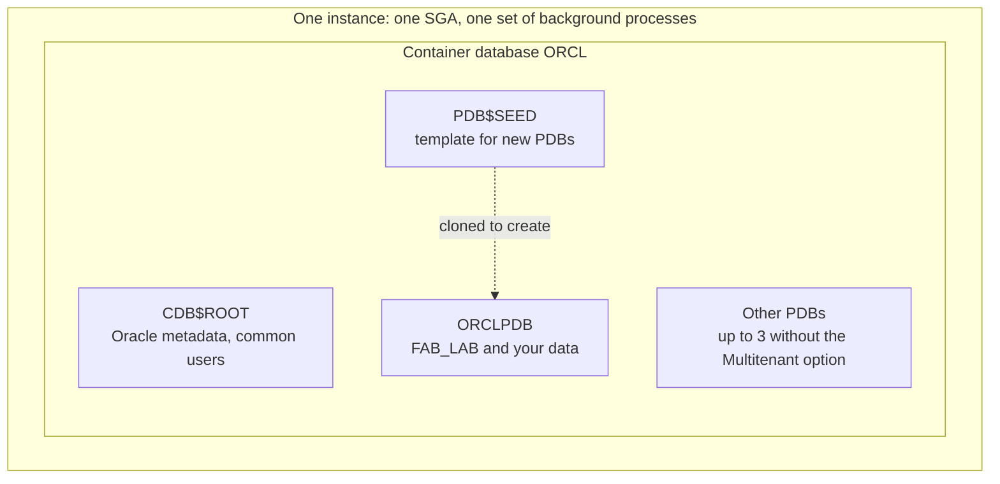
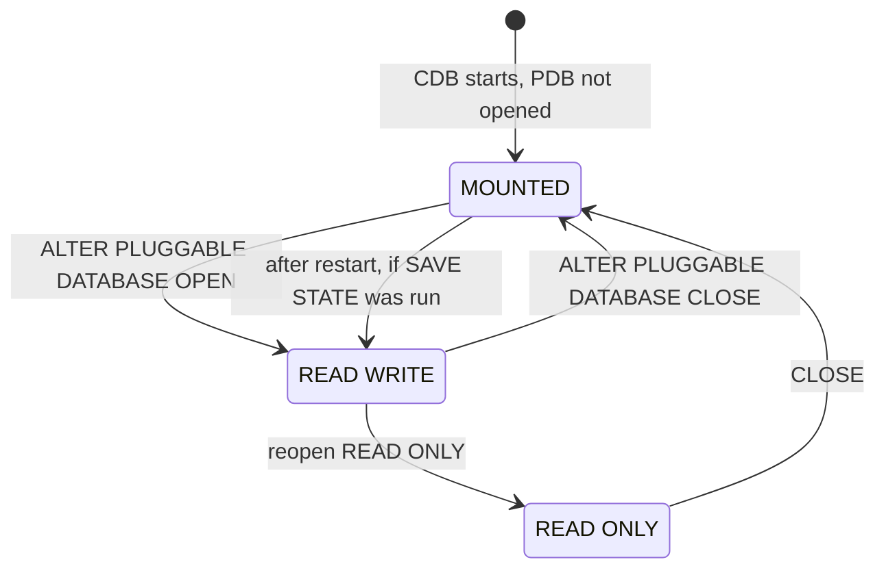

# Multitenant architecture

This page explains how a 19c database is organised as a container database (CDB) that holds pluggable databases (PDBs). It covers the root and the seed, the difference between common and local users, how to find out which container you are in, and the open modes a PDB can be in.

## Container databases and pluggable databases

Before 12c, every Oracle database was a single unit: one set of data dictionary tables, one set of users, one application (or several squeezed into one). Oracle now calls that a **non-CDB**.

A **container database (CDB)** is one database that holds several **containers**. Each container has its own set of data files and its own view of the data dictionary, but they all share one instance: one SGA, one set of background processes, one set of control files and online redo logs. Oracle describes a pluggable database as a collection of schemas and objects that "appears to an Oracle Net client as a non-CDB". To an application connected to it, a PDB looks and behaves like an ordinary database.

Every CDB has these containers:

| Container | Name | What it holds |
| --- | --- | --- |
| Root | `CDB$ROOT` | Oracle-supplied metadata and common users. No application data |
| Seed | `PDB$SEED` | A system-supplied template used to create new PDBs. You cannot add or change objects in it |
| Pluggable databases | Your choice, for example `ORCLPDB` | Application schemas and data. This is where you work |

The layout of a CDB. All containers share one instance, and each has its own data files:



A block of flats is a fair picture of this. The building, with its lifts, wiring and plumbing, is the instance that every flat shares. Each flat is a PDB with its own front door, furniture and residents. The root is the management office on the ground floor, where nobody lives, and PDB$SEED is the show flat that new flats are copied from.

On the course install the CDB is called ORCL and has one PDB, ORCLPDB (your names may differ if you chose others). All labs run in the PDB.

### Why Oracle built it this way

- Consolidation. Several applications can share one instance and one server, so memory and background processes are not duplicated for each database.
- Patch once. Patching or upgrading the CDB patches every PDB in it.
- Move and copy. A PDB can be cloned (for example, to give a test team a copy of production), unplugged from one CDB and plugged into another.

As an invented example: a wafer fab runs its MES, its reporting database and its equipment-data store as three PDBs in one CDB. The DBA patches all three in one maintenance window, but can clone the MES PDB for a test team, or restore the reporting PDB, without touching the others.

### Licensing and the non-CDB

In 19c you may have up to three user-created PDBs in a CDB without licensing the Multitenant option. More than three requires the option (Enterprise Edition only). The seed does not count.

The non-CDB architecture still works in 19c but is deprecated, and Oracle Database 21c no longer supports it. New 19c databases should be CDBs.

## Seeing the containers

`V$CONTAINERS` lists every container the current session can see. Connected to the root as SYSTEM on the test database used for these pages (a 21c XE install whose PDB is called XEPDB1):

```sql
SELECT con_id, name, open_mode
FROM   v$containers
ORDER  BY con_id;
```

```text
    CON_ID NAME                 OPEN_MODE
---------- -------------------- ----------
         1 CDB$ROOT             READ WRITE
         2 PDB$SEED             READ ONLY
         3 XEPDB1               READ WRITE
```

The container ID (`CON_ID`) is always 1 for the root and 2 for the seed. PDBs get 3 and up. The same query run from inside the PDB shows only the PDB itself:

```text
    CON_ID NAME             OPEN_MODE
---------- ---------------- ----------
         3 XEPDB1           READ WRITE
```

`V$PDBS` gives the same open-mode information for the seed and the PDBs only:

```sql
SELECT name, open_mode FROM v$pdbs;
```

```text
NAME                 OPEN_MODE
-------------------- ----------
PDB$SEED             READ ONLY
XEPDB1               READ WRITE
```

On your machine you will see ORCLPDB (or the name you chose) instead of XEPDB1.

## Which container am I in?

The root and the PDB look alike from a SQL prompt, so check where you are before you create anything. GitLab learned what two look-alike windows can cost on 31 January 2017. An engineer meant to wipe the data directory on the secondary database server (db2) to rebuild replication, but ran the command on the primary (db1). About 300 GB was gone before they stopped it, none of the backup methods worked as expected, and the restore came from an LVM snapshot taken about 6 hours earlier. Roughly 5,000 projects, 5,000 comments and 700 new user accounts from those 6 hours were lost. GitLab's public postmortem is listed under Further reading. A connection to the root and a connection to the PDB are your own db1 and db2. In SQL*Plus and in SQL Developer's worksheet (run with F5), use:

```sql
SHOW CON_NAME
SHOW CON_ID
```

Connected as SYSTEM to the root:

```text
CON_NAME
------------------------------
CDB$ROOT
```

Connected as FAB_LAB to the PDB:

```text
CON_NAME
------------------------------
XEPDB1
```

In any SQL tool (including application code) the same information comes from `SYS_CONTEXT`:

```sql
SELECT sys_context('USERENV', 'CON_NAME') AS con_name
FROM   dual;
```

A common user with the right privilege can switch containers inside one session. As SYSTEM in the root:

```sql
ALTER SESSION SET CONTAINER = XEPDB1;
SHOW CON_NAME
SHOW CON_ID
ALTER SESSION SET CONTAINER = CDB$ROOT;
SHOW CON_NAME
```

```text
Session altered.

CON_NAME
------------------------------
XEPDB1

CON_ID
------------------------------
3

Session altered.

CON_NAME
------------------------------
CDB$ROOT
```

For everyday work it is simpler to have separate connections, one to the root service and one to the PDB service, with names that make it obvious which is which (ROOT and PDB, say). [Oracle Net and the listener](04-oracle-net-and-the-listener.md) explains services.

## Common users and local users

A CDB has two kinds of database user.

A **common user** exists with the same identity in the root and in every PDB, current and future. Oracle-supplied accounts such as SYS and SYSTEM are common users. Common users you create yourself must have a name that starts with the value of the `COMMON_USER_PREFIX` parameter, which is `C##` by default, for example `C##DBA_TEAM`. You create them in the root.

A **local user** exists in exactly one PDB and cannot log in to another PDB or to the root. Application schemas are local users. FAB_LAB, the lab schema, is a local user in your PDB. No local user name may begin with `C##`.

The `CDB_USERS` view, queried in the root, shows both kinds and the container each user lives in:

```sql
SELECT username, common, con_id
FROM   cdb_users
WHERE  username IN ('SYSTEM', 'FAB_LAB')
ORDER  BY username, con_id;
```

```text
USERNAME             COM     CON_ID
-------------------- --- ----------
FAB_LAB              NO           3
SYSTEM               YES          1
SYSTEM               YES          3
```

SYSTEM appears once per open container because it is common. FAB_LAB appears only in container 3, the PDB. (The `CDB_` views are the multitenant version of the `DBA_` views: queried from the root, they add a `CON_ID` column and cover every open container. See [The data dictionary](12-data-dictionary.md).)

The rule that matters on Day 1: if you try to create an ordinary user such as FAB_LAB while connected to the root, Oracle refuses with ORA-65096: invalid common user or role name, because in the root only `C##` names are allowed. The fix is to connect to the PDB and run the statement there.

## PDB open modes

A PDB has its own open mode, separate from the CDB. The ones you will see are:

| Open mode | Meaning |
| --- | --- |
| `MOUNTED` | The PDB is closed. Only administrators with a privilege such as SYSDBA can connect |
| `READ WRITE` | Normal working state |
| `READ ONLY` | Queries only. The seed is always in this mode |



When the CDB starts, Oracle opens the root, but the other containers are mounted. A PDB only opens automatically at startup if you have saved its open state. Without that, users of the PDB get ORA-01109: database not open after every restart. As SYSTEM in the root:

```sql
ALTER PLUGGABLE DATABASE ALL OPEN;
ALTER PLUGGABLE DATABASE ALL SAVE STATE;
```

[Configuration and parameters](05-configuration-and-parameters.md) covers SAVE STATE in more detail, and [Instance and database](06-instance-and-database.md) explains what "mounted" means.

## Common mistakes

- Working in the root: creating users or tables, or running lab scripts, in CDB$ROOT. You get ORA-65096 for an ordinary user name, or you create objects in the wrong place. Run `SHOW CON_NAME` first; it must not say CDB$ROOT.
- Creating a C## user to get around ORA-65096. It makes the error go away, but you now have a common user in the root and your schema in the wrong container. Connect to the PDB instead.
- Forgetting that the PDB is closed. After a restart, ORA-01109 means the PDB is mounted. Open it and save its state.
- Counting the seed as a PDB. The three-PDB limit without the Multitenant option counts user-created PDBs only.

## Check your understanding

1. Name the three kinds of container in every CDB and say which one holds your application data.
2. You connect as SYSTEM, run `CREATE USER fab_test IDENTIFIED BY "x";` and get ORA-65096. What happened, and what do you do?
3. What is the difference between a common user and a local user?
4. Which statement tells you which container your session is in?
5. After a server reboot, the CDB is open but the application gets ORA-01109. What state is the PDB in, and how do you prevent this next time?

## Further reading

- [Oracle Multitenant Administrator's Guide 19c, chapter 1: Introduction to the Multitenant Architecture](https://docs.oracle.com/en/database/oracle/oracle-database/19/multi/introduction-to-the-multitenant-architecture.html)
- [Oracle Multitenant Administrator's Guide 19c, chapter 2: Overview of the Multitenant Architecture](https://docs.oracle.com/en/database/oracle/oracle-database/19/multi/overview-of-the-multitenant-architecture.html) (includes common and local users)
- [Oracle Multitenant Administrator's Guide 19c, chapter 13: Administering a CDB](https://docs.oracle.com/en/database/oracle/oracle-database/19/multi/administering-a-cdb-with-sql-plus.html)
- [Oracle Multitenant Administrator's Guide 19c, chapter 15: Administering PDBs](https://docs.oracle.com/en/database/oracle/oracle-database/19/multi/administering-pdbs-with-sql-plus.html)
- [Oracle Database Licensing Information User Manual 19c, chapter 1: Licensing Information](https://docs.oracle.com/en/database/oracle/oracle-database/19/dblic/Licensing-Information.html) (number of PDBs per edition)
- [ORACLE-BASE: Multitenant: Overview of Container Databases (CDB) and Pluggable Databases (PDB)](https://oracle-base.com/articles/12c/multitenant-overview-container-database-cdb-12cr1)
- [ORACLE-BASE: Multitenant: Connecting to Container Databases (CDB) and Pluggable Databases (PDB)](https://oracle-base.com/articles/12c/multitenant-connecting-to-cdb-and-pdb-12cr1)
- [GitLab blog: Postmortem of database outage of January 31](https://about.gitlab.com/blog/postmortem-of-database-outage-of-january-31/)

### Answers

1. The root (CDB$ROOT), the seed (PDB$SEED) and one or more pluggable databases. Your application data lives in a PDB.
2. You are connected to the root. In the root only common users, whose names start with C##, can be created. Connect to the PDB service, check with `SHOW CON_NAME`, and create the user there.
3. A common user has the same identity in the root and in every PDB, and its name starts with C## (unless it is Oracle-supplied, such as SYSTEM). A local user exists in one PDB only. Application schemas are local users.
4. `SHOW CON_NAME` in SQL*Plus or SQL Developer, or `SELECT sys_context('USERENV', 'CON_NAME') FROM dual;` in any tool.
5. The PDB is MOUNTED, because a CDB opens only the root at startup. Open it with `ALTER PLUGGABLE DATABASE ALL OPEN;` and then run `ALTER PLUGGABLE DATABASE ALL SAVE STATE;` so it opens automatically after future restarts.
