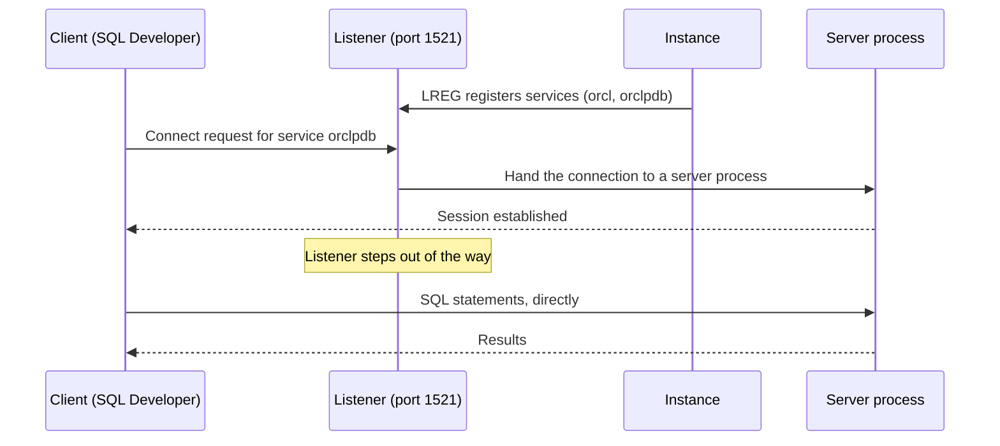

# Oracle Net and the listener

This page explains how a client such as SQL Developer finds and connects to your database: the listener, database services, the difference between a service name and a SID, the two ways of writing a connect string (EZConnect and `tnsnames.ora`), how to read `lsnrctl status`, and what the common ORA-125xx connection errors mean.

## How a connection is made

Your client never opens a database file. It sends a connection request over the network to a process called the **listener**, and asks for a **service** by name. The listener knows which instance offers that service, hands the connection over to a server process for that instance, and then steps out of the way. From then on your session talks to its server process directly. Stopping the listener does not disconnect sessions that are already connected; it only stops new ones.

The listener works like a hotel receptionist. You ask for a guest by name (the service), and the receptionist sends you up to the right room. Once you are upstairs, the receptionist has nothing more to do with your conversation, and if the receptionist goes on a break, guests already in their rooms carry on talking.

The pieces involved are:

| Piece | What it is |
| --- | --- |
| Listener | A separate process (on Windows, the `OracleOraDB19Home1TNSListener` service) that waits for connection requests, by default on TCP port 1521 |
| Service | A logical name for a database or part of one. Clients ask for a service, not for a file or an instance |
| Service registration | The instance's LREG background process tells the listener which services it offers, without any entry in `listener.ora` |
| Connect string | What the client gives: host, port and service name, written in EZConnect form or as a `tnsnames.ora` alias |

The steps of a connection, in order:



Because registration is dynamic, the listener only knows a service while the instance is running and has registered it. That explains several of the errors further down.

## Services and SIDs

A **service name** is a logical name that clients use to connect. A database can offer several services, and in Oracle RAC one service can be offered by several instances. In a CDB:

- the root has a service named after the CDB, for example `orcl`,
- each PDB automatically gets a default service with the same name as the PDB, for example `orclpdb`.

Each PDB is reached through its own service, and the service name in the connect string decides which PDB you land in. Oracle notes that the default PDB service is meant for administration and recommends creating your own services for production applications; for this course the default service is fine.

A **SID** (system identifier) is the name of an instance on a host, for example `ORCL`. It is not the same thing as a service. Old connect strings and some client tools let you connect by SID, but a SID identifies the CDB instance, not a PDB. To reach a PDB you must use its service name. In SQL Developer's connection dialog, choose Service name, not SID.

You can ask the database which container and service you came in through:

```sql
SELECT sys_context('USERENV', 'CON_NAME')     AS con_name,
       sys_context('USERENV', 'SERVICE_NAME') AS service_name
FROM   dual;
```

Connected as FAB_LAB on the test database (a 21c XE install whose PDB is XEPDB1), the result was XEPDB1 for the container and `xepdb1` for the service. On your machine you will see ORCLPDB and `orclpdb`, or the names you chose.

## Connect strings: EZConnect

**EZConnect** (Easy Connect) needs no configuration file. You write the address directly:

```text
host[:port][/service_name]
```

The port defaults to 1521. For the course:

| Connect as | Connect string |
| --- | --- |
| SYSTEM to the root | `localhost:1521/orcl` |
| SYSTEM or FAB_LAB to the PDB | `localhost:1521/orclpdb` |

From a Command Prompt:

```text
sqlplus fab_lab/Lab_2026@localhost:1521/orclpdb
```

Some documentation writes the same thing with a leading `//`, as in `//localhost:1521/orclpdb`; both forms work. In SQL Developer you enter the same three parts in separate fields: Hostname `localhost`, Port `1521`, Service name `orclpdb`.

## Connect strings: tnsnames.ora

The older method is **local naming**: you give a short alias, and the client looks it up in the file `tnsnames.ora`, which maps each alias to a full **connect descriptor**. The file lives in `%ORACLE_HOME%\network\admin` (or in the folder named by the `TNS_ADMIN` environment variable). An entry for the course PDB would look like this:

```text
ORCLPDB =
  (DESCRIPTION =
    (ADDRESS = (PROTOCOL = TCP)(HOST = localhost)(PORT = 1521))
    (CONNECT_DATA =
      (SERVER = DEDICATED)
      (SERVICE_NAME = orclpdb)
    )
  )
```

With that entry in place, `sqlplus fab_lab/Lab_2026@ORCLPDB` connects to the same place as the EZConnect string above. NETCA, the Net Configuration Assistant, can add entries for you.

The three Oracle Net files in `%ORACLE_HOME%\network\admin` are:

| File | Used by | Purpose |
| --- | --- | --- |
| `listener.ora` | The listener | Listener name, protocol, host and port. Dynamic registration means services do not have to be listed here |
| `tnsnames.ora` | Clients | Aliases for connect descriptors (local naming) |
| `sqlnet.ora` | Clients and server | General settings, such as which naming methods to try (`NAMES.DIRECTORY_PATH`) |

## Reading lsnrctl status

`lsnrctl` is the Listener Control utility. Run it from a Command Prompt on the database machine:

```text
lsnrctl status
```

The two parts to read are the Listening Endpoints Summary (which host and port the listener uses) and the Services Summary (which services it can hand you to). This is an excerpt of the output from the test database, a 21c XE install on Linux; a few lines and extra services are removed:

```text
STATUS of the LISTENER
------------------------
Alias                     LISTENER
Version                   TNSLSNR for Linux: Version 21.0.0.0.0 - Production
Listener Parameter File   /opt/oracle/homes/OraDBHome21cXE/network/admin/listener.ora
Listening Endpoints Summary...
  (DESCRIPTION=(ADDRESS=(PROTOCOL=tcp)(HOST=0.0.0.0)(PORT=1521)))
Services Summary...
Service "XE" has 1 instance(s).
  Instance "XE", status READY, has 1 handler(s) for this service...
Service "xepdb1" has 1 instance(s).
  Instance "XE", status READY, has 1 handler(s) for this service...
The command completed successfully
```

Read it like this:

- The listener listens on port 1521.
- Service `XE` is the root, and service `xepdb1` is the PDB. Both are offered by instance `XE`.
- `status READY` means the instance registered itself dynamically and accepts connections. `BLOCKED` means the instance cannot accept connections. `UNKNOWN` means the service is listed statically in `listener.ora` and the listener cannot tell whether the instance is up.

On your Windows install you will see `orcl` and `orclpdb` among the services. Whatever names appear under Services Summary are exactly the names you may put after the slash in an EZConnect string.

Other useful commands are `lsnrctl services` (more detail per service), `lsnrctl start` and `lsnrctl stop`. On Windows you can also start and stop the listener from the Services console.

## Common connection errors

Most "cannot connect" problems in a new environment come down to a handful of errors. Read the error number first.

| Error | What it means | What to do |
| --- | --- | --- |
| ORA-12541: TNS:no listener | Nothing is listening at the host and port you gave | Start the listener service, or run `lsnrctl start`. Check the port |
| ORA-12514: TNS:listener does not currently know of service requested in connect descriptor | The listener is running but does not know that service name | Check the spelling against the Services Summary of `lsnrctl status`. If the database was just started, wait a moment for it to register |
| ORA-12505: TNS:listener does not currently know of SID given in connect descriptor | The client connected by SID, and the listener knows no such SID | Switch the connection to Service name and use the PDB's service |
| ORA-12154: could not resolve the connect identifier specified | The alias you used is not in `tnsnames.ora` (or the client reads a different `tnsnames.ora`) | Use EZConnect, or fix the alias and check `TNS_ADMIN` |
| ORA-12560: TNS:protocol adapter error | Windows only: often the `OracleService<SID>` service is not running | Start the database service |
| ORA-01109: database not open | You reached the PDB, but it is mounted, not open | As SYSTEM in the root: `ALTER PLUGGABLE DATABASE ALL OPEN;` and then save its state (see [Configuration and parameters](05-configuration-and-parameters.md)) |

Here are the first two as SQL*Plus showed them on the test machine. A service name that does not exist:

```text
ERROR:
ORA-12514: TNS:listener does not currently know of service requested in connect
descriptor
```

And a port where no listener runs (1599 instead of 1521):

```text
ERROR:
ORA-12541: TNS:no listener
```

ORA-12514 proves that the network path and the listener work, and only the service name is wrong: you reached the front desk and asked for a guest the receptionist has never heard of. ORA-12541 means the request never reached a listener at all, as if nobody were at the desk. Knowing which of the two you have halves the search.

## Common mistakes

- Choosing SID in SQL Developer. Use Service name and the PDB's service. A SID connection reaches the CDB instance, not your PDB, and gives ORA-12505 if you type the PDB name as a SID.
- Guessing the service name. Copy it from the Services Summary of `lsnrctl status`.
- Restarting the listener to fix ORA-01109. The listener is fine in that case; the PDB is closed.
- Connecting to the root by accident. If `SHOW CON_NAME` says CDB$ROOT, your connection uses the root service. Make a second connection with the PDB service.

## Check your understanding

1. What does the listener do after it has handed your connection to a server process?
2. Why can you not reach a PDB by its SID?
3. Write the EZConnect string to connect to a PDB service called `orclpdb` on your own machine, default port.
4. You get ORA-12514. Is the listener running? What is your next step?
5. Where do you look to find the exact service names you may use?

## Further reading

- [Oracle Database Net Services Administrator's Guide 19c, chapter 2: Identifying and Accessing the Database](https://docs.oracle.com/en/database/oracle/oracle-database/19/netag/identifying-and-accessing-database.html) (services, SIDs and connect descriptors)
- [Oracle Database Net Services Administrator's Guide 19c, chapter 8: Configuring Naming Methods](https://docs.oracle.com/en/database/oracle/oracle-database/19/netag/configuring-naming-methods.html) (Easy Connect and `tnsnames.ora`)
- [Oracle Database Net Services Administrator's Guide 19c, chapter 9: Configuring and Administering Oracle Net Listener](https://docs.oracle.com/en/database/oracle/oracle-database/19/netag/configuring-and-administering-oracle-net-listener.html) (dynamic registration, `lsnrctl status`)
- [Oracle Database Net Services Administrator's Guide 19c, chapter 16: Troubleshooting Oracle Net Services](https://docs.oracle.com/en/database/oracle/oracle-database/19/netag/troubleshooting-oracle-net-services.html) (ORA-12514, ORA-12541, ORA-12154, ORA-12560)
- [Oracle Database Concepts 19c, chapter 17: Application and Oracle Net Services Architecture](https://docs.oracle.com/en/database/oracle/oracle-database/19/cncpt/application-and-networking-architecture.html)
- [Oracle Multitenant Administrator's Guide 19c, chapter 15: Administering PDBs](https://docs.oracle.com/en/database/oracle/oracle-database/19/multi/administering-pdbs-with-sql-plus.html) (default PDB services)
- [ORACLE-BASE: Multitenant: Connecting to Container Databases (CDB) and Pluggable Databases (PDB)](https://oracle-base.com/articles/12c/multitenant-connecting-to-cdb-and-pdb-12cr1)
- [ORACLE-BASE: Oracle Network Configuration (listener.ora, tnsnames.ora, sqlnet.ora)](https://oracle-base.com/articles/misc/oracle-network-configuration)

### Answers

1. Nothing more. Once the client is connected to its server process, the listener is no longer involved. Stopping the listener does not affect existing sessions.
2. The SID names the instance, and in a CDB the one instance serves the root and every PDB. A PDB is identified by its service, so you must connect with the service name.
3. `localhost:1521/orclpdb` (or `localhost/orclpdb`, because 1521 is the default).
4. Yes. ORA-12514 comes from the listener, so it is running and reachable. The service name is wrong or not registered yet: compare it with the Services Summary of `lsnrctl status`.
5. In the Services Summary section of `lsnrctl status` on the database machine.
