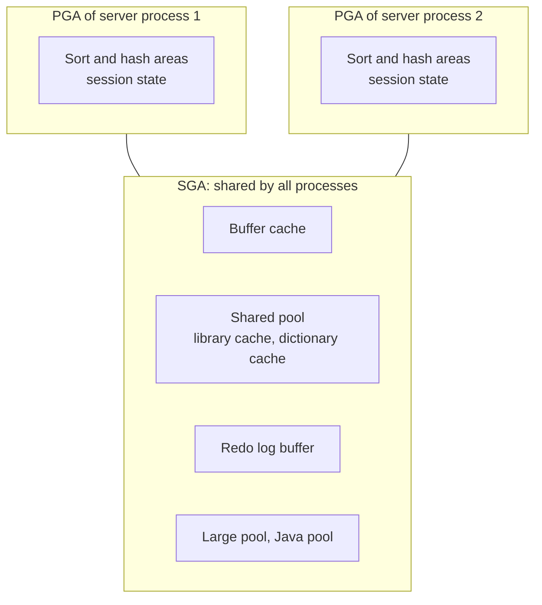

# Memory: the SGA and the PGA

This page describes the two kinds of memory an Oracle instance uses: the System Global Area (SGA), which all sessions share, and the Program Global Area (PGA), which is private to each process. It lists what lives in each area, how Oracle sizes them automatically, and how to see the sizes on your own instance with `V$SGAINFO` and `V$PARAMETER`.

## Two kinds of memory

An Oracle instance is memory plus processes (see [Instance and database](06-instance-and-database.md)). The memory comes in two kinds.

The **System Global Area (SGA)** is one block of shared memory allocated when the instance starts. Every server process and every background process can read it. When two sessions run the same query, they can use the same parsed statement in the SGA, and when they read the same table they can use the same cached blocks.

The **Program Global Area (PGA)** is memory that belongs to one process. Oracle's Concepts guide defines it as memory "specific to an operating process or thread that is not shared by other processes or threads on the system". Each server process (one per connected session in the usual dedicated-server setup) has its own PGA, and so does each background process.

An office makes a handy picture. The SGA is the shared kitchen: one fridge, one coffee machine, and if a colleague has already made a pot you can pour from it. The PGA is your own desk drawer, which nobody else opens and which is cleared out when you leave.

The table on the slide sums up both areas:

| Area | Holds | Why you care this week |
| --- | --- | --- |
| Buffer cache (SGA) | Copies of data blocks | Repeated reads come from memory (Day 4) |
| Shared pool (SGA) | Parsed SQL and PL/SQL, data dictionary cache | Bind variables let SQL be reused (Day 4); compiled PL/SQL lives here (Day 2) |
| Redo log buffer (SGA) | Change records waiting for LGWR | Every COMMIT flushes it |
| Large and Java pools (SGA) | Shared server, parallel query, backup; Java | Rarely tuned by developers |
| PGA (per process) | Sort and hash areas, session and package variables | Package state is per session (Day 2); big sorts spill to TEMP |



## The SGA components

### Database buffer cache

The **buffer cache** holds copies of data blocks read from the data files. When a query needs a block, the server process looks in the buffer cache first. If the block is there, no disk read is needed. If not, the block is read from disk into the cache, where later queries from any session can find it. It is the same reason operators keep the wafers they are working on at the tool instead of walking to the stocker for every step.

Changes are also made in the buffer cache. An UPDATE changes the block in memory, and the buffer becomes **dirty**: it contains modified data that has not yet been written to disk. The database writer (DBWn) writes dirty buffers to the data files later, in the background. [COMMIT, redo and undo](10-commit-redo-and-undo.md) explains why a COMMIT does not have to wait for that write.

### Shared pool

The **shared pool** holds parsed SQL, PL/SQL code, system parameters and data dictionary information. Its main parts are:

- The **library cache**, which stores executable SQL and PL/SQL code. When a session submits a statement that is already in the library cache, Oracle reuses it (a soft parse). When it is not there, Oracle must parse and optimize it from scratch (a hard parse), which costs CPU and shared pool memory.
- The **data dictionary cache** (also called the row cache), which holds information about tables, columns, users and privileges. Parsing uses it heavily.
- The **server result cache**, which can hold query results and PL/SQL function results.

This has two consequences for the course. First, statements that differ only in a literal value (`WHERE lot_id = 'L26-001'` and `WHERE lot_id = 'L26-002'`) are different statements to the library cache, so each one is hard parsed. Bind variables solve this, and Day 4 comes back to it. Second, when you compile a PL/SQL procedure on Day 2 and call it, its code is loaded into the shared pool, where every session can run it.

### Redo log buffer

The **redo log buffer** is a circular buffer in the SGA that stores redo entries describing changes made to the database. Every change you make produces redo, and the redo goes into this buffer first. The log writer (LGWR) writes it sequentially to the online redo log files on disk. It does so at every COMMIT, and also at other times, such as every three seconds and when the buffer is one third full. The buffer is small compared with the other pools (7 MB on the test instance below).

### Large pool and Java pool

The **large pool** is an optional area for allocations that are too large for the shared pool. Oracle's documentation lists these uses: session memory (UGA) for shared server connections and the XA interface, message buffers for parallel execution, buffers for RMAN I/O slaves, and buffers for deferred inserts. The **Java pool** stores session-specific Java code and data for the Java virtual machine inside the database. Developers rarely tune either one.

## The PGA

The PGA holds what one process needs for its own work. For a server process, the parts you notice are:

- The private SQL area, which holds bind variable values and the execution state of each open cursor.
- SQL work areas, which are memory for operations such as sorting (the sort area, used by `ORDER BY`) and hash joins (the hash area).
- Session memory. With a dedicated server connection, the session's **user global area (UGA)** lives in the PGA. The UGA holds session state, including the values of PL/SQL package variables.

Because package variables live in each session's own memory, two users who call the same package never see each other's package state. This is a Day 2 topic.

When a sort or hash join needs more memory than its work area gets, Oracle splits the data into pieces, processes some in memory and writes the rest to temporary disk storage (the TEMP tablespace) to process later. A sort that spills to disk is much slower than one that fits in memory.

The UGA moves into the SGA (the large pool, or the shared pool if there is no large pool) only with shared server connections, where a session can be served by different processes from call to call. Your course installation uses dedicated server connections.

## How Oracle sizes the memory

You rarely set each pool by hand. Oracle 19c offers three levels of automatic management, set through initialization parameters (see [Configuration and parameters](05-configuration-and-parameters.md)):

| Method | Parameters you set | What Oracle does |
| --- | --- | --- |
| Automatic memory management (AMM) | `MEMORY_TARGET` (and optionally `MEMORY_MAX_TARGET`) | Moves memory between the SGA and the PGA as needed |
| Automatic shared memory management (ASMM) | `SGA_TARGET` | Sizes the buffer cache, shared pool, large pool, Java pool and Streams pool inside that total |
| Automatic PGA memory management | `PGA_AGGREGATE_TARGET`, with `PGA_AGGREGATE_LIMIT` as a hard limit | Shares the target among the work areas of all sessions |

A few rules from Oracle's Administrator's Guide:

- Oracle recommends AMM when the total SGA and PGA memory is 4 GB or less, and ASMM when it is 4 GB or larger. If the database instance has more than 4 GB of physical memory, the installer does not offer AMM.
- `PGA_AGGREGATE_TARGET` is a target, so PGA use can go above it at times. `PGA_AGGREGATE_LIMIT` is a hard limit: if the instance goes over it, Oracle terminates calls from the sessions that use the most untunable PGA memory.
- When `MEMORY_TARGET` is set, any value in `SGA_TARGET` and `PGA_AGGREGATE_TARGET` becomes a minimum size.
- Oracle strongly recommends leaving automatic PGA memory management enabled.

Memory in the SGA is allocated in units called **granules**. The granule size depends on the maximum SGA size (4 MB for an SGA of 1 GB or less, larger for bigger SGAs), and `V$SGAINFO` reports it.

## Seeing the memory on your instance

`V$SGAINFO` displays size information about the SGA: the size of each component, the granule size and free memory. Run this as SYSTEM in the root container (this is section 4 of `lab2_explore_instance.sql` in [Lab 2](../labs/lab-2-inside-your-instance.md)):

```sql
SELECT name, ROUND(bytes/1024/1024) AS mb, resizeable
FROM   v$sgainfo
ORDER  BY bytes DESC;
```

On the small test install used to prepare this course (Oracle 21c Express Edition), the output was:

```text
NAME                                     MB RES
-------------------------------- ---------- ---
Maximum SGA Size                       1536 No
Buffer Cache Size                       912 Yes
Shared Pool Size                        448 Yes
Startup overhead in Shared Pool         205 No
Java Pool Size                          144 Yes
Shared IO Pool Size                      80 Yes
Granule Size                             16 No
Large Pool Size                          16 Yes
Fixed SGA Size                            9 No
Redo Buffers                              7 No
In-Memory Area Size                       0 No
Streams Pool Size                         0 Yes
Free SGA Memory Available                 0
Data Transfer Cache Size                  0 Yes

14 rows selected.
```

Express Edition caps memory, so these numbers are not typical of a 19c Enterprise Edition install. Your values will differ. The pattern usually holds, though: the buffer cache and the shared pool are the large components and the redo buffer is small. The `RESIZEABLE` column shows which components automatic management can grow and shrink.

To see which memory method is in use, read the parameters from `V$PARAMETER`, which shows the initialization parameters currently in effect for your session:

```sql
SELECT name, value
FROM   v$parameter
WHERE  name IN ('memory_target','memory_max_target','sga_target','sga_max_size',
                'pga_aggregate_target','pga_aggregate_limit')
ORDER  BY name;
```

```text
NAME                             VALUE
-------------------------------- --------------------
memory_max_target                0
memory_target                    0
pga_aggregate_limit              2147483648
pga_aggregate_target             536870912
sga_max_size                     1610612736
sga_target                       1610612736

6 rows selected.
```

Values are in bytes. Here `memory_target` is 0, so AMM is off; `sga_target` is 1.5 GB, so ASMM sizes the SGA components; and the PGA has a 512 MB target with a 2 GB hard limit.

For the PGA, `V$PGASTAT` shows how much is really in use:

```sql
SELECT name, ROUND(value/1024/1024) AS mb
FROM   v$pgastat
WHERE  name IN ('aggregate PGA target parameter','total PGA allocated',
                'total PGA inuse','maximum PGA allocated');
```

```text
NAME                                             MB
---------------------------------------- ----------
aggregate PGA target parameter                  512
total PGA inuse                                 220
total PGA allocated                             275
maximum PGA allocated                           306

4 rows selected.
```

In SQL*Plus or SQLcl, `SHOW SGA` prints a short SGA summary, and `SHOW PARAMETER sga_target` prints one parameter. In SQL Developer, the queries above work in any worksheet.

## Common mistakes

- Assuming a session's package variables are shared with other users. They live in each session's PGA (UGA), so every session has its own copy.
- Reading the memory sizes from a laptop or an Express Edition database and expecting the same on a production server. Memory sizes depend entirely on the installation and its parameters.
- Treating `PGA_AGGREGATE_TARGET` as a ceiling. It is a target; the hard limit is `PGA_AGGREGATE_LIMIT`.
- Reading memory parameters in the PDB instead of the root. On the test instance, `V$PARAMETER` in the PDB showed `sga_target` as 0, while the root showed 1.5 GB: in a PDB, `sga_target` is an optional limit on how much SGA that PDB may use, and it was not set. The SGA belongs to the whole instance, so check the memory settings from the root as SYSTEM, as Lab 2 does.

## Check your understanding

1. Two users run the same SELECT on the LOTS table, one after the other. Which SGA components can the second user benefit from, and why?
2. Where does the value of a PL/SQL package variable live for a dedicated server session, and what does that mean for two users of the same package?
3. A report sorts 5 million measurements and runs slowly. Which memory area does the sort use, and what happens when the data does not fit?
4. On your instance `memory_target` is 0 and `sga_target` is not 0. Which memory management method is in use?
5. Which view shows the current size of the buffer cache, and which shows the value of `pga_aggregate_target`?

## Further reading

- [Oracle Database Concepts 19c: Memory Architecture](https://docs.oracle.com/en/database/oracle/oracle-database/19/cncpt/memory-architecture.html)
- [Oracle Database Administrator's Guide 19c: Managing Memory](https://docs.oracle.com/en/database/oracle/oracle-database/19/admin/managing-memory.html)
- [Oracle Database Reference 19c: V$SGAINFO](https://docs.oracle.com/en/database/oracle/oracle-database/19/refrn/V-SGAINFO.html)
- [Oracle Database Reference 19c: V$PARAMETER](https://docs.oracle.com/en/database/oracle/oracle-database/19/refrn/V-PARAMETER.html)
- [Oracle Database Reference 19c: SGA_TARGET](https://docs.oracle.com/en/database/oracle/oracle-database/19/refrn/SGA_TARGET.html)
- [ORACLE-BASE: Automatic Memory Management (AMM) in Oracle Database 11g Release 1](https://oracle-base.com/articles/11g/automatic-memory-management-11gr1)

### Answers

1. The buffer cache, because the blocks of LOTS read by the first user are still cached and the second user reads them from memory. The shared pool, because the parsed statement is in the library cache and the second user's statement can be soft parsed, as long as the SQL text is identical.
2. In the session's UGA, which is part of the PGA for a dedicated server connection. Each session has its own copy, so one user never sees the other user's package variable values.
3. A SQL work area (the sort area) in the PGA of that session's server process. When the data does not fit, Oracle writes part of it to temporary storage in the TEMP tablespace and processes it in several passes, which is much slower.
4. Automatic shared memory management (ASMM). AMM is off because `memory_target` is 0, and `sga_target` lets Oracle size the SGA components inside that total. The PGA is managed separately with `pga_aggregate_target`.
5. `V$SGAINFO` (the "Buffer Cache Size" row) for the buffer cache, and `V$PARAMETER` for `pga_aggregate_target`.
