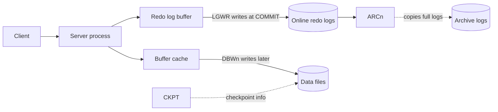

# Background processes

This page explains the processes that make up an Oracle instance: the server processes that run your SQL, and the background processes that write data and redo to disk, record checkpoints, recover after a crash and clean up after failed sessions. It also shows how to list them with `V$BGPROCESS`, `V$PROCESS` and `V$SESSION`.

## Server processes and background processes

When you connect to Oracle, your tool (SQL Developer, SQL*Plus, an application) is a **client process**. It never touches the database files itself. Oracle creates a **server process** to handle the requests of each client, and the client always talks to the database through that server process. With the usual dedicated server setup, each session gets its own server process. That server process parses and runs your SQL, reads blocks into the buffer cache and returns rows to your tool.

**Background processes** are the other processes of the instance. Oracle creates them automatically when the instance starts. They do maintenance work that no single session owns: writing changed blocks and redo to disk, recording checkpoints, recovering after a failure, cleaning up after sessions that died. An instance has many of them, and not all of them exist in every configuration. Oracle's documentation divides them into mandatory ones, present in all typical configurations, and optional ones, such as ARCn.

On Windows, which you use in this course, Oracle's process architecture is thread-based. The instance (its threads and memory) runs as a Windows service, `OracleService<SID>`, and the background and server processes are threads inside that service. Oracle still calls them processes, and the V$ views on this page list them the same way on every platform.

## The processes you should know

The test instance used to prepare this course had between 64 and 78 background processes running, depending on when it was checked. You do not need to know all of them. These are the ones that explain behaviour you will see:

| Process | Job |
| --- | --- |
| DBWn | Writes changed (dirty) blocks from the buffer cache to the data files, in the background |
| LGWR | Writes redo from the log buffer to the online redo logs, at every COMMIT |
| CKPT | Records checkpoints in the control file and data file headers |
| SMON | Instance recovery after a crash; cleans up temporary segments |
| PMON | Cleans up after failed sessions: releases locks, rolls back |
| ARCn | Copies full online redo logs to archive logs (ARCHIVELOG mode only) |
| MMON, LREG | Performance snapshots; registers services with the listener |

How the main processes work together:



### DBWn: database writer

The **database writer** (DBW0, and DBW1 onwards if more are configured) writes the contents of database buffers to the data files. It does not write when you commit. It writes when server processes need clean buffers to reuse, and periodically to advance the checkpoint. Picture the night crew that puts stock back on the shelves when it suits them, not every time a customer picks something up. One database writer is enough for most systems.

Before DBWn writes a changed block, the redo for that change must already be on disk. If it is not, DBWn asks LGWR to write it first and waits. This is the write-ahead rule, and it is what makes recovery possible.

### LGWR: log writer

The **log writer** manages the redo log buffer and writes its contents to the online redo log. It writes when a user commits, at a log switch, every three seconds, when the redo buffer is one third full or holds 1 MB, and before DBWn writes changed buffers. LGWR writes sequentially, which is fast; DBWn writes blocks scattered across the data files, which is slower. A COMMIT returns once LGWR has written the commit record. LGWR is the court stenographer: the judge does not move on until every word is in the transcript, and a transaction is not committed until its redo is on disk. [COMMIT, redo and undo](10-commit-redo-and-undo.md) follows this in detail.

### CKPT: checkpoint process

The **checkpoint process** updates the control file and the data file headers with checkpoint information and signals DBWn to write blocks. CKPT does not write data blocks or redo itself; it puts a bookmark in the log. A checkpoint marks a point up to which all changes are known to be in the data files, so instance recovery only has to start from there.

### SMON: system monitor

The **system monitor** performs instance recovery when the database opens after a crash or a `SHUTDOWN ABORT`, applying the online redo automatically, much like the person who comes in after a power cut and puts the half-finished work back in order before anyone starts again. It also cleans up temporary segments that are no longer in use, and recovers transactions that were skipped because a file was offline.

### PMON: process monitor

The **process monitor** detects when another process ends abnormally. In 19c, PMON works as a group: PMON detects the failure, and the cleanup main process (CLMN) and its helpers (CLnn) do the cleanup work. The cleanup covers terminated processes and sessions, their transactions and their network connections.

In practice, suppose a user updates a lot in an invented wafer fab, without committing, and their laptop then loses its Wi-Fi connection. The row stays locked while the session looks alive. Once the session is detected as dead, the PMON group rolls the transaction back and releases the lock, and other sessions can change the row again.

### ARCn: archiver

The **archiver** copies an online redo log file to an archive location after a log switch. ARCn processes exist only when the database is in ARCHIVELOG mode with automatic archiving enabled. A database in NOARCHIVELOG mode has no ARCn process, which Lab 2 asks you to explain.

### MMON and LREG

The **manageability monitor** (MMON) does work for the Automatic Workload Repository (AWR): taking performance snapshots, raising alerts when a metric crosses a threshold and capturing statistics. Its helper MMNL writes Active Session History data to disk.

The **listener registration process** (LREG) registers the instance and its services with the Oracle Net listener. When the instance starts, LREG checks whether the listener is running and keeps trying if it is not. This is why `lsnrctl status` lists your PDB's service a short while after the database starts (see [Oracle Net and the listener](04-oracle-net-and-the-listener.md)). Before Oracle 12c, PMON did this job.

## Listing the background processes

`V$BGPROCESS` displays information about the background processes. It lists every background process the instance knows about, including ones that are not running. A process that is running has a process address (`PADDR`) other than `'00'`. Run these as SYSTEM in the root ([Lab 2](../labs/lab-2-inside-your-instance.md), section 5 of `lab2_explore_instance.sql`):

```sql
SELECT COUNT(*) AS running_background_processes
FROM   v$bgprocess
WHERE  paddr <> '00';
```

```text
RUNNING_BACKGROUND_PROCESSES
----------------------------
                          64

1 row selected.
```

```sql
SELECT name, description
FROM   v$bgprocess
WHERE  paddr <> '00'
AND    name IN ('PMON','SMON','DBW0','LGWR','CKPT','MMON','MMNL','MMAN',
                'RECO','LREG','ARC0','CJQ0','DBRM','PSP0')
ORDER  BY name;
```

```text
NAME   DESCRIPTION
------ ---------------------------------------------
CJQ0   Job Queue Coordinator
CKPT   checkpoint
DBRM   DataBase Resource Manager
DBW0   db writer process 0
LGWR   Redo etc.
LREG   Listener Registration
MMAN   Memory Manager
MMNL   Manageability Monitor Process 2
MMON   Manageability Monitor Process
PMON   process cleanup
PSP0   process spawner 0
RECO   distributed recovery
SMON   System Monitor Process

13 rows selected.
```

These results come from the small Oracle 21c Express Edition install used to prepare the course. The count on your 19c instance will differ, and it can change over time, because some processes start and stop as needed. ARC0 is missing from the list because that database runs in NOARCHIVELOG mode:

```sql
SELECT log_mode FROM v$database;
```

```text
LOG_MODE
------------
NOARCHIVELOG

1 row selected.
```

## Your own server process

`V$SESSION` has one row per session, and its `TYPE` column says whether it is a `USER` or a `BACKGROUND` session. `V$PROCESS` has one row per process. Joining the two shows which process serves which session. This query shows your own session next to two background processes:

```sql
SELECT s.sid, s.username, s.type, p.spid, p.pname, p.background
FROM   v$session s JOIN v$process p ON p.addr = s.paddr
WHERE  s.sid = SYS_CONTEXT('USERENV','SID')
   OR  p.pname IN ('LGWR','DBW0')
ORDER  BY s.type, s.sid;
```

```text
       SID USERNAME   TYPE       SPID                     PNAME  B
---------- ---------- ---------- ------------------------ ------ -
        17            BACKGROUND 84                       LGWR   1
       266            BACKGROUND 82                       DBW0   1
       285 SYSTEM     USER       717

3 rows selected.
```

Your session is served by an ordinary server process with no `PNAME` and no background flag. `SPID` is the operating system identifier of the process. Counting sessions by type gives a quick picture of the instance:

```sql
SELECT type, COUNT(*) AS sessions FROM v$session GROUP BY type;
```

```text
TYPE         SESSIONS
---------- ----------
BACKGROUND         60
USER                1

2 rows selected.
```

## Common mistakes

- Expecting COMMIT to make DBWn write the changed blocks. COMMIT waits for LGWR only; DBWn writes later.
- Killing the client tool and assuming the locks are released at once. The PMON group cleans up only once it has detected that the session is dead.
- Counting all rows of `V$BGPROCESS` as running processes. Filter on `paddr <> '00'`.
- Looking for ARC0 on a database in NOARCHIVELOG mode. It only runs in ARCHIVELOG mode.

## Check your understanding

1. Which process writes redo to the online redo log, and which writes changed data blocks to the data files?
2. A session updates a row, does not commit, and its client machine crashes. Which process group cleans up, and what happens to the row?
3. Why does `lsnrctl status` know about your database's services without you configuring them in `listener.ora`?
4. Your database is in NOARCHIVELOG mode. Should ARC0 appear among the running background processes?
5. What is the difference between a server process and a background process?

## Further reading

- [Oracle Database Concepts 19c: Process Architecture](https://docs.oracle.com/en/database/oracle/oracle-database/19/cncpt/process-architecture.html)
- [Oracle Database Reference 19c: Background Processes](https://docs.oracle.com/en/database/oracle/oracle-database/19/refrn/background-processes.html)
- [Oracle Database Reference 19c: V$BGPROCESS](https://docs.oracle.com/en/database/oracle/oracle-database/19/refrn/V-BGPROCESS.html)
- [Oracle Database Reference 19c: V$SESSION](https://docs.oracle.com/en/database/oracle/oracle-database/19/refrn/V-SESSION.html)
- [Oracle Database Administrator's Reference for Microsoft Windows 19c: Thread-Based Architecture](https://docs.oracle.com/en/database/oracle/oracle-database/19/ntqrf/thread-based-architecture.html)

### Answers

1. LGWR writes redo to the online redo log. DBWn (DBW0 on most systems) writes changed blocks to the data files.
2. The PMON group (PMON detects the failure, CLMN and the CLnn helpers clean up). Once the session is detected as dead, its transaction is rolled back, so the row gets its old value back and the lock is released.
3. The LREG background process registers the instance and its services with the listener when the instance starts, and keeps trying until the listener is available.
4. No. ARCn processes exist only in ARCHIVELOG mode with automatic archiving enabled.
5. A server process is created to handle the requests of a client session: it runs that session's SQL. A background process is started with the instance and does shared maintenance work, such as writing blocks and redo, checkpoints, recovery and cleanup.
