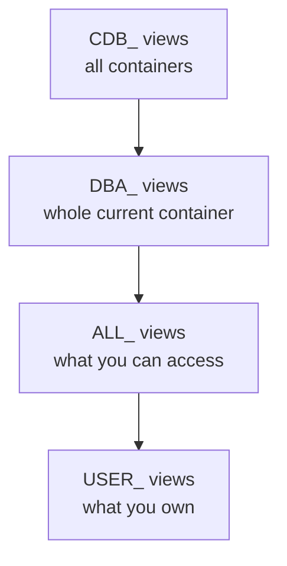

# The data dictionary

This page explains how Oracle describes itself. The data dictionary views (USER_, ALL_, DBA_ and, in a container database, CDB_) describe the objects in the database. The dynamic performance views (V$) describe the running instance: sessions, SQL, waits, memory and files. The DICTIONARY view lists them all. The page ends with queries you will use all week.

## What the data dictionary is

The **data dictionary** is a set of read-only tables and views that describe the database: every table, column, index, constraint, user, privilege, PL/SQL unit and storage allocation. Oracle maintains it itself. When you run `CREATE TABLE`, Oracle records the new table in the dictionary; when you query, Oracle reads the dictionary to check that the table exists and that you may use it.

The dictionary tables live in the SYSTEM tablespace, which is always online when the database is open, so the dictionary is always available. You never query the underlying tables directly. You query views built on them.

Think of the dictionary as the database's own library catalogue. Every tool, SQL Developer included, is reading the catalogue: its object browser, its reports and EM Express all run dictionary queries for you. If you know the views, you can answer the same questions in any tool, or in a script, without a graphical interface.

## Four families of dictionary views

Most dictionary views come in a set with the same suffix and different prefixes:

| Prefix | Shows | Typical user |
| --- | --- | --- |
| `USER_` | What you own | Every user |
| `ALL_` | What you can access: what you own plus what you have been granted | Every user |
| `DBA_` | Everything in the database (in a CDB: in the current container) | Administrators |
| `CDB_` | Everything in all containers of a CDB | Administrators, in the root |



In catalogue terms, `USER_` is the list of books on your own loan card, `ALL_` adds every book you are allowed to borrow, and `DBA_` is the library's whole holding. So there are `USER_TABLES`, `ALL_TABLES`, `DBA_TABLES` and `CDB_TABLES`, and the same pattern for `_OBJECTS`, `_TAB_COLUMNS`, `_INDEXES`, `_CONSTRAINTS`, `_SOURCE` and hundreds more.

The columns are nearly the same across a set. `USER_` views have no `OWNER` column, because the owner is you. `ALL_` and `DBA_` views add `OWNER`, and some `DBA_` views have extra columns useful to administrators. `CDB_` views add a `CON_ID` column that says which container each row comes from.

### USER_ views

Connected as FAB_LAB, `USER_TABLES` lists the lab tables:

```sql
SELECT table_name, num_rows FROM user_tables ORDER BY table_name;
```

```text
TABLE_NAME       NUM_ROWS
-------------- ----------
LOTS
MEASUREMENTS
PRODUCTS
TOOLS
WAFERS

5 rows selected.
```

`NUM_ROWS` is empty. It is an optimizer statistic, filled only when statistics are gathered on the table. It is not a live row count; use `COUNT(*)` for that. Statistics are a Day 4 topic.

`USER_TAB_COLUMNS` describes the columns of a table, which is what `DESCRIBE` shows you:

```sql
SELECT column_name, data_type, data_length, nullable
FROM   user_tab_columns
WHERE  table_name = 'LOTS'
ORDER  BY column_id;
```

```text
COLUMN_NAME    DATA_TYPE  DATA_LENGTH N
-------------- ---------- ----------- -
LOT_ID         VARCHAR2            12 N
PRODUCT_ID     NUMBER              22 N
LOT_TYPE       VARCHAR2             8 N
PARENT_LOT_ID  VARCHAR2            12 Y
START_DATE     DATE                 7 N
STATUS         VARCHAR2             8 N
PRIORITY       NUMBER              22 N
HOLD_REASON    VARCHAR2            60 Y

8 rows selected.
```

`USER_CONSTRAINTS` shows the keys. Here are the primary key and the two foreign keys of LOTS, with the constraint each foreign key refers to:

```sql
SELECT constraint_name, constraint_type, r_constraint_name
FROM   user_constraints
WHERE  table_name = 'LOTS' AND constraint_type IN ('P','R','U')
ORDER  BY constraint_name;
```

```text
CONSTRAINT_NAME  C R_CONSTRAINT_NAME
---------------- - -----------------
LOTS_PARENT_FK   R LOTS_PK
LOTS_PK          P
LOTS_PRODUCT_FK  R PRODUCTS_PK

3 rows selected.
```

`P` is a primary key, `R` a foreign key (referential), `U` a unique key. `LOTS_PARENT_FK` points back to LOTS itself: it is the parent-lot link that the hierarchical queries in Module 2 follow.

Dictionary views store names in upper case, because that is how Oracle stores unquoted identifiers. `WHERE table_name = 'lots'` finds nothing.

### ALL_ views

`ALL_TABLES` adds the tables of other users that FAB_LAB may access:

```sql
SELECT owner, COUNT(*) AS tables
FROM   all_tables
GROUP  BY owner
ORDER  BY tables DESC
FETCH FIRST 5 ROWS ONLY;
```

```text
OWNER          TABLES
---------- ----------
SYS               131
XDB                35
SYSTEM              6
FAB_LAB             5
OUTLN               3

5 rows selected.
```

The counts come from the test database used to prepare the course and will differ on yours. `ALL_` views follow the roles that are enabled in your session. Inside a stored PL/SQL procedure roles are not enabled by default, so an `ALL_` query in a procedure can return fewer rows than the same query in a worksheet. Day 2 comes back to privileges in PL/SQL.

### DBA_ views

`DBA_` views show everything in the current database, and in a CDB that means the current container. You need administrative privileges to read them. The lab script grants FAB_LAB the SELECT_CATALOG_ROLE role, so FAB_LAB can read `DBA_` and `V$` views too. As SYSTEM in the PDB:

```sql
SELECT object_type, status, COUNT(*) AS objects
FROM   dba_objects
WHERE  owner = 'FAB_LAB'
GROUP  BY object_type, status
ORDER  BY object_type;
```

```text
OBJECT_TYPE             STATUS     OBJECTS
----------------------- ------- ----------
INDEX                   VALID           11
TABLE                   VALID            5

2 rows selected.
```

`STATUS` matters from Day 2 onward: a PL/SQL unit that fails to compile, or that depends on an object that changed, shows as `INVALID`.

### CDB_ views

In a CDB, every `DBA_` view has a `CDB_` partner. What it shows depends on where you are:

- In the root, a common user such as SYSTEM sees rows from the root and from every PDB it has privileges in, with `CON_ID` saying which container.
- In a PDB, a `CDB_` view shows only the current PDB, just like the `DBA_` view.

As SYSTEM in the root, FAB_LAB's tables are not visible through `DBA_TABLES`, because FAB_LAB exists only in the PDB:

```sql
SELECT COUNT(*) AS tables FROM dba_tables WHERE owner = 'FAB_LAB';
```

```text
    TABLES
----------
         0

1 row selected.
```

`CDB_TABLES` finds them, and `V$CONTAINERS` gives the container name for the `CON_ID`:

```sql
SELECT t.con_id, c.name, COUNT(*) AS tables
FROM   cdb_tables t JOIN v$containers c ON c.con_id = t.con_id
WHERE  t.owner = 'FAB_LAB'
GROUP  BY t.con_id, c.name;
```

```text
    CON_ID NAME           TABLES
---------- ---------- ----------
         3 XEPDB1              5

1 row selected.
```

`CON_ID` 1 is always CDB$ROOT and 2 is PDB$SEED; your PDB has 3 or higher. See [Multitenant architecture](02-multitenant-architecture.md).

## V$ views: the running instance

The **dynamic performance views**, or V$ views, show what the instance is doing right now: sessions, SQL in the shared pool, waits, locks, memory, processes and files. They are updated continuously while the database is open and in use. They are not ordinary tables, and Oracle does not guarantee read consistency for them, because the data changes while you read it. Treat them like the live tool-status board on the fab floor, where the numbers can move between the top of the board and the bottom.

Technically, SYS owns the underlying views, whose names start with `V_$`, and public synonyms with the `V$` prefix point to them. You always query the `V$` names. For almost every `V$` view there is a `GV$` view, which in Oracle RAC returns the rows from all instances. In a CDB, V$ views have a `CON_ID` column too.

You met several V$ views on the other Module 1 pages:

| View | Shows | Page |
| --- | --- | --- |
| `V$INSTANCE`, `V$DATABASE` | Instance name, version, open mode, log mode | [Instance and database](06-instance-and-database.md) |
| `V$CONTAINERS`, `V$PDBS` | Root, seed and PDBs, with open modes | [Multitenant architecture](02-multitenant-architecture.md) |
| `V$PARAMETER` | Initialization parameters in effect | [Configuration and parameters](05-configuration-and-parameters.md) |
| `V$SGAINFO` | SGA component sizes | [Memory: SGA and PGA](07-memory-sga-and-pga.md) |
| `V$BGPROCESS`, `V$PROCESS` | Background and server processes | [Background processes](08-background-processes.md) |
| `V$DATAFILE`, `V$LOG`, `V$CONTROLFILE` | Files of the database | [Storage structures](09-storage-structures.md) |
| `V$TRANSACTION` | Open transactions and the undo they use | [COMMIT, redo and undo](10-commit-redo-and-undo.md) |

Two more that you will use constantly: `V$SESSION`, with one row for each current session, and `V$SQL`, with one row for each SQL statement in the shared pool.

### Who is connected?

```sql
SELECT sid, username, status, program
FROM   v$session
WHERE  username IS NOT NULL
ORDER  BY sid;
```

Background sessions have no user name, so the filter leaves the user sessions. The `PROGRAM` column shows which client program each session uses.

### Who is blocking whom?

A classic question in the invented fab: "the lot-move procedure is hanging; which session is blocking it?" `V$SESSION` answers it in any tool:

```sql
SELECT sid, blocking_session, event, sql_id
FROM   v$session
WHERE  blocking_session IS NOT NULL;
```

On a quiet system this returns `no rows selected`. To produce a real result on the test database, one FAB_LAB session updated lot L26-010 without committing, and a second session then tried to update the same row and had to wait. The query returned:

```text
       SID BLOCKING_SESSION EVENT                          SQL_ID
---------- ---------------- ------------------------------ -------------
       304               40 enq: TX - row lock contention  29faqg3d6jwxc

1 row selected.
```

Session 304 waits on a row lock (`enq: TX - row lock contention`) held by session 40. The `SQL_ID` leads to the waiting statement in `V$SQL`:

```sql
SELECT sql_text FROM v$sql WHERE sql_id = '29faqg3d6jwxc';
```

```text
SQL_TEXT
------------------------------------------------------------
UPDATE lots SET priority = priority WHERE lot_id = 'L26-010'

1 row selected.
```

Both sessions then rolled back. The fix in real life is to have session 40 commit or roll back; as a last resort a DBA can end it. On Day 4 the same `SQL_ID` leads to the execution plan, through `DBMS_XPLAN.DISPLAY_CURSOR`.

## DICTIONARY: the index of the dictionary

With thousands of views, you need a way to find the right one, a catalogue of the catalogue. The **DICTIONARY** view (public synonym `DICT`) contains the name and a short description of every data dictionary view you can access. It has two columns, `TABLE_NAME` and `COMMENTS`.

To find the views about table columns, as SYSTEM in the PDB:

```sql
SELECT table_name
FROM   dictionary
WHERE  table_name LIKE '%\_TAB\_COLUMNS' ESCAPE '\'
ORDER  BY table_name;
```

```text
TABLE_NAME
--------------------
ALL_TAB_COLUMNS
CDB_TAB_COLUMNS
DBA_TAB_COLUMNS
USER_TAB_COLUMNS

4 rows selected.
```

The `ESCAPE` clause is needed because `_` is a wildcard in `LIKE`. The list depends on your privileges: on the test database, DICTIONARY had 3186 entries for SYSTEM in the PDB and 968 for FAB_LAB.

## Useful queries

Run these as FAB_LAB (with SELECT_CATALOG_ROLE) or SYSTEM in the PDB. They are read-only.

```sql
-- Your objects, newest first
SELECT object_name, object_type, status, created, last_ddl_time
FROM   user_objects
ORDER  BY last_ddl_time DESC;

-- Indexes and their columns for one table
SELECT index_name, column_name, column_position
FROM   user_ind_columns
WHERE  table_name = 'MEASUREMENTS'
ORDER  BY index_name, column_position;

-- Space used by a schema, by segment
SELECT segment_name, segment_type, bytes/1024 AS kb
FROM   dba_segments
WHERE  owner = 'FAB_LAB'
ORDER  BY bytes DESC;

-- Invalid objects in a schema (useful from Day 2)
SELECT object_name, object_type
FROM   dba_objects
WHERE  owner = 'FAB_LAB' AND status = 'INVALID';

-- Source code of a stored PL/SQL unit (from Day 2)
SELECT line, text
FROM   user_source
WHERE  name = 'YOUR_PROCEDURE'
ORDER  BY line;

-- The SQL statements in the shared pool that used the most time
SELECT sql_id, executions, ROUND(elapsed_time/1e6, 2) AS elapsed_s, SUBSTR(sql_text, 1, 60) AS sql_text
FROM   v$sql
ORDER  BY elapsed_time DESC
FETCH FIRST 10 ROWS ONLY;
```

## Common mistakes

- Writing object names in lower case in dictionary queries. Use `WHERE table_name = 'LOTS'`, not `'lots'`.
- Reading `NUM_ROWS` as the current row count. It is a statistic from the last time statistics were gathered, and is empty if they never were.
- Querying `DBA_` views in the root and not finding objects that live in a PDB. Connect to the PDB, or use the `CDB_` view from the root.
- Expecting a stored procedure that queries `ALL_` views to see the same rows as your worksheet. Roles are not enabled by default inside stored procedures.
- Assuming a `V$` query is a consistent snapshot. V$ data changes while you read it.

## Check your understanding

1. FAB_LAB wants to list the columns of its own table WAFERS. Which view does it query, and what does the WHERE clause look like?
2. What is the difference between `ALL_TABLES` and `DBA_TABLES`?
3. You are SYSTEM in the root and `DBA_TABLES` shows no tables for FAB_LAB. Why, and which view would find them from the root?
4. Which view tells you which session is blocking another one, and which column links a session to the SQL statement it runs?
5. You need a view about tablespaces but do not know its name. How do you find it?

## Further reading

- [Oracle Database Concepts 19c: Data Dictionary and Dynamic Performance Views](https://docs.oracle.com/en/database/oracle/oracle-database/19/cncpt/data-dictionary-and-dynamic-performance-views.html)
- [Oracle Multitenant Administrator's Guide 19c: Overview of the Multitenant Architecture](https://docs.oracle.com/en/database/oracle/oracle-database/19/multi/overview-of-the-multitenant-architecture.html) (see "Container Data Objects in a CDB")
- [Oracle Database Reference 19c: DICTIONARY](https://docs.oracle.com/en/database/oracle/oracle-database/19/refrn/DICTIONARY.html)
- [Oracle Database Reference 19c: V$SESSION](https://docs.oracle.com/en/database/oracle/oracle-database/19/refrn/V-SESSION.html)
- [ORACLE-BASE: Multitenant : Overview of Container Databases (CDB) and Pluggable Databases (PDB)](https://oracle-base.com/articles/12c/multitenant-overview-container-database-cdb-12cr1)

### Answers

1. `USER_TAB_COLUMNS`, with `WHERE table_name = 'WAFERS'` (upper case), ordered by `column_id`.
2. `ALL_TABLES` lists the tables the current user owns or has been granted access to. `DBA_TABLES` lists every table in the database (in a CDB, in the current container) and needs administrative privileges.
3. FAB_LAB and its tables exist only in the PDB, and `DBA_` views in the root show only the root. `CDB_TABLES` queried from the root shows the tables of all containers, with `CON_ID` naming the container.
4. `V$SESSION`: the `BLOCKING_SESSION` column gives the SID of the blocker, and the `SQL_ID` column links a session to its statement in `V$SQL`.
5. Query `DICTIONARY`, for example `SELECT table_name FROM dictionary WHERE table_name LIKE '%TABLESPACE%';`.
